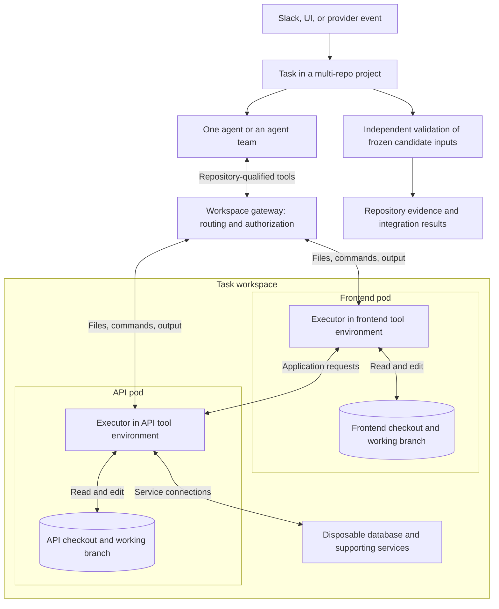

# Architecture options

Status: proposed technical model; no implementation or API is selected.

## Domain model

| Concept | Meaning |
| --- | --- |
| Project | Persistent context and policy references for related repositories |
| Repository binding | Provider identity, access grant, and branch or revision selection |
| Environment revision | Validated locked inputs plus executor, image, platform, and preparation identity |
| Task | Durable request, conversation, scope, outcomes, and external correlation identifiers |
| Attempt | Execution attempt with pinned inputs, agent profile, budgets, checkpoints, and status |
| Workspace | Attempt-owned checkouts, execution environments, and supporting services |
| Agent profile | Resolved implementation, model settings, skills, tools, MCP connections, and permitted capabilities |
| Evidence bundle | Measured sources, environment identities, quality artifacts, integration results, and execution records |

A project is not an agent process. An agent participates in a task. Tasks survive
containers and may have multiple attempts. Project membership does not
automatically grant every agent write access to every repository.

## Proposed component responsibilities

| Component | Responsibility |
| --- | --- |
| Provider adapters | Enrollment, access changes, event validation, provider APIs, and PR/MR integration |
| Task service | Conversation, routing, state transitions, checkpoints, policy, and durable external-action records |
| Environment controller | Reconcile readiness, request builds, track image identity, and manage retention |
| Workspace controller | Provision execution and service resources, readiness, deadlines, and cleanup |
| Agent integration | Translate context and workspace tools into a supported agent runtime |
| Workspace gateway | Authorize and route repository-qualified file and command operations |
| Evidence service | Collect controlled-runner outputs and bind them to actual inputs |
| Notification adapters | Deliver meaningful task events to authorized destinations |

These are responsibility boundaries, not a requirement for separate services.
An initial implementation may combine several in one process. Kubernetes custom
resources could represent resource lifecycle, with conversations and detailed
logs in durable application storage. The database and custom-resource design
remain open.

## Access model

Agents need source access and command execution in the appropriate toolchain.
Sharing a checkout does not share another container's compiler, libraries, PATH,
or environment variables.

This diagram explores separate repository workspaces behind one tool interface.
Services and repository names are examples.



Illustrative agent-facing operations:

```text
read_file(repo="frontend", path="src/payments.ts")
apply_patch(repo="api", patch=...)
exec(repo="api", command="cargo test")
verify(repo="frontend", signal="test")
```

The gateway resolves attempt, repository, working directory, runtime, permissions,
output stream, deadline, and cancellation. Commands execute inside the selected
repository's tool environment. MCP is one possible presentation of these tools,
not a selected transport.

## Workspace topology alternatives

| Alternative | Benefits | Costs and limits |
| --- | --- | --- |
| One combined container or VM | Local directories and ordinary filesystem/shell tools suit existing agents | Toolchain conflicts, combined preparation, larger footprint; composing locks is not automatic |
| One pod with several environment containers | Shared volumes give quick file access; commands can target a container | Same-node placement, shared networking, and lifecycle coupling; sharing files does not route execution |
| One pod per repository workspace | Independent environment revisions, sizing, startup, and replacement | Remote file/command interface; cross-repo search and agent compatibility need work |

Separate pods are an initial preference to test, not an accepted architecture.
Cursor integration may favor a combined worker environment for the first
prototype. Do not require every repository to start on every request: task
discovery can determine the working set, with optional prewarming.

### Sidecars and command transport

Containers in one Kubernetes pod can share explicitly mounted volumes and a
network namespace. They do not automatically share root filesystems or toolchains.
See [Pods](https://kubernetes.io/docs/concepts/workloads/pods/).

SSH is not required. A trusted service can use Kubernetes container execution, or
an authenticated executor can run inside each development environment. See
[executing in a selected container](https://kubernetes.io/docs/tasks/debug/debug-application/get-shell-running-container/).

A shell launched by a sidecar runs in that sidecar's environment unless it
explicitly delegates. Do not give agents broad cluster credentials for routing.
Evaluate gateway-mediated execution against in-environment executors for
compatibility, streaming, interactive sessions, cancellation, and recovery.

## Durable execution

Keep task state outside disposable workers. A tentative attempt lifecycle is
`queued → preparing → running → validating → completed`, with explicit waiting,
failed, cancelled, and interrupted outcomes. Names and transitions are provisional.

Webhooks, reconciliation, and worker retries can repeat. Kubernetes documents that
a Job program can sometimes start twice. Store stable task, attempt, and
external-action identities so retries do not duplicate PRs, branches, or
notifications. Reconcile provider state after uncertain outcomes before repeating
an action. [Kubernetes Jobs](https://kubernetes.io/docs/concepts/workloads/controllers/job/)

Persist useful source checkpoints and conversation state. A surviving filesystem
does not guarantee a resumable agent conversation; a restarted process does not
necessarily represent an unchanged attempt.

## Execution boundaries

Treat build hooks, repository commands, and agent-editable configuration as
executable inputs. Separate builder, development, final validation, and publishing
privileges. Resource limits and egress permissions come from orchestrator policy,
not solely repository requests. Scope credentials and caches by trust domain.
Namespaces alone are not a complete hostile-code boundary; isolation and tenancy
remain design decisions.

Capture final evidence outside agent-writable storage and revalidate exact
candidate inputs. Signing is an optional later mechanism, not a substitute for
a controlled execution path.

## Ayni backend gap

Existing Ayni managed commands launch through Docker/Podman and validate lock,
build, preparation, and source-snapshot state. Simply running its host execution
mode inside a pod would not supply the managed evidence contract. A Kubernetes
path must preserve or explicitly evolve that contract.

Reference: [Ayni architecture](https://github.com/ayni-oss/ayni/blob/main/ARCHITECTURE.md)
and [managed environments](https://github.com/ayni-oss/ayni/blob/main/docs/product/environments.md).
