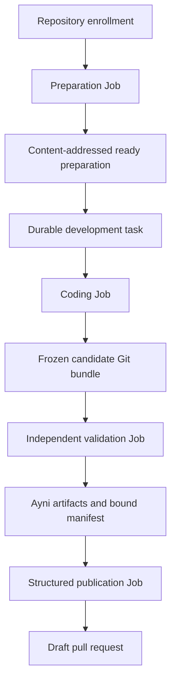

# Architecture

Ayni Orchestrator is an application-API-first control plane that uses Kubernetes
Jobs as bounded execution resources. Application storage, not Kubernetes object
status, is the source of truth for task lifecycle and external actions.

## Workspace

| Component | Responsibility |
| --- | --- |
| `api` | Generated Rust types, service contracts, and descriptor set for `ayni.orchestrator.v1` |
| `domain` | Validated task, attempt, result, and state-transition types |
| `observability` | Shared JSON logging, safe filtering, correlation fields, and redaction helpers |
| `control-plane` | Transport-neutral application operations, native gRPC, operational HTTP endpoints, SQLite persistence, reconciliation, Kubernetes Job creation, GitHub App integration, and publication |
| `worker` | Source preparation, managed Ayni execution, coding-agent tools, frozen-candidate validation, and structured PR authoring |
| `clients/typescript` | Checked-in Node-compatible native gRPC bindings generated from the canonical protobuf contract |
| `packages/bff` | Server-only gRPC client policy, browser-safe DTO mapping, deadlines, cancellation, correlation, and safe error translation |
| `apps/web` | SvelteKit Node server, server loads and actions, and bounded same-origin task-update relay |

The canonical protobuf contract is independent of persistence, Kubernetes, and
browser types. Product semantics remain in the domain and control-plane
application operations; generated transport types do not become domain types.
The native Tonic server calls those operations; HTTP is limited to health,
metrics, and a bearer-protected internal publication callback. The gRPC listener is required to bind to pod loopback in the
supported local profile. Although the Service declares the gRPC target for
`kubectl port-forward`, normal Service traffic addresses the pod IP and cannot
reach the loopback listener. A non-loopback listener requires separate
authentication, authorization, transport-protection, and network-isolation
design.

The SvelteKit runtime is a sidecar in the control-plane Pod. It reaches gRPC at
`127.0.0.1:50051` through the shared Pod network namespace and is exposed by a
separate internal `web` Service. It has no Kubernetes service-account token or
credential volume. Generated protobuf values stop at the server-only BFF;
browser data consists only of explicit allowlisted DTOs. The BFF is not a
second supported product protocol or a generic JSON mirror.

Dependencies point toward `domain`; workers do not own durable lifecycle state.

## Durable state and retained data

The local profile uses four persistent volume claims:

| Claim | Contents |
| --- | --- |
| `control-plane-state` | SQLite task, attempt, idempotency, lifecycle, provider-usage, preparation, and external-action state |
| `development-checkpoints` | Candidate Git bundles and bounded agent checkpoints |
| `managed-check-evidence` | Original Ayni artifacts and digest-bound validation manifests |
| `prepared-environments` | Ayni image archives, build records, and preparation manifests |

Disposable Jobs never become the authoritative record. Development transitions
also append an idempotent lifecycle event in the same SQLite transaction as the
mutable task phase. These events retain logical stage outcomes and stable reason
codes after Job expiry or process restart, allowing elapsed stage durations to be
reconstructed. Coding and PR-authoring workers also atomically spool bounded,
prompt-free per-interaction provider usage into mode-0700 retained checkpoint
subpaths that repository command processes cannot access. Reconciliation
imports those reports idempotently into SQLite and derives explicitly versioned
cost estimates without retaining provider content. Normal cleanup preserves all
four claims. The single-writer SQLite volume constrains the current profile to
one control-plane replica. The Deployment uses a `Recreate` update strategy so
an update cannot overlap two control-plane processes on that volume.

An optional Docker Desktop observability deployment runs disposable Prometheus,
kube-state-metrics, and Grafana Deployments. Prometheus scrapes the bounded
aggregate `/metrics` surface, namespaced Kubernetes object state, and only the
orchestrator namespace's kubelet/cAdvisor resource series. Its node permission
is limited to discovery and the metric-only `nodes/metrics` subresource; it
cannot use the general node proxy. Grafana receives only
that datasource. Prometheus and Grafana use bounded `emptyDir` storage and are
operational views rather than durable evidence; SQLite remains authoritative.
The application metrics omit task IDs and task content. Kubernetes workload
series may carry the existing task and stage labels for short-lived resource
attribution, and expire with the monitoring retention window.

## Repository and task flow

1. Enrollment records the GitHub repository, installation, base branch, and
   expected Ayni lock digest.
2. Preparation checks out one exact revision, validates its Ayni contract,
   builds and doctors the managed environment, and retains an immutable archive
   and build record.
3. The control plane fetches and briefly caches the OpenAI key's live model
   catalog through Rig. Task submission freezes the selected model with its
   provider and credential reference, plus the repository, revision, request,
   acceptance criteria, protected repository paths, test-edit authorization,
   lock, preparation identity, and optional deadline.
4. The coding Job receives fixed file and command tools but no Kubernetes token
   or GitHub App private key. It stores a local commit and Git bundle on retained
   checkpoint storage.
5. Validation mounts the bundle read-only, reconstructs the candidate, checks
   every added, modified, deleted, or renamed path against the frozen scope,
   compares supported Rust test syntax with the starting revision, loads the
   retained environment into a fresh isolated engine, runs Ayni, and writes
   artifacts outside the editable workspace. Scope violations are retained as
   `scope_rejected` evidence and never advance to publication.
6. Publication proceeds only from the validated candidate identity. The control
   plane mints repository-scoped GitHub App credentials and reconciles a
   deterministic branch and draft PR.

## Reconciliation and idempotency

Every state-changing API action has a durable idempotency identity. Attempt Jobs
use names derived from durable UUIDs. A control-plane restart observes an
existing Job rather than creating a second logical attempt. Cancellation records
durable intent before deleting an owned Job, and a late worker report cannot
replace a terminal or cancelled state.

External publication is also reconciled. After an uncertain provider response,
the control plane searches for the deterministic branch and existing pull
request before repeating creation.

## Trust boundaries

- Repository source, build hooks, and agent-edited files are executable,
  untrusted inputs.
- Coding, final validation, and publication use separate Jobs and credentials.
- Agent Jobs do not receive Kubernetes service-account tokens.
- GitHub App and model credentials are held in Kubernetes Secrets and injected
  only where required. The control plane receives the OpenAI key through a
  read-only projected file for catalog discovery; the key is never returned by
  the API or UI.
- Final artifacts are collected outside agent-writable storage and bound to the
  exact candidate and environment identities.
- Managed Ayni execution uses an isolated privileged Docker-in-Docker engine;
  the worker itself remains non-root and does not receive the host Docker socket.
- The browser and control-plane Services have no end-user authentication in the
  current profile and are restricted operationally to a trusted local cluster.
  The SvelteKit sidecar receives no Kubernetes service-account token. Native
  gRPC binds to pod loopback; its Service target is usable through a
  host-loopback `kubectl port-forward` but is not reachable through the Service
  cluster IP.

## Supported boundary

The current implementation supports one allowlisted private Rust repository,
Ayni `0.13.0`, a GitHub App integration, an OpenAI provider catalog and task-frozen
model selection, Docker Desktop Kubernetes, and single-node retained storage. Dependency-manifest changes return
an explicit unsupported result. Requirements beyond this boundary are tracked in
the [Orchestrator Project](https://github.com/orgs/ayni-oss/projects/2), not in
this architecture document.
