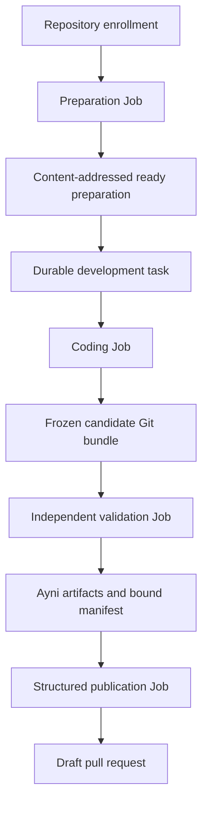

# Architecture

Ayni Orchestrator is an application-API-first control plane that uses Kubernetes
Jobs as bounded execution resources. Application storage, not Kubernetes object
status, is the source of truth for task lifecycle and external actions.

## Workspace

| Crate | Responsibility |
| --- | --- |
| `domain` | Validated task, attempt, result, and state-transition types |
| `control-plane` | HTTP API and UI, SQLite persistence, reconciliation, Kubernetes Job creation, GitHub App integration, and publication |
| `worker` | Source preparation, managed Ayni execution, coding-agent tools, frozen-candidate validation, and structured PR authoring |

Dependencies point toward `domain`; workers do not own durable lifecycle state.

## Durable state and retained data

The local profile uses four persistent volume claims:

| Claim | Contents |
| --- | --- |
| `control-plane-state` | SQLite task, attempt, idempotency, preparation, and external-action state |
| `development-checkpoints` | Candidate Git bundles and bounded agent checkpoints |
| `managed-check-evidence` | Original Ayni artifacts and digest-bound validation manifests |
| `prepared-environments` | Ayni image archives, build records, and preparation manifests |

Disposable Jobs never become the authoritative record. Normal cleanup preserves
all four claims. The single-writer SQLite volume constrains the current profile
to one control-plane replica.

## Repository and task flow

1. Enrollment records the GitHub repository, installation, base branch, and
   expected Ayni lock digest.
2. Preparation checks out one exact revision, validates its Ayni contract,
   builds and doctors the managed environment, and retains an immutable archive
   and build record.
3. Task submission freezes repository, profile, revision, request, acceptance
   criteria, protected repository paths, test-edit authorization, lock,
   preparation identity, and optional deadline.
4. The coding Job receives fixed file and command tools but no Kubernetes token
   or GitHub App private key. It stores a local commit and Git bundle on retained
   checkpoint storage.
5. Validation mounts the bundle read-only, reconstructs the candidate, checks
   every added, modified, deleted, or renamed path against the frozen scope,
   compares supported Rust test syntax with the starting revision, loads the
   retained environment into a fresh isolated engine, runs Ayni, and writes
   artifacts outside the editable workspace. Scope violations are retained as
   `scope_rejected` evidence and never advance to publication.
6. Publication proceeds only from the validated candidate identity. The control
   plane mints repository-scoped GitHub App credentials and reconciles a
   deterministic branch and draft PR.

## Reconciliation and idempotency

Every state-changing API action has a durable idempotency identity. Attempt Jobs
use names derived from durable UUIDs. A control-plane restart observes an
existing Job rather than creating a second logical attempt. Cancellation records
durable intent before deleting an owned Job, and a late worker report cannot
replace a terminal or cancelled state.

External publication is also reconciled. After an uncertain provider response,
the control plane searches for the deterministic branch and existing pull
request before repeating creation.

## Trust boundaries

- Repository source, build hooks, and agent-edited files are executable,
  untrusted inputs.
- Coding, final validation, and publication use separate Jobs and credentials.
- Agent Jobs do not receive Kubernetes service-account tokens.
- GitHub App and model credentials are held in Kubernetes Secrets and injected
  only where required.
- Final artifacts are collected outside agent-writable storage and bound to the
  exact candidate and environment identities.
- Managed Ayni execution uses an isolated privileged Docker-in-Docker engine;
  the worker itself remains non-root and does not receive the host Docker socket.
- The browser/API Service has no end-user authentication in the current profile
  and is restricted operationally to loopback port-forwarding on a trusted
  local cluster.

## Supported boundary

The current implementation supports one allowlisted private Rust repository,
Ayni `0.13.0`, a GitHub App integration, an OpenAI agent profile, Docker Desktop
Kubernetes, and single-node retained storage. Dependency-manifest changes return
an explicit unsupported result. Requirements beyond this boundary are tracked in
the [Orchestrator Project](https://github.com/orgs/ayni-oss/projects/2), not in
this architecture document.
