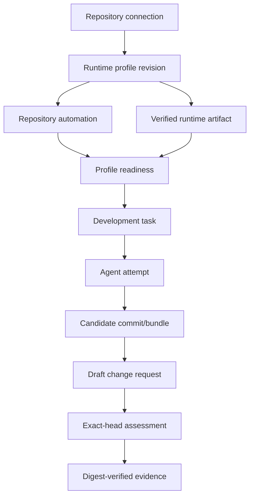

# Architecture

> **Clean-v1 target.** This document defines the replacement architecture
> accepted in [Decision 0007](decisions/0007-clean-v1-runtime-profiles.md).
> The checked-in pilot implementation is retired design history, not a current
> product capability; delivery is tracked by #53–#68.

Ayni Orchestrator is an application-API-first control plane for producing
reviewable repository changes. One shared foundation supports closed runtime
profiles: **Ayni Managed** (first operational profile) and **Custom Runtime**
(follow-up #66). Kubernetes Jobs are bounded execution resources; durable
application storage, not Kubernetes status, is the lifecycle authority.

## Components and ownership

| Component | Shared responsibility | Profile responsibility |
| --- | --- | --- |
| API/BFF/UI | Repository connections, profile views, tasks/attempts, candidates, change requests, assessments, evidence, bounded watch/poll | Display profile state and safe profile-specific remediation |
| Control plane | SQLite resources, idempotent actions, GitHub provider connection, OCI verification, reconciliation, candidate publication, assessment import | Ayni automation template/version and policy dispatch |
| Runtime runner | Digest-pinned OCI execution, workspace/scratch isolation, launcher, candidate output, cancellation | No Ayni lock, signal, or validation behavior |
| Ayni Managed automation | — | Setup PR, Actions workflows, GHCR artifact publication, default-branch verification, exact-head managed assessment and comment |
| Evidence store | Immutable, bounded evidence references and digest conflict detection | Ayni manifests/signals only for Ayni Managed |

The protocol is independent of persistence, Kubernetes, browser types, and
provider implementation. The server-side BFF remains an adapter, never a second
product API. The supported local deployment boundary remains Docker Desktop,
one trusted team, loopback access, and a single controller replica until a
separate topology decision changes it.

## Resources and flow

All nodes are separate durable resources. Each external mutation has a durable
idempotency/action record before the call; reconciliation uses deterministic
provider identities and read-before-retry after uncertainty. A task freezes its
repository revision, profile revision, OCI digest, model/agent selection,
request, constraints, and deadline. A candidate commit, PR head SHA, workflow
run, and evidence digest are distinct immutable identities.

## Ayni Managed flow

1. A repository connection selects a GitHub repository and installation. A
   profile revision records the committed Ayni contract.
2. The controller creates/reconciles one pipelines setup PR. It never writes the
   default branch directly.
3. After merge, trusted default-branch automation validates the lock and
   publishes or verifies `lock-<full-64-hex-lock-fingerprint>` in the enrolled
   GHCR package. The controller resolves the tag, verifies ownership, platform,
   Ayni labels, and immutable OCI digest.
4. Only a profile with verified automation and artifact is `ready`. A source-only
   revision verifies/reuses its valid artifact; a lock revision is `updating`
   until a new artifact is verified.
5. The runner starts coding with `image@sha256:...`; each attempt retains that
   digest even if the active profile later changes. `ayni check --host` is
   advisory feedback, not a gate.
6. A candidate becomes a draft PR. Managed PR automation checks the exact head,
   retains a bounded manifest/signals as digest-verified evidence, and yields an
   assessment. The GitHub check and marker-owned comment are presentations.

## Reconciliation and failure model

Repository/profile readiness, artifact availability, task execution, change
request publication, and assessment import reconcile independently. A failed
new lock never falls back silently to an old artifact for new tasks, while old
in-flight work can finish on its frozen digest. Missing or moved tags,
malformed locks/metadata, unsupported platforms, failed/stale workflows,
credential loss, and controller restart fail closed and expose a bounded
remediation state. See Decision 0007 for the normative recovery table.

## Trust boundary

Repository and candidate code, build hooks, and workflow outputs are untrusted
inputs. GitHub App credentials are short-lived and controller-scoped; candidate
PR execution cannot publish packages or receive controller/model credentials.
GHCR tags discover artifacts but OCI digests plus verified metadata identify
them. Coding containers mount only task workspace and bounded scratch, never a
host socket, controller database, Kubernetes token, or another task's state.
Kubernetes node cache is not evidence. The controller retains verified evidence
under assessment identities; comments, checks, and host feedback cannot
substitute for it.

## Retained state

The clean baseline stores repository connections, profiles/revisions, artifacts,
automation/actions, tasks/attempts, candidates, change requests/publication
actions, assessments, evidence references, reconciliation cursors, and bounded
usage/diagnostics. The pilot's preparation archives and task-wide validation
paths are not migrated or read. Retention and safe later GHCR retirement are
specified by #55 and #67.
