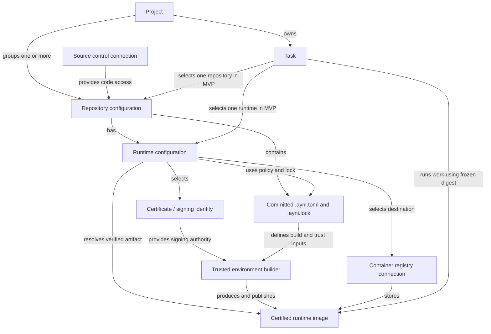
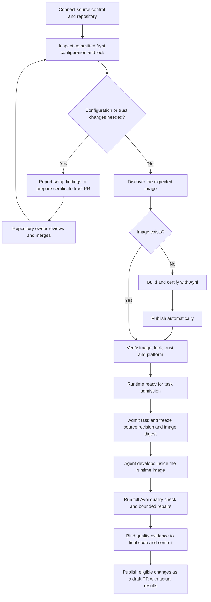

# Ayni development flow

Internal product model · 2026-10-07

Ayni Orchestrator turns a development request into code changes, quality evidence,
and a draft pull request. The Ayni flow runs that work inside a certified runtime
image tied to the repository's committed environment and quality configuration.
The MVP uses one repository and one Ayni runtime per task.

| Concept | Product meaning |
| --- | --- |
| Source control | A provider connection that grants access to code and allows branch and pull request publication. GitHub is the MVP provider. |
| Container registry | A connection defining where certified runtime images are published and retrieved. GitHub Container Registry, or GHCR, is the MVP registry. |
| Certificate | A signing identity with a private key for certification and a public key for verification. The repository must trust that public key. |
| Repository | A configuration connecting a code source and branch to its available development runtimes. |
| Runtime | A repository's configured development environment. Its verified image is used to run task work. Ayni Managed is supported; Custom Runtime is currently unsupported. |
| Project | A group of repositories with a shared purpose. It owns the tasks pursuing that purpose. |
| Task | The complete unit of requested work, including orchestration, selected inputs, progress, results, and publication. |

## Object relationships

Repositories may belong to several projects. Their runtime configurations are
shared across those projects; changing project membership does not configure a
runtime or modify repository content.

The dependency chain is **runtimes → repositories → tasks → projects**:
environments enable repository work, tasks perform that work, and projects give
it purpose. Ownership follows the diagram: repositories own runtime configuration
and projects own tasks.

## Runtime configuration and certified images

A runtime is a durable configuration. Its image is an immutable artifact produced
from that configuration and the relevant repository environment inputs.
Rebuilding can produce another artifact for the same logical runtime.

An Ayni runtime requires:

- Committed `.ayni.toml` defining repository quality policy, environment inputs,
  and trusted signing keys.
- Committed `.ayni.lock` matching those inputs and the supported Ayni contract.
- A usable signing identity whose public key is trusted by the repository.
- A registry destination with working publication and retrieval access.
- A verified image compatible with the selected source, lock, and execution platform.

These requirements belong to **Ayni Managed**. Custom Runtime will need its own
readiness contract when supported.

Builders produce images; registries store them. Trusted builders receive signing
and registry push access, while task workloads receive pull access without signing
or push authority. Selecting a certificate in the product does not replace the
repository's committed trust policy.

Certification covers environment metadata and protected content, including
prepared dependencies, against the lock and trust policy. Code quality is assessed
separately against `.ayni.toml`; certification does not establish that editable
source passes its checks.

## The Ayni flow

This diagram describes the intended product flow. Runtime setup is shared,
durable preparation; each task owns its development work through publication.
Configuration and trust changes require repository-owner review before the changed environment
becomes trusted, and pull requests are never merged automatically.

### Preparation and readiness

Repository access and runtime readiness are separate. A repository can be connected
and included in a project while its runtime still needs configuration, trust, or
an image. The product shows the missing requirement on the affected runtime.

Readiness applies to the selected configuration and verified artifact. Changes to
environment inputs, signing identity, or registry destination require reconciliation
before admitting new work. Already admitted tasks retain their frozen inputs.

### Image preparation

The runtime remains visible when setup is incomplete. Analysis freezes an exact
source commit and reports committed policy, lock, CLI compatibility, certificate,
trust, registry and platform findings. General repository bootstrap is outside
this milestone; owners commit missing configuration through their own review.
Certificate trust changes retain the reviewed PR flow.

Progress is durable: **Analyzing → Building → Publishing → Verifying → Ready**.
A genuinely absent image triggers a build automatically. Access denials, outages
and malformed responses fail analysis; they never mean absence. An existing
image must pass independent verification before reuse. A mismatch reports a
finding and offers **Rebuild**; it is never overwritten automatically.
Every successful build publishes. There is no publication preference, separate
publish action, retained unpublished artifact, artifact PVC or node-local import.

**Analyze / Sync** inspects current inputs; **Rebuild** creates a fresh frozen
intent after prerequisites pass. **Retry analysis** releases a failed observation.
The failing phase, reason and corrective action remain visible. Three exhausted
reconciliation failures or publication attempts require an explicit action.
See [managed runtime execution](managed-runtime-execution.md) for the build,
publication, verification and recovery boundaries.

### Task behavior

A task carries the request, acceptance criteria, selected repository and runtime,
agent and model, constraints, and execution limits. Admission freezes the source
revision, runtime revision, and image digest so configuration updates cannot
silently change running work.

The worker verifies the environment and checkout, uses focused Ayni feedback during
development, and runs a full repository quality check before publication. Final
evidence binds the checked source and commit; missing evidence cannot count as a pass.

| Outcome | What the product reports |
| --- | --- |
| Execution | Whether task work completed, failed, was cancelled, or exceeded its deadline. |
| Quality | Whether the repository contract passed, failed, or could not be assessed. |
| Publication | Whether a draft PR was created, failed to publish, or was not applicable. |

Eligible changed work can produce a draft with failed or unavailable quality,
reported explicitly. Admission failures, unsafe changes, cancellation, and
no-change outcomes do not publish. Publication retry uses retained work without
another coding session; an ordinary task retry creates a new attempt.

## MVP and future scope

The current task flow uses one repository, one ready Ayni runtime, and one worker.
Projects can contain multiple repositories, but each task selects a single member.
Managed certificate selection and repository trust reconciliation are being
introduced in [PR 117](https://github.com/ayni-oss/orchestrator/pull/117).
Approval-driven bootstrap initialization remains outside the current implementation boundary.

The task remains the whole unit of work. Future tasks may coordinate multiple
repositories and runtimes through a directed acyclic graph, an agent-managed flow,
or another mechanism. This product model introduces no task subtype, separate
execution category, or mandatory target object to prescribe that future structure.

## Related documentation

- [Operator onboarding](operator-onboarding.md) describes available connection and runtime setup operations.
- [Architecture](architecture.md) defines task admission, worker responsibilities, evidence, and credential boundaries.
- [Managed runtime execution](managed-runtime-execution.md) describes worker execution and limits.
- [Decision 0011](decisions/0011-project-centered-ui-and-onboarding.md) records shared project membership and the onboarding implementation boundary.
