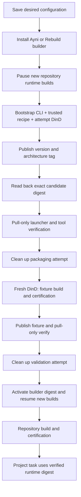

# Deployment-wide Ayni image building

The Ayni page configures one build service for all Ayni Managed repositories.
Repository registry destinations and certificate choices remain authoritative.
Stable releases are discovered from GitHub with bounded pagination and a five-minute
cache. Only the verified 0.14.5 CLI contract can be selected; release discovery never
upgrades configuration.

Choose the supported Ayni version, Linux architecture, validated GHCR registry,
and ready certificate for service validation. **Save configuration** persists
these choices; it does not build an image. **Install Ayni** starts the durable
installation operation. **Rebuild builder** explicitly replaces its version and
architecture tag.

Installation uses a pinned Docker CLI bootstrap image and the worker's shipped
recipe to build the first reusable Ayni builder through disposable DinD. No
pre-existing Ayni builder or repository checkout is required. It publishes
`ghcr.io/<namespace>/orchestrator:ayni-builder-<version>-<arch>`, reads back the
exact candidate digest, and pulls that digest for launcher/tool verification.
The reusable image contains Ayni, Docker CLI, Buildx, mise, Git and runtime
libraries, without certificates, signing keys, or registry credentials.

Next, the installed candidate builds and certifies a trusted Rust fixture,
publishes the fixture with separate push credentials, and verifies its exact
digest using pull-only credentials. Fixture images are separate applications,
not Ayni builders. Their tags remain unique; registry retention owns deletion.
Only successful verification and completed cleanup activate the builder digest.
Repositories use it to build certified runtime images; project tasks use those
repository runtimes.

Installation status and stages are distinct from the explicit **Test build
service** action, which retests an installed digest without rebuilding it.
Starting installation or a rebuild pauses new repository runtime builds.
Failure and cancellation keep them paused until installation succeeds.
Already-running attempts and project tasks retain their frozen identities.
Rebuilding a tag does not change any pinned digest automatically.

Settings, installation progress, recipe identity, candidates, and outcomes are
stored in SQLite. Source, signing, push and pull credentials remain Kubernetes
Secret references. Only certified runtime builds receive signing authority.
Restart resumes the saved operation; engine loss starts a fresh attempt after
retirement, with at most two retries. Cancellation persists cleanup intent before
stopping clients and retiring their engine. Configuration updates are rejected
during installation or testing; stale results cannot activate another revision.

## Engines and security modes

Every attempt creates a Pod, disposable `emptyDir` Docker storage, internal Service,
NetworkPolicies, and an immutable Secret with newly generated mutual TLS identities.
The build and publication Jobs share that attempt's engine. Completion and failure
cleanup remove those resources. Engine containers mount only CA and server keys;
client Jobs mount only CA and client keys. The engine does not mount signing or
registry credentials, host storage, runtime sockets, or a service-account token.

The deployment administrator selects `runtime.engineMode`: `external-isolated`
(the default, with no Kubernetes engines), `local-development`, or
`dedicated-builder`. The Ayni UI displays that mode and edits the desired version, architecture,
registry, certificate, and engine/provisioning identities. The installed builder
identity is read-only; the UI never authorizes deployment privileges. Requests cannot change the mode or external
endpoint. A deployment mode change invalidates readiness and requires a fresh test.
Old experimental deployment fields must be removed from Helm values explicitly
(use cleaned values with `--reset-values`, rather than retaining obsolete fields
with `--reuse-values`). They do not authorize DinD.

Both Kubernetes modes use the same privileged DinD lifecycle, overlay2 storage
driver and resource limits. The builder nodes must support nested overlay mounts;
this milestone does not support every Kubernetes runtime.
`local-development` runs on Docker Desktop and accepts locally loaded immutable
builder images. Local success proves functionality only.

`dedicated-builder` requires Linux nodes of the selected architecture labelled
`ayni.io.node-restriction.kubernetes.io/builder=true`. Provision the label through
an administrator with NodeRestriction enabled and taint those nodes
`ayni.io/builder=true:NoSchedule`. Engines have a required node selector and only
that taint's toleration; unavailable builder capacity leaves engines Pending and
the attempt fails on startup timeout. There is no scheduling fallback.
The control plane and credential-bearing Jobs require that the protected label
is absent, even if the taint is accidentally removed. Configure trusted node
capacity and storage accordingly. Provision new builder nodes without trusted
workloads; drain reused nodes first, because scheduling affinity does not evict
already running Pods when labels change. These are scheduling controls, not proof
of isolation.

The recommended deployment is a separate builder Kubernetes cluster on disposable
VMs, with trusted orchestration and credential-bearing Jobs on separate trusted
nodes. The current adapter uses its configured Kubernetes client/namespace for all
attempt resources: deploy that adapter in the builder cluster; it does not route
engines into a second cluster from an application-cluster installation. A dedicated
node pool in the application cluster reduces exposure but retains cluster-credential
risk. Cluster administrators own admission policy, node credentials, VM disposal,
and the actual infrastructure boundary. Restrict builder node identities to their
own nodes and pods and prohibit access to trusted-node Secrets.

Attempt-specific NetworkPolicies admit only that attempt's clients on engine port
2376 and deny inbound connections to the client Jobs. DNS and HTTP/HTTPS egress
remain available for dependencies and registries, including private endpoints.
Infrastructure administrators must enforce firewall/CNI restrictions preventing
production-service, metadata, and control-plane access, including nested-container
traffic and both IP families. The generated policies do not establish those
protections; there is no activation checkbox for network isolation.

Privileged engines can compromise their node. An engine and credential-bearing Job
sharing a node cannot maintain credential isolation after node compromise. Separate
node placement prevents that co-location in dedicated mode, but a compromised node
still carries cluster credentials and may attack cluster infrastructure. mTLS and
Secret mount separation do not remove that risk. Local mode explicitly shares the
Docker Desktop node and has this limitation.

Engine loss discards its candidate, cleans up the old attempt and retries with a
fresh engine identity and empty storage, within the retry budget. The trusted
fixture follows the same rule. Cleanup waits for Job dependents and engine Pod
deletion before readiness; restart resumes durable progress or cleanup.

## Packaging and deployment

`deploy/images/runtime-builder/Dockerfile` pins Ayni 0.14.5, Docker CLI 28.3.3,
Buildx from that immutable CLI image, and checksum-verified mise 2026.6.14. Git,
CA certificates and runtime libraries complete the trusted launcher environment.
The container runs as UID 10001. Jobs inject the separately packaged launcher and
mount writable workspace and scratch volumes under a read-only root filesystem.

`dev/ctl deploy` builds and loads the application and worker images. Builder
packaging happens through `/ayni`, using the same image-build interface, engine
lifecycle, publication and candidate observation as repository runtime builds.
No separate GitHub packaging workflow is required. Native architecture selection
is enforced for builder packaging and launcher verification; unavailable nodes
leave the operation Pending rather than using another architecture.

The selected builder is published as, for example,
`ghcr.io/ayni-oss/orchestrator:ayni-builder-0.14.5-arm64`. Deployments and future
runtime attempts use its verified manifest digest. The release contract owns the
trusted recipe and bootstrap/executor identities. A recipe change during an
operation invalidates the frozen installation instead of silently changing its
inputs. An emulated AMD64 smoke check is not native runtime validation.

Helm `runtime.builderDefaults` can seed engine and provisioning identities. A legacy
`builder_image` is imported as unvalidated metadata, not editable UI input, and
does not activate configuration.
`runtime.engineMode` independently controls the deployed boundary.

## Legacy external-engine migration

Existing `runtime.managedRuntime.build` is imported as administrator-managed,
inactive configuration. `isolated_engine: true` retains its original meaning only
for an external TLS engine. It never grants permission for privileged Kubernetes
DinD. The old endpoint and TLS Secret references are retained as
`external-isolated`; native engine configuration has its own explicit mode.
If exactly one ready registry and certificate exist, migration selects them for
the service test. Seed `builderDefaults.provisioning_base` for that test. With
ambiguous connections, migrate through operator configuration rather than silently
choosing an identity. Validate the imported configuration before enabling builds.

## Observability

`orchestrator_builder_failures_total` exposes bounded stage/reason labels including
engine startup/TLS and cleanup failures. `orchestrator_builder_duration_seconds`
records completed service-test duration. Existing runtime activity and Job metrics
continue to expose ordinary build, publication, and verification stages.
