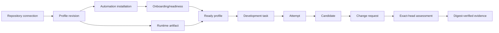
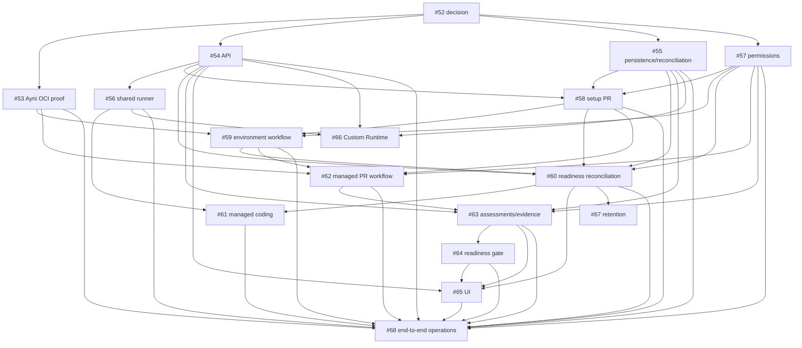

# Decision 0007: clean v1 runtime profiles

- Status: accepted
- Date: 2026-09-29
- Supersedes: the current pilot's preparation, task, validation, and retained-state model

## Decision

Pre-public `ayni.orchestrator.v1` is replaced directly with one shared
orchestrated-development foundation and two closed **runtime profile** variants:
**Ayni Managed** and **Custom Runtime**. Ayni Managed is the first operational
profile. Custom Runtime is a supported product name and shared-model variant,
but its execution is delivered by #66 after the Ayni-first foundation.

This is a clean v1 baseline. The unused pilot protobuf contract, SQLite schema,
generated bindings, preparation archives, validation manifests, and legacy-read
paths are removed rather than migrated. Buf and release compatibility baselines
reset with the replacement. Future releases start compatibility from that new
baseline.

## Vocabulary

| Term | Meaning |
| --- | --- |
| **runtime profile** | A versioned repository configuration selecting one closed runtime variant and its profile-specific policy. |
| **Ayni Managed** | A profile whose committed Ayni contract is used to produce, verify, and reuse a managed OCI environment and managed Ayni assessments. |
| **Custom Runtime** | A profile whose owner supplies a supported OCI coding runtime; it has no Ayni contract, environment workflow, or Ayni evidence requirement. |
| **runtime artifact** | The verified, platform-specific OCI runtime identity for one profile revision: registry repository, discovery tag where applicable, resolved manifest digest, metadata, and status. |
| **candidate** | An immutable agent-produced commit/bundle derived from one frozen task attempt. It is not a pull request or an assessment. |
| **change request** | The provider-specific review object published from a candidate (a GitHub pull request in the MVP; an MR is the equivalent future provider object). |
| **assessment** | A durable producer result bound to a change request and its exact head SHA, with an explicit conclusion. It is not task completion. |
| **evidence** | Bounded retained bytes or metadata whose digest is verified under an assessment identity. Evidence is not a comment or mutable provider status. |
| **repository automation** | A versioned, provider-installed workflow/integration owned and reconciled by a profile, such as the Ayni Managed setup PR and its Actions workflows. |

The product never uses “basic,” “unmanaged,” or “Ayni-less” as profile names.

## Ownership

| Shared foundation | Ayni Managed adapter | Custom Runtime adapter |
| --- | --- | --- |
| Repository connection/snapshot, profile revisions, OCI digest admission, agent tasks and attempts, candidate storage, PR/MR publication, change-request and assessment identity, evidence retention, idempotent external actions, and reconciliation | `.ayni.toml`/`.ayni.lock` interpretation, Ayni release provisioning, GitHub Actions setup and workflow templates, GHCR publication/verification, `ayni check --host` feedback, managed PR checks, signals, and default-branch environment reconciliation | Supported external OCI reference discovery and verification; repository-native checks are observed as external assessments without representing them as Ayni evidence |

No shared resource contains mandatory Ayni lock, signal, preparation, or
GitHub-only fields. Provider-specific identities are attached at provider
boundaries, not made universal fields.

## Immutable identities

These values are related but must never be substituted for one another:

| Identity | Rule |
| --- | --- |
| Repository revision | Immutable provider commit SHA captured when a profile or task reads source. |
| Profile revision | Immutable version of the runtime profile configuration; changing a lock or supplied runtime creates a new revision. |
| Ayni lock fingerprint | The full 64-hex fingerprint (without its `sha256:` prefix only where a tag grammar requires it) of the complete lock contract. It is neither a source SHA nor an OCI digest. |
| OCI discovery tag | A mutable lookup reference. Ayni Managed uses `lock-<full-64-hex-lock-fingerprint>` in the enrolled repository's GHCR package. It is never authority for a task. |
| OCI digest | Immutable resolved manifest digest, verified with platform and metadata before admission, and frozen in every task/attempt snapshot. |
| Candidate commit | Immutable commit produced by a particular attempt; it does not authorize publication quality or readiness. |
| PR head SHA | Exact provider head of a change request. Assessments and readiness must bind this SHA, not merely a branch name or candidate claim. |
| Workflow run and attempt | Immutable producer execution identity retained with its assessment; a later run cannot overwrite an earlier assessment. |
| Evidence digest | Digest of each retained evidence object or manifest; it authenticates retained bytes, not a GitHub check/comment. |

A current Ayni lock demonstrates why a fingerprint cannot be treated as a source
dependency hash: its covered contract includes schema and recipe versions,
contract digest, Ayni and Mise versions, provisioning-base reference/digest and
variant, platforms, target runtimes/components, signal tools, dependency locks
and source digests, capabilities, and resource limits. #53 must prove the
exact fingerprint and image-label contract against the supported Ayni release. The
current executable research record is [Ayni OCI workflow research](../research/ayni-oci-workflow.md).

## Lifecycle and reconciliation

Every row below is independently observable and reconciled. A durable action
record with idempotency identity and pending/completed/failed state precedes an
externally effective operation.

- **Repository connection** records provider repository and installation access;
  it is not an Ayni enrollment.
- **Profile onboarding/readiness** is `setup_required`, `setup_pr_open`,
  `awaiting_environment`, `ready`, `updating`, or `degraded`, with terminal
  failure where repair is not automatic.
- **Runtime artifact** is separately verified per profile revision and
  platform. In-flight work keeps an old verified digest while new work waits
  for its replacement.
- **Task/attempt**, **candidate**, **change request**, **assessment**, and
  **evidence** have separate terminal states. A successful agent attempt is not
  a successful assessment; a comment is not evidence.

For Ayni Managed, onboarding creates one idempotent pipelines setup PR. After
merge, the trusted default-branch workflow validates the committed lock and
publishes or verifies the lock-keyed GHCR artifact. The profile becomes ready
only when the controller independently verifies the expected workflow,
full-fingerprint tag, digest, platform, and Ayni metadata. A source-only
change verifies/reuses the existing artifact; a lock change creates an
`updating` profile revision. The controller never builds environments itself
and periodically reconciles workflow state and GHCR artifacts.

Coding runs in the verified `image@sha256:...` artifact on an eligible node.
`ayni check --host` is optional agent feedback only. The managed PR workflow
checks the exact PR head with managed `ayni check`; its digest-verified manifest
and evidence produce the authoritative assessment. The GitHub check and one
marker-owned summary comment are projections. They may be updated, deleted, or
stale without changing retained assessment truth. Draft-to-ready policy may
act only on a current successful exact-head assessment.

## Trust boundary

- GitHub App credentials are controller-held, short-lived, operation-scoped,
  and never stored in task state, evidence, comments, metrics, or logs.
- GitHub Actions is trusted only according to its event, token, checkout,
  pinned-template, workflow-run, and retained-evidence bindings. Candidate
  code never receives package-write or controller credentials; `pull_request_target`
  is not used to execute it.
- GHCR tags are discovery references. The controller verifies ownership,
  expected labels, platform, and resolved digest; moved or missing tags fail
  closed.
- Candidate-controlled source, build hooks, and PR workflows are untrusted
  inputs. Coding containers get only the task workspace, bounded scratch, and
  scoped credentials; no controller database, host socket, Kubernetes token,
  or another task's state.
- Kubernetes nodes and coding containers execute a digest-pinned artifact but
  are not evidence authorities. Node cache is an optimization, never identity.
- The controller is the reconciliation authority, not a replacement for
  immutable provider or registry evidence.

## Failure and recovery

| Condition | Safe result and recovery |
| --- | --- |
| Setup PR closed, unmerged, or drifted | Keep `setup_required`/`setup_pr_open`; reconcile owned files and create or update the idempotent setup action after operator repair. Never mutate the default branch directly. |
| Stale or malformed lock | Mark the profile revision degraded or updating; admit no new work for it. Repair and merge a valid lock, then verify a new artifact. |
| Failed, stale, or unknown workflow | Retain its run identity; do not promote its output. Reconcile the exact source/head and await or dispatch only a documented safe retry. |
| GHCR tag missing, moved, wrong owner/label, or bad digest | Mark artifact/profile degraded, preserve prior task snapshots, and require a newly verified trusted workflow result. Never rewrite a retained digest. |
| Unsupported platform/runtime | Reject task admission with an actionable profile/artifact reason; do not schedule a generic coding Job. |
| Unavailable/revoked credentials | Persist the failed external action, surface remediation, and reconcile after access returns without duplicating provider mutations. |
| Controller restart or uncertain response | Resume from durable actions and immutable identities, read provider/registry state before retrying, and never let a late result replace a newer desired revision or PR head. |

## Delivery and acceptance mapping

The delivery issues own executable acceptance tests: #54 covers resource/API
identities; #55 lifecycle/restart boundaries; #56 digest-pinned runner
admission; #57 trust permissions; #58 onboarding actions; #59/#61 artifact and
default-branch transitions; #62/#63 exact-head assessments/evidence; #64
readiness; #65 visibility; #66 profile reuse; #67 retained artifact references;
and #68 the end-to-end and recovery matrix.
