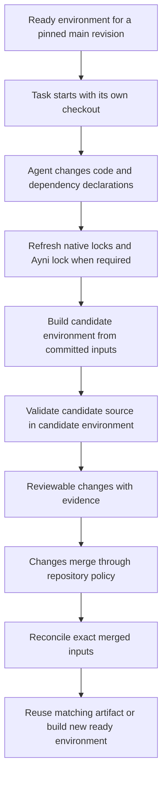

# Environment lifecycle

Status: proposed orchestration over existing Ayni contracts.

## Existing Ayni foundation

At the recorded source revision, Ayni supports managed project shapes for Rust,
npm/pnpm Node, Go modules, uv Python, and locked Gradle Kotlin. Support and signal
depth are adapter-specific; discovery is not a promise of universal execution.

The committed policy defines required measurements. The environment lock records
resolved runtime and tool inputs, native dependency-input digests, an immutable
provisioning base, platform requirements, requested capabilities, and resource
ceilings. The build record additionally identifies the executor, prepared state,
and actual built image. The lock hash alone does not identify every execution byte.

Lock-consuming commands do not implicitly refresh stale locks. Quality commands
own their managed launch; ordinary `env run` and `env shell` are development
access and do not normalize quality evidence. Reference:
[managed environments](https://github.com/ayni-oss/ayni/blob/main/docs/product/environments.md)
and [capabilities](https://github.com/ayni-oss/ayni/blob/main/docs/product/capabilities.md).

## Flow 1: enroll and prepare repositories

1. A provider installation grants access to selected repositories. Discover the
   current authorized set through the provider API; do not wait for a push.
2. Resolve an exact revision and fetch its policy, lock, and required manifests,
   wrappers, and native locks. The Ayni lock alone is not the complete build input.
3. Validate supported shape, lock freshness, orchestrator permissions, and provenance.
4. Reuse a compatible prepared artifact or schedule a bounded isolated build.
5. Validate image and preparation readiness before marking the environment ready.
6. Expose setup diagnostics and retain the environment identity for future tasks.

Missing configuration is an onboarding outcome, not permission to invent and
commit policy silently. An explicitly requested onboarding agent could propose
the needed files as a separate change.

Webhook events trigger reconciliation. Periodic provider synchronization should
cover missed events and access revocation. Deduplicate deliveries and resolve
their repository identities against current authorization. Do not let an older
build completion replace a newer desired revision.

GitHub provides an installation repository listing; GitLab and other providers
need their own authorization mapping rather than an assumed identical app model.
[GitHub installation API](https://docs.github.com/en/rest/apps/installations)

## Environment identity and storage

Use immutable content identity for reuse, not illustrative names such as v1/v2.
A candidate cache identity should account for the environment lock, execution
recipe, executor, target platform, and preparation inputs. Trust-domain boundaries
also constrain reuse. Exact keys remain an implementation decision.

Public publication is optional. A multi-node deployment still needs an internal
image-distribution strategy, such as a private registry. Prepared dependency
state that lives outside the OCI image also needs explicit transport or
reconstruction; an image alone must not falsely establish readiness.

Do not mutate an existing image identity when dependencies change. Keep task
checkouts separate from reusable preparation. Retention must protect artifacts
used by active attempts while expiring abandoned candidates and unused state.

## Environment changes during development

Agents may install packages interactively to explore a solution. Durable
acceptance requires declaring the resulting requirements and rebuilding from
those declarations. A test that succeeds only because of an unrecorded live
installation does not validate the reproducible candidate.

Dependency changes should be validated before merge. After merge, reuse the
candidate artifact only if the merged inputs match; rebases, conflict resolution,
and intervening changes can require new preparation and validation.

An in-flight task keeps its pinned environment until it intentionally transitions.
A failed new build must not silently redirect a task to an old incompatible
environment. An older environment can remain available for its matching source.
Policy or capability changes require evaluation under orchestrator rules; lock
generation cannot authorize itself.

## Development services

Maintain a conceptual separation between:

| Configuration | Examples |
| --- | --- |
| Execution environment | Runtimes, package managers, analysis tools, native packages |
| Development services | Database, queue, migrations, fixtures, readiness probes |
| Agent configuration | Runtime, model, skills, tools, MCP, budgets |

Agents can discover and propose service requirements from repository context.
Orchestrator policy determines which resources they can instantiate. Service
definitions need image/version references, initialization inputs, connectivity,
readiness, limits, and cleanup ownership. A service can be task-specific or a
policy-approved shared instance; default topology remains open.

Use synthetic fixtures initially. A reproducible service image does not reproduce
its data. Record fixture and initialization versions where material, along with
uncontrolled external dependencies. Provision service credentials separately from
committed locks and image layers.

## Build and runtime permissions

Ayni currently distinguishes repository capability requests from per-invocation
orchestrator authorization. Preserve that distinction. Build-time package hooks can
execute and access the network even when the eventual quality runtime is more
restricted. Isolate builders and validate outer resource limits independently.

Reference: [Ayni security model](https://github.com/ayni-oss/ayni/blob/main/docs/product/security.md).
