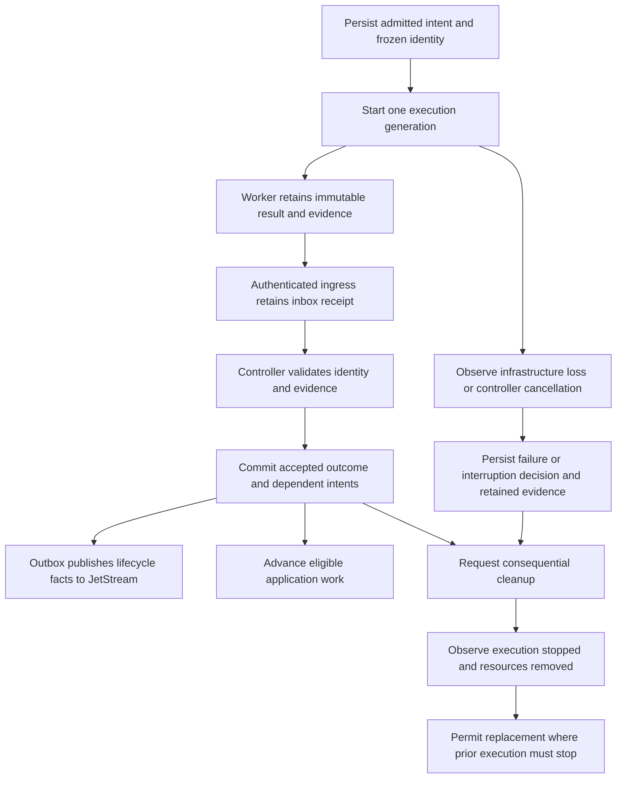

# Control-plane events and evidence

> Historical research from 11 October 2026. Start with the [current event platform](../../architecture/event-platform.md) for implemented behavior. The proposal and source inventory below preserve provenance.

Research snapshot: 11 October 2026, orchestrator commit `1f4e03a44e3217d6e3cf14b9848096e0ca03c8ac`. Source analysis; deployed runtime behavior was not exercised. Current behavior is recorded in the linked inventory. The event protocol and JetStream placement below are research proposals, not an accepted architecture decision or implemented transport.

The control plane should advance on validated application evidence and controller policy. Kubernetes observations should establish execution availability, failure and stop confirmation. Cleanup should have its own durable state so it cannot erase evidence or masquerade as a failed task.

The [flow inventory](control-plane-event-flows.md) maps all implemented flows, their current signals, transition gates and cleanup ordering. The [contract catalog](control-plane-event-contracts.csv) indexes current RPCs, state vocabularies, resource events and worker tools.

[Observability and lifecycle events](../../reference/observability-and-events.md) describes how
OpenTelemetry traces, logs and metrics complement these application contracts.
The [CloudEvents contract](../../reference/cloudevents-contract.md) recommends a standard
envelope and defines its relationship to JetStream routing and trace context.
The [implementation proposal](event-platform-implementation.md) develops this
research into phased delivery with [retirement gates](../../operations/event-compatibility.md).

## Findings that drive the design

- The system already has transactional resource events and resumable gRPC streams. The missing contract is consistent producer reporting and accepted lifecycle events.
- Coding already separates execution, quality and publication, retains full evidence, and records publication intent before remote actions.
- Runtime preparation uses compact termination messages, while trust preparation uses logs and coding uses retained files.
- Verification reporting can fail above 4 KiB. That failure is reduced to a generic verification error.
- Three runtime failures count reconciliation errors, not necessarily three fresh worker executions. Retry exhaustion and display metadata disagree.
- Cleanup is consequential in several flows, but runtime Ready currently waits for cleanup. Replacement execution correctly waits for prior Pods to stop.

Sources: [Transactional resource events and bounded retention](https://github.com/ayni-oss/orchestrator/blob/1f4e03a44e3217d6e3cf14b9848096e0ca03c8ac/backend/servers/control-plane/src/adapters/sqlite/pagination_events.rs#L87); [Runtime preparation, failure counting, publication and cleanup](https://github.com/ayni-oss/orchestrator/blob/1f4e03a44e3217d6e3cf14b9848096e0ca03c8ac/backend/servers/control-plane/src/coordinators/reconciliation/preparation.rs#L13); [Evidence retention, cleanup and guarded activation ordering](https://github.com/ayni-oss/orchestrator/blob/1f4e03a44e3217d6e3cf14b9848096e0ca03c8ac/backend/servers/control-plane/src/coordinators/reconciliation/activation.rs#L11); [Coding result collection, recovery and cleanup](https://github.com/ayni-oss/orchestrator/blob/1f4e03a44e3217d6e3cf14b9848096e0ca03c8ac/backend/servers/control-plane/src/coordinators/reconciliation/coding.rs#L25); [Publication intent, provider readback and receipts](https://github.com/ayni-oss/orchestrator/blob/1f4e03a44e3217d6e3cf14b9848096e0ca03c8ac/backend/workers/runtime-worker/src/coding/publication.rs#L281); [Verification reporting and the 4 KiB limit](https://github.com/ayni-oss/orchestrator/blob/1f4e03a44e3217d6e3cf14b9848096e0ca03c8ac/backend/workers/runtime-worker/src/main.rs#L138).

## Current functionality and expected authority

| Question | Current authority | Expected authority |
| --- | --- | --- |
| Can this task be admitted? | Frozen Ready runtime and verified artifact checks | Control-plane policy remains authoritative |
| Has execution started or stopped? | Kubernetes Job/Pod observation | Kubernetes observation plus execution-generation identity |
| Is the worker responsive? | No periodic worker heartbeat; activity is action-driven | Trusted supervisor heartbeat with expiry reported as uncertainty |
| Has coding, checking or publication completed? | Worker files, usually collected after Job completion | Validated operation result with retained evidence |
| Does the image exist or was a draft created? | Registry/GitHub readback and receipts | Provider-bound evidence; broker acknowledgement is insufficient |
| Can resources be removed? | Flow-specific cleanup after collection or terminal decision | Durable cleanup intent following accepted result, cancellation or supersession |
| Can another process use the same retained attempt? | Cleanup and stopped-Pod check | Explicit stop/fence confirmation before replacement |

A result can arrive before Kubernetes termination. Infrastructure failure can also happen before a worker reports anything. Both arrival orders must be supported without manufacturing successful work or waiting forever for an absent result.

Sources: [Runtime evidence admission checks](https://github.com/ayni-oss/orchestrator/blob/1f4e03a44e3217d6e3cf14b9848096e0ca03c8ac/backend/servers/control-plane/src/profiles/ayni/evidence_policy.rs#L21); [Task admission and frozen identities](https://github.com/ayni-oss/orchestrator/blob/1f4e03a44e3217d6e3cf14b9848096e0ca03c8ac/backend/servers/control-plane/crates/application/src/tasks.rs#L150); [Coding result collection, recovery and cleanup](https://github.com/ayni-oss/orchestrator/blob/1f4e03a44e3217d6e3cf14b9848096e0ca03c8ac/backend/servers/control-plane/src/coordinators/reconciliation/coding.rs#L25); [Decisions from task state and Kubernetes execution state](https://github.com/ayni-oss/orchestrator/blob/1f4e03a44e3217d6e3cf14b9848096e0ca03c8ac/backend/servers/control-plane/crates/application/src/reconciliation.rs#L18); [Task server-sent events and connection heartbeat](https://github.com/ayni-oss/orchestrator/blob/1f4e03a44e3217d6e3cf14b9848096e0ca03c8ac/apps/web/src/routes/tasks/[taskId]/updates/+server.ts#L68).

## Proposed ordering

This is a proposed protocol. Advancing before cleanup requires operation-specific checks: build engines remain until publication finishes, and recovery cannot overlap another writer.

## Proposed event families

| Family | Examples | Role |
| --- | --- | --- |
| Requested action | `runtime.reconcile.requested`, `task.cancel.requested` | Durable command; admitted and authorized before execution |
| Execution observation | `execution.started`, `execution.failed`, `execution.stopped` | Infrastructure facts and safe recovery decisions |
| Advisory activity | `worker.stage.changed`, `model.request.started`, `tool.completed` | Live information; never substitutes for evidence |
| Worker result | `build.result.available`, `verification.result.available`, `task.result.available` | Final immutable outcome with artifact references |
| Controller decision | `verification.accepted`, `result.rejected`, `retry.exhausted` | Accepted meaning under current policy |
| External outcome | `registry.manifest.observed`, `draft.receipt.accepted` | Provider identity and uncertain-response recovery |
| Cleanup lifecycle | `cleanup.requested`, `cleanup.deferred`, `cleanup.completed` | Separate retained work and resource status |

These names are proposals. A `ToolFinished` activity does not imply that the tool succeeded, and a model response does not imply coding completion.

## Durability and trust rules

1. Bind every event to an operation, attempt, execution generation, producer sequence and frozen-input identity. Producer identity determines which subjects and outcomes it can claim.
2. Persist critical results locally before submission. Retain and retry until authenticated ingress confirms durable receipt; reconcile accepted results from retained evidence after interruption.
3. In one database transaction, deduplicate the incoming event, commit accepted state and append dependent command/event intents. Acknowledge consumption after commit.
4. Publish controller events through an outbox committed with state changes. Existing resource snapshots remain client projections.
5. Store full evidence in retained artifact storage. Result events contain bounded summaries, hashes and references; report size never changes a successful verification into a trust failure.
6. Distinguish publication acknowledgement, result acceptance, execution quiescence and cleanup completion. They are separate facts.
7. Cancellation, deadlines and supersession override late results. Retain observed external side effects for truthful reporting even when they cannot advance state.
8. Use at-least-once delivery with idempotent handling and execution fencing. Broker deduplication cannot make Git push, PR creation or database writes exactly once.

The trusted worker supervisor publishes lifecycle evidence. Repository processes and agent tools must not obtain unrestricted publication credentials or impersonate another attempt.

## JetStream placement

The implementation proposal starts worker reporting through authenticated
control-plane ingress with retained inbox data. The transactional outbox
distributes lifecycle facts to JetStream. Direct worker-to-broker publication
would require a separately reviewed producer-authentication contract.

Use JetStream for durable lifecycle/results and independently consumable notifications. Keep high-rate advisory activity on a separate retention policy so it cannot evict terminal evidence. Retain replayable history with an explicit limits policy; a work queue that deletes messages after processing is unsuitable as the only audit record.

Durable pull consumers can redeliver unacknowledged messages. Consumer acknowledgement follows database commit, and poison events receive a persisted rejection rather than an infinite retry loop. [NATS delivery and acknowledgement](https://docs.nats.io/learn/jetstream/delivery-and-acknowledgment), [NATS retention policies](https://docs.nats.io/learn/jetstream/retention-policies).

Kubernetes watches improve responsiveness but need relist/recovery when history expires. Periodic reconciliation remains the repair mechanism for missed observations and drift. [Kubernetes API concepts](https://kubernetes.io/docs/reference/using-api/api-concepts/).

## Design dependencies

Reporting and outcome contracts must identify each producer, validator, progression gate and cleanup prerequisite before changing transport. Durable evidence and explicit retry eligibility are needed to avoid preserving current reporting failures in a new stream. Independent cleanup must preserve selection guards and stop confirmation before replacement.

Durable ingestion requires transactional deduplication and an outbox. JetStream and Kubernetes watches then provide responsive delivery and independent consumers, while reconciliation repairs missed observations. Client projections must distinguish accepted application outcomes, execution/liveness and cleanup. Requirements, acceptance criteria and delivery status belong in linked GitHub issues.

## Tradeoffs and limits

JetStream adds a durable transport, not a new source of truth for runtime policy or external provider state. The control-plane database still owns accepted transitions. Existing provider readback and retained worker recovery remain necessary.

Normal completion can follow validated code reports while Kubernetes cleanup proceeds independently. Stop confirmation remains mandatory before retrying a writer, reusing an engine or deleting credentials needed by frozen work. Explicit cancellation and deadline enforcement must work even if no code report arrives.

The larger migration should preserve the current one-worker coding/check/publication topology. Separate stage Pods and independent assessment require their own trust-boundary decision.
