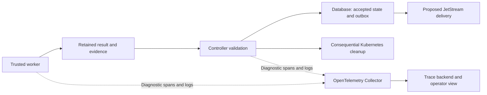

# Observability and lifecycle events

Research snapshot: 11 October 2026, application source at commit
`1f4e03a44e3217d6e3cf14b9848096e0ca03c8ac`. This is a proposed approach;
OpenTelemetry integration was not implemented or exercised.

Add OpenTelemetry tracing alongside the [event architecture research](control-plane-events.md).
Durable results and accepted transitions establish what happened and authorize
the next action. Telemetry explains execution paths, elapsed time and failures.
Tracing can improve diagnosis before introducing a message broker.

## Responsibilities and authority

| Signal | Question it answers | Role in Orchestrator |
| --- | --- | --- |
| Durable command/result/domain event | What was requested, reported and accepted? | Frozen identity, validated outcomes, recovery and dependent actions |
| Trace and spans | Which operations ran, how were they connected, and where was time spent? | Diagnosis across API, controller, worker and provider calls |
| Structured logs | What safe detail was recorded at this point? | Correlated errors and diagnostic context |
| Metrics | How often, how slow, and how much is waiting? | Aggregate health, trends and alerts |
| Kubernetes observation | Does execution exist, fail or stop? | Infrastructure availability, failure investigation and replacement safety |

An OpenTelemetry *span event* is a timestamped annotation inside a trace. It
does not provide the durable lifecycle contract proposed for worker results.
The same accepted outcome can appear in both forms, with telemetry referencing
its durable event identity. [OpenTelemetry traces](https://opentelemetry.io/docs/concepts/signals/traces/).

Telemetry can be sampled or lost through bounded queues, exporter failures and
retention. Neither a successful span nor receipt by a Collector establishes
accepted task completion. Trace absence does not establish execution failure.
Control-plane decisions must remain valid during a telemetry outage.
[Sampling](https://opentelemetry.io/docs/concepts/sampling/),
[Collector resiliency](https://opentelemetry.io/docs/collector/resiliency/).

## Existing implementation

The shared [observability library](../backend/libs/observability/src/lib.rs#L24)
initializes JSON `tracing` logs, includes span context and emits span-close
records. Its [process span](../backend/libs/observability/src/lib.rs#L60) accepts
bounded task, attempt, preparation, stage, Job, provider and model fields.
This is process-local diagnostic context; it does not propagate distributed
OpenTelemetry context.

The [gRPC boundary](../backend/servers/control-plane/src/adapters/grpc/mod.rs#L215)
records request identity, completion status and latency. [Worker activity](../backend/workers/runtime-worker/src/coding/activity.rs#L42)
records stages and failure classifications. The [metrics endpoint](../backend/servers/control-plane/src/process/metrics.rs#L51)
exposes bounded gRPC and runtime-failure counters. The [local chart](../dev/charts/ayni-orchestrator-local/values.yaml#L196)
already configures a Prometheus datasource in Grafana.

The audited [workspace dependencies](../Cargo.toml#L59) contain `tracing` and
`tracing-subscriber`, with no OpenTelemetry SDK, OTLP exporter or tracing bridge.
Existing generic errors and discarded subprocess output remain information
gaps; installing an exporter alone cannot recover their missing detail.

Instrument trusted worker supervision of subprocesses to expose their duration,
exit and diagnostic classification. Internal child-process steps require their
own instrumentation. Neither Kubernetes observation nor an OpenTelemetry
exporter automatically explains arbitrary repository processes.

## Separate execution and telemetry paths

JetStream would transport application contracts under their own durability and
acknowledgement rules. OTLP would export diagnostic signals to the Collector.
Keep these pipelines independent; telemetry export failure must not consume a
runtime retry budget or prevent result acceptance, publication or cleanup.

## Correlation across asynchronous work

Retain task, attempt, operation/preparation and physical execution-generation
identities in events, evidence and telemetry. Add event and causation identities
to the proposed durable envelope. Trace/span IDs provide diagnostic links;
they must not become idempotency keys, admission authority or execution fences.

Propagate W3C `traceparent` and optional `tracestate` through request metadata,
trusted worker launch inputs and future message headers. Persist the relevant
creation context alongside durable intents so reconciliation can link work after
a restart. Context is optional and untrusted; malformed or missing trace context
must not invalidate an otherwise valid application result.
[Context propagation](https://opentelemetry.io/docs/concepts/context-propagation/).

The proposed [CloudEvents contract](cloudevents-contract.md) retains originating
trace context in event extensions. Protocol headers can describe individual
delivery hops; the immutable event keeps its original context.

Use bounded spans for API handling, each useful reconciliation operation, worker
stages, provider calls, result acceptance and cleanup. Start new spans for retries
and resumed execution, linking them to the originating work. Avoid one open span
covering days of review or the control-plane process lifetime. Messaging span
links support asynchronous, batched and independently consumed work.
[Messaging conventions](https://opentelemetry.io/docs/specs/semconv/messaging/messaging-spans/).

## First instrumentation targets

| Flow | Useful spans and measurements | Durable fact kept separately |
| --- | --- | --- |
| Runtime preparation | Discovery, build, publication, readback, verification and report writing | Candidate/digest identity, evidence acceptance and retry eligibility |
| Coding task | Checkout, model calls, tools, full check, repair, finalization and publication | Independent execution, quality and publication outcomes |
| Result ingestion | Evidence reads, validation, database commit and future consumer acknowledgement | Accepted/rejected result and dependent intents |
| Recovery and cleanup | Recovery eligibility, delete request, stop observation and cleanup retry | Fencing, cancellation/deadline precedence and retained cleanup state |

For the verification issue, instrument Ayni execution, artifact validation and
report serialization separately. Record safe error class and report byte count;
retain detailed diagnostics outside Pod lifetime. This can distinguish a failed
check from failed reporting. The existing [4 KiB report limit](../backend/workers/runtime-worker/src/main.rs#L138)
is a source-level finding, not a proven diagnosis of the historical attempt.

Use histograms for stage duration and observation/acceptance delay; counters for
classified failures and physical executions; gauges for queue age and cleanup
backlog. Task/attempt IDs belong in traces and logs, rather than metric labels.
Heartbeat age and time since meaningful progress require separate measurements.

## Integration and operational boundaries

Extend the shared Rust subscriber with `tracing-opentelemetry` and an OTLP trace
exporter, preserving the existing JSON log output. The bridge does not export
logs automatically; retain stdout collection or deliberately add a log exporter.
Pin compatible crates and test shutdown/flush behavior for short-lived Jobs.
[Tracing bridge](https://docs.rs/tracing-opentelemetry/latest/tracing_opentelemetry/).

For the requested CNCF direction, use an OTLP Collector and Jaeger as the proposed
tracing path, retaining existing Prometheus metrics. Jaeger is a
[CNCF Graduated project](https://www.cncf.io/projects/jaeger/).
Its [all-in-one setup](https://www.jaegertracing.io/docs/2.22/getting-started/)
provides a local evaluation path with transient in-memory storage. Production
retention, storage and availability need a separate deployment decision.

Initially retain all traces for the selected low-volume diagnostic flows, within
explicit resource limits. Sampling can later favor failed or slow traces; it must
never sample away durable outcomes. Export asynchronously with bounded buffers,
timeouts and a bounded shutdown flush. Abrupt Pod loss can leave traces incomplete.

Trusted supervisors emit telemetry using allowlisted metadata. Preserve existing
redaction and content boundaries: prompts, repository content, command payloads
and credentials do not enter telemetry by default. Trace context never grants
repository processes authority to publish lifecycle results. Validate collector
outage, worker interruption and restart without changing application decisions.
