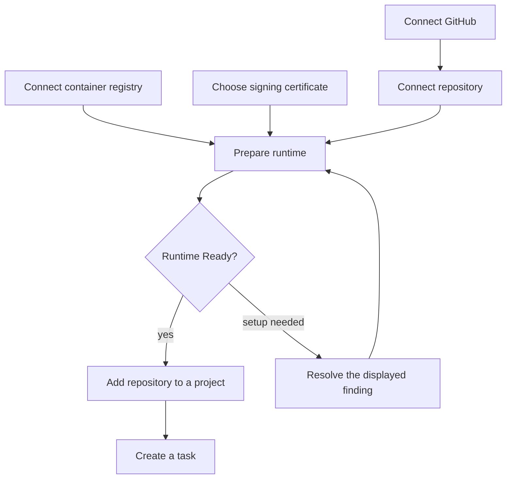

# Get started

Open your Ayni Orchestrator deployment. You can configure integrations before
model access is available; model-backed tasks need that access before they can start.
If you do not have a deployment, ask the person managing your installation to provide one.

## Connect GitHub

In **Config → Source control → GitHub**, create a GitHub App or import an existing
App. Install it on the repositories you want to use. GitHub controls the App's
ownership and installation permissions.

An integration marked **Managed by your administrator** is read-only. Ask your
deployment administrator to change it.

## Connect a container registry

In **Config → Container registries → GitHub**, add a GHCR connection. Provide its
image namespace, a push token and a separate pull-only token. Wait for the access
tests, then select the connection in your repository runtime's **Edit** dialog.
A cleanup warning is reported separately from push and pull access.

## Choose a signing certificate

Open **Config → Ayni**, then its **Certificates** card. Generate or import a
certificate. The first valid certificate becomes the default; runtimes can follow
that default or select another enabled certificate.

## Connect your repository

Open **Repositories → Connect repository** and choose a repository the GitHub App
can access. Enable **Use Ayni** to prepare its runtime, and select a ready registry
connection or **Configure later**. For an existing repository without Ayni enabled,
use **Set up Ayni** on its detail page.

Commit the repository's `.ayni.toml` and `.ayni.lock` using the
[Ayni CLI](https://cli.ayni.build/getting-started/quickstart). Resolve the findings
shown by **Analyze repository**, and review any certificate-trust pull request.
Setup changes require the repository owner's review.

When the runtime is **Ready**, [add it to a project and create a task](projects-and-tasks.md).
