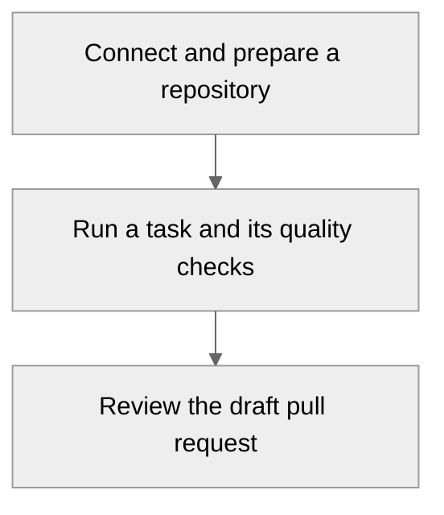
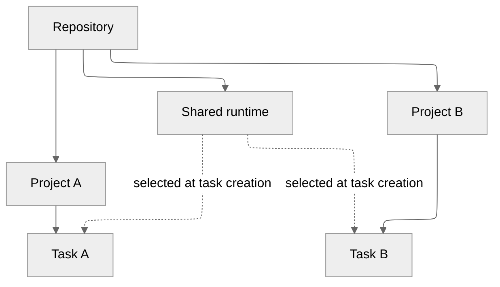

# Ayni Orchestrator

Turn a development request into a reviewable pull request. Connect a repository,
prepare its Ayni environment, and give a task a clear goal. Ayni Orchestrator
runs the work, checks the result and creates a draft for you to review.

## What you can do

- [Get started](getting-started.md): connect source control, a registry and a signing certificate.
- [Prepare a repository](repositories-and-runtimes.md): understand runtime readiness and repairs.
- [Run a task](projects-and-tasks.md): organize projects, write instructions and set limits.
- [Read results](results-and-recovery.md): understand quality and recover a failed delivery.
- [Understand trust](trust-and-quality.md): distinguish environment certification, checks and approval.
- [Troubleshoot](troubleshooting.md): choose the next action when setup or execution stalls.

## How repositories and projects fit together

Projects organize work. The repository owns its runtime, so preparing one runtime
makes it available to every project using that repository. Each task keeps the
source, runtime and limits selected when it was admitted.

The current task works on one repository with an Ayni Managed runtime. Custom
runtimes and coordinated tasks across repositories are not available yet.
[Ayni CLI documentation](https://cli.ayni.build) covers local environment and quality commands.
