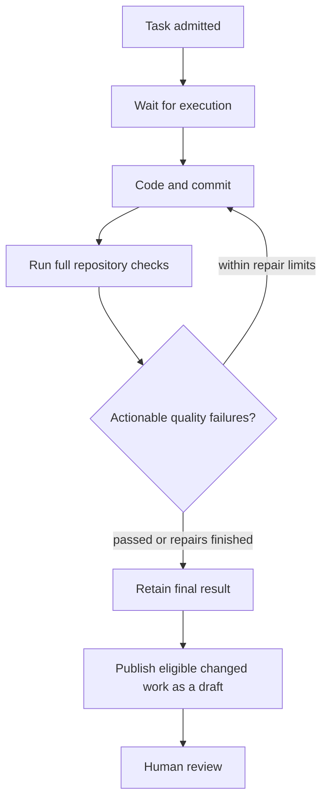

# Projects and tasks

A project groups repositories around a purpose. Add a connected repository to a
project, then create a task using one of its **Ready** runtimes.

## Describe the work

Give the task a concrete request and acceptance criteria that describe observable
results. Choose an available model, decide whether test edits are allowed, and
identify any protected files or directories. Ayni policy and lock files remain protected.

| Setting | Meaning |
| --- | --- |
| Agent iterations | Total model turns across implementation and quality repairs; default 24, range 1–128 |
| Deadline | Time available for queueing, work, checks and publication; default one hour |
| Acceptance criteria | Guidance for the task; mandatory repository checks still run |
| Protected paths | Exact repository-relative files or directory prefixes, not globs |

The task keeps its chosen source, runtime, model and limits. Later deployment or
runtime changes do not rewrite those choices.

## Follow execution

Open task details to see **Progress**, **Quality** and **Pull request**. Each attempt
shows its activity, usage and consumed limits. Measurements that are unavailable
remain unavailable rather than appearing as zero.

A draft can contain failed or unavailable quality, disclosed in its results.
Unsafe changes, cancellation, admission failures and no-change outcomes do not
publish a draft. Ayni Orchestrator does not merge pull requests automatically.

Use [results and recovery](results-and-recovery.md) to choose between a new attempt,
publication retry or cancellation. Tasks that change the Ayni environment and
coordinated work across multiple repositories remain future capabilities.
