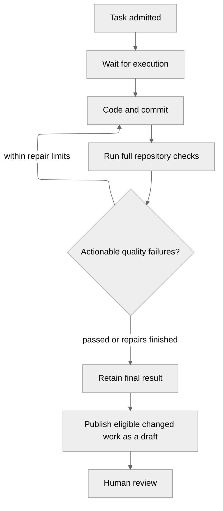

# Projects and tasks

A workspace brings together connected repositories and shared agent settings.
Create a project in a workspace, give it a goal, and select the repositories it
needs. Several projects can share a repository and its runtime. Then describe work
in a project conversation or create a task using one of its **Ready** runtimes.

Existing projects keep their repositories, conversations and tasks in an
automatically assigned workspace. Archiving a workspace blocks new work while
preserving project history and tasks already admitted.

## Choose a project view

| View | Use it to |
| --- | --- |
| Overview | Discuss the goal in a fixed-height chat above the current plan. Scroll the timeline to read messages, session details, and saved history. |
| Plans | Review saved plan versions, inspect the research run, and approve the exact tasks shown. Version links can be bookmarked. |
| Tasks | Follow project tasks and open their execution attempts, quality results, and pull requests. |

The selected conversation follows you between views. **Project settings** in the
project actions menu contains the goal and planning instructions, selected
repositories, and model overrides. Repository instructions such as `AGENTS.md`
remain in each repository.

Open the workspace link for **Shared configuration**: repository membership,
agent defaults, and the default planner idle timeout. Repository links lead to
shared runtimes; connection links lead to provider setup. Each settings form
shows saving progress and reports failures so you can retry.

## Work through a project conversation

Under **Config → LLM providers**, configure and test an OpenAI connection. In the
workspace settings, choose separate models for repository research and coding.
Projects inherit these settings and can override them in project settings.
Anthropic Claude and AWS Bedrock are shown as unavailable.

In **Agent capability profiles**, workspace settings can select instructions,
pinned skill revisions, tools, repository scope and budget ceilings for the planner
and worker. Project settings can narrow those selections and add project
instructions. Model choices remain separate. Leave inheritance enabled to use
workspace or application capabilities.

New research turns and tasks freeze their effective profiles. Inspect the frozen
revision in research-run details or task details. Later settings changes apply to
new work. If the worker profile changes before a plan is approved, request fresh
research and review the new plan. Instructions and skills cannot grant permissions;
never put credential values in them. The planner can read scoped source and prepare
proposals. Worker tools stay within the approved task and sandbox.

Start a conversation and choose the repositories it can research. Describe the
outcome you want. The project agent reads an immutable checkout and asks for missing
requirements. It cannot edit the checkout or execute repository code. Research can
begin before a coding runtime is ready; starting a task requires a ready runtime.

Review the plan's findings, scope, acceptance criteria, proposed tasks and dependency
or environment impact. Each revision keeps the earlier versions available. Expand
the proposed tasks to review each repository revision, runtime, coding model,
request, constraints and limits.

**Approve** starts all proposed tasks in the exact plan version shown. **Reject**
closes that version without starting work; **Request revision** closes it for
revision, then send a message describing the changes you want. A newer plan version
needs its own approval. If source or runtime identity changed, the plan explains
what needs refreshing; request new research before approving again. Dependency and
environment findings describe impact and do not authorize environment changes.

Conversations and task links survive reconnects and planner restarts. Use
**Saved planning context and history** to inspect the working summary and search earlier messages,
plan decisions and task outcomes. Search results preserve their original record
identities; the summary is an index of excerpts, so consult original records for
details. Decisions, unresolved questions and research references stay in the
conversation history.

The planner stays available between messages. Choose **5 minutes** or **24 hours**
in workspace settings to control how long it stays warm while idle; conversations
can inherit or override that choice. An active turn keeps its own deadline.
After idle expiry, send another message to resume with saved history. Session
details show its state and expiry. Use the planner's cancel action to stop an
active research turn; cancelling research preserves the conversation and its plans.

Approved plan cards link to tasks and their retained results. Task details link
back to the originating conversation and approved plan version, including after a
retry. **Worker updates** in that conversation show accepted progress, questions,
findings, changes, quality evidence and draft pull requests. Read execution,
quality and publication separately; a draft is not quality or merge approval.
Updates refresh without starting a planner turn. Earlier evidence remains searchable
in conversation history.

Choose **Discuss this question** to bring a worker question into the planner
conversation. Sending your answer requests a follow-up plan for review and fresh
approval; it does not resume the waiting attempt. Cancel or retry through task
details, or request the action in chat and confirm its action card.

One interaction prepares at most one task per repository. Tasks across repositories
run independently; coordinate dependent changes after reviewing the earlier result.
Plan approval validates all proposed tasks before admitting them together.

## Describe the work

Give the task a concrete request and acceptance criteria that describe observable
results. Choose an available model, decide whether test edits are allowed, and
identify any protected files or directories. Ayni policy and lock files remain protected.

| Setting | Meaning |
| --- | --- |
| Agent iterations | Total model turns across implementation and quality repairs; default 24, range 1–128 |
| Deadline | Time available for queueing, work, checks and publication; default one hour |
| Acceptance criteria | Guidance for the task; mandatory repository checks still run |
| Protected paths | Exact repository-relative files or directory prefixes, not globs |

The task keeps its chosen source, runtime, model and limits. Later deployment or
runtime changes do not rewrite those choices.

## Follow execution

Open task details to see **Progress**, **Quality** and **Pull request**. Each attempt
shows its activity, usage and consumed limits. Measurements that are unavailable
remain unavailable rather than appearing as zero.

A draft can contain failed or unavailable quality, disclosed in its results.
Unsafe changes, cancellation, admission failures and no-change outcomes do not
publish a draft. Ayni Orchestrator does not merge pull requests automatically.

Use [results and recovery](results-and-recovery.md) to choose between a new attempt,
publication retry or cancellation. Tasks that change the Ayni environment and dependency orchestration across
repositories remain future capabilities.
