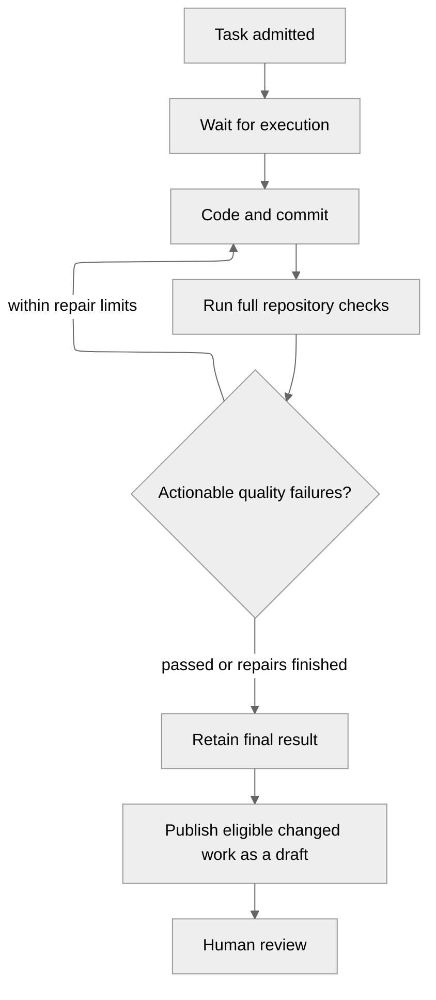

# Projects and tasks

A workspace brings together connected repositories and shared agent settings.
Create a project in a workspace, give it a goal, and select the repositories it
needs. Several projects can share a repository and its runtime. Then describe work
in a project conversation or create a task using one of its **Ready** runtimes.

Existing projects keep their repositories, conversations and tasks in an
automatically assigned workspace. Archiving a workspace blocks new work while
preserving project history and tasks already admitted.

## Work through a project conversation

Under **Config → LLM providers**, configure and test an OpenAI connection. In the
workspace settings, choose separate models for repository research and coding.
Projects inherit these settings and can override them in project settings.
Anthropic Claude and AWS Bedrock are shown as unavailable.

Start a conversation and choose the repositories it can research. Describe the
outcome you want. The project agent reads an immutable checkout, asks for missing
requirements, and prepares a task for each target repository. It cannot edit the
checkout or execute repository code. Research can begin before a coding runtime
is ready; starting a task requires a ready runtime.

Review the repository revision, runtime, coding model, request, acceptance criteria,
constraints and limits on the proposal card. **Approve** starts the exact task
shown; **Reject** discards the proposal, and a new message can request revisions.
If the source or runtime changed, refresh the proposal before approving it.

Conversations and task links survive reconnects. Task cards show progress and
results, with an automatic summary when an attempt finishes or needs your input.
A summary does not start further work. To cancel or retry, name the task in your
request and confirm the resulting action card. You can still use the task detail
page directly.

One interaction prepares at most one task per repository. Tasks across repositories
run independently; coordinate dependent changes after reviewing the earlier result.
A failed task submission does not undo another repository's admitted task.

## Describe the work

Give the task a concrete request and acceptance criteria that describe observable
results. Choose an available model, decide whether test edits are allowed, and
identify any protected files or directories. Ayni policy and lock files remain protected.

| Setting | Meaning |
| --- | --- |
| Agent iterations | Total model turns across implementation and quality repairs; default 24, range 1–128 |
| Deadline | Time available for queueing, work, checks and publication; default one hour |
| Acceptance criteria | Guidance for the task; mandatory repository checks still run |
| Protected paths | Exact repository-relative files or directory prefixes, not globs |

The task keeps its chosen source, runtime, model and limits. Later deployment or
runtime changes do not rewrite those choices.

## Follow execution

Open task details to see **Progress**, **Quality** and **Pull request**. Each attempt
shows its activity, usage and consumed limits. Measurements that are unavailable
remain unavailable rather than appearing as zero.

A draft can contain failed or unavailable quality, disclosed in its results.
Unsafe changes, cancellation, admission failures and no-change outcomes do not
publish a draft. Ayni Orchestrator does not merge pull requests automatically.

Use [results and recovery](results-and-recovery.md) to choose between a new attempt,
publication retry or cancellation. Tasks that change the Ayni environment and dependency orchestration across
repositories remain future capabilities.
