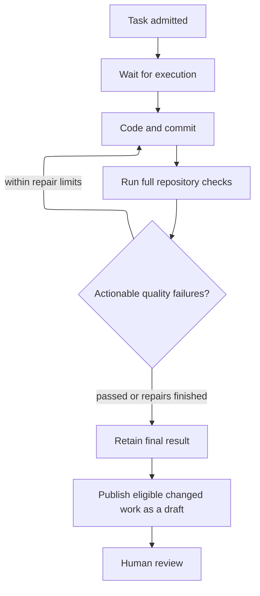

# Projects and tasks

A workspace brings together connected repositories and shared agent settings.
Create a project in a workspace, give it a goal, and select the repositories it
needs. Several projects can share a repository and its runtime. Then open
**Conversation**, describe the work, review the versioned plan, and approve its tasks.

Existing projects keep their repositories, conversations and tasks in an
automatically assigned workspace. Archiving a workspace blocks new work while
preserving project history and tasks already admitted.

## Choose a project view

| View | Use it to |
| --- | --- |
| Conversation | Read and send messages in the conversation. Load earlier messages when you need older history. |
| Plans | Review saved plan versions, inspect the research run, and approve the exact tasks shown. Version links can be bookmarked. |
| Tasks | Follow project tasks, worker questions, execution attempts, quality results, and pull requests. |
| Settings | Edit the project goal, repositories, agent models and capabilities, and the selected conversation’s planner timeout. |

The selected conversation follows you between views. Repository instructions such
as `AGENTS.md` remain in each repository.

Open **Workspaces** and choose a workspace. Its **Projects** view is the place
to create projects; the workspace is fixed during creation. **Repositories**
manages access to existing repository connections and links to shared runtimes.
**Settings** contains agent defaults and the default planner idle timeout.
Connect and prepare repositories through the global **Repositories** catalog. Each settings form
shows saving progress and reports failures so you can retry.

## Work through a project conversation

The sidebar's **Conversations** section lists history across the selected workspace,
with each conversation's project beneath its title. Select **New conversation**
to open a blank composer in the current project, or choose a project when
working from a workspace. Conversations inherit the project’s repositories.
Type your first message.
Press **Enter** to send and create the conversation; **Shift+Enter** adds a new
line. Titles use the first 30 characters of the message. Opening a blank composer
does not create a saved conversation. The sidebar shows the current project,
or **No project** outside a project. Without a selected workspace, creation
is disabled. Selecting a conversation opens its project's
**Conversation**; use **Plans** and **Tasks** to review the related work.

Under **Config → LLM providers**, configure and test an OpenAI connection. In the
workspace settings, choose separate models for repository research and coding.
Projects inherit these settings and can override them in project settings.
Anthropic Claude and AWS Bedrock are shown as unavailable.

In **Agent capability profiles**, workspace settings can select instructions,
pinned skill revisions, tools, repository scope and budget ceilings for the planner
and worker. Project settings can narrow those selections and add project
instructions. Model choices remain separate. Leave inheritance enabled to use
workspace or application capabilities. Each profile has its own form and save button.
Review the current and proposed values in the confirmation dialog before saving.
Returning to the form keeps your edits. If configuration cannot load, reload before
changing profiles or submitting work.

New research turns and tasks freeze their effective profiles. Inspect the frozen
revision in research-run details or task details. Later settings changes apply to
new work. If the worker profile changes before a plan is approved, request fresh
research and review the new plan. Instructions and skills cannot grant permissions;
never put credential values in them. The planner can read scoped source and prepare
proposals. Worker tools stay within the approved task and sandbox.

Start a conversation and choose the repositories it can research. Describe the
outcome you want. The project agent reads an immutable checkout and asks for missing
requirements. It cannot edit the checkout or execute repository code. Research can
begin before a coding runtime is ready; starting a task requires a ready runtime.

Review the plan's findings, scope, acceptance criteria, proposed tasks and dependency
or environment impact. Each revision keeps the earlier versions available. Expand
the proposed tasks to review each repository revision, runtime, coding model,
request, constraints and limits.

**Approve** starts all proposed tasks in the exact plan version shown. **Reject**
closes that version without starting work; **Request revision** closes it for
revision, then send a message describing the changes you want. A newer plan version
needs its own approval. If source or runtime identity changed, the plan explains
what needs refreshing; request new research before approving again.

For dependency updates that need a new environment lock, each proposed task lists
**Environment changes** with the exact dependency manifests and lockfiles. Approval
authorizes those files and regeneration of `.ayni.lock`. Quality policy and trust
settings in `.ayni.toml` remain protected. An impact assessment alone grants no
additional permission; request a revised plan for an unplanned environment change.

The worker proposes the change in a draft PR using its original runtime. When the
proposed lock differs from that runtime, full-check evidence is **Unavailable**:
the draft explains that the candidate environment has not been certified. Review
and merge the PR before repository reconciliation prepares the matching shared
runtime for future tasks.

Conversations and task links survive reconnects and planner restarts. Use
**Load earlier messages** in the conversation to read older discussion.

The planner stays available between messages. Choose **5 minutes** or **24 hours**
in workspace settings to control its idle timeout. The selected conversation can
inherit or override that choice under **Settings → Conversation settings**.
After idle expiry, send another message to resume with saved history. The same
settings card lets you cancel an active research turn while preserving the
conversation and its plans.

Approved plan cards link to tasks and their retained results. Task details link
back to the originating conversation and approved plan version, including after a
retry. **Worker updates** in the **Tasks** tab show accepted progress, questions,
findings, changes, quality evidence and draft pull requests. Read execution,
quality and publication separately; a draft is not quality or merge approval.
Updates refresh without starting a planner turn. Earlier evidence remains searchable
in conversation history.

Choose **Discuss this question** to bring a worker question into the planner
conversation. Sending your answer requests a follow-up plan for review and fresh
approval; it does not resume the waiting attempt. Cancel or retry through task
details, or request the action in chat and confirm its action card.

One interaction prepares at most one task per repository. Tasks across repositories
run independently; coordinate dependent changes after reviewing the earlier result.
Plan approval validates all proposed tasks before admitting them together.

## Submit a task directly

For work whose inputs are already known, open the project actions menu and choose
**Submit task directly**. Select a ready runtime and coding connection/model, then
review the request, criteria, constraints and deadline before submitting. Test
edits start enabled and the default iteration budget is 24.

Direct submission authorizes those displayed inputs without creating a plan.
Its task details identify that it has no originating plan. The global **Task
history** page follows execution across projects; start new work within a project.
Old task-creation bookmarks lead to the project dialog or project selection.

## Describe the work

Give the task a concrete request and acceptance criteria that describe observable
results. Choose an available model, decide whether test edits are allowed, and
identify any protected files or directories. Ayni policy and lock files remain protected.

| Setting | Meaning |
| --- | --- |
| Agent iterations | Total model turns across implementation and quality repairs; default 24, range 1–128 |
| Deadline | Time available for queueing, work, checks and publication; default one hour |
| Acceptance criteria | Guidance for the task; mandatory repository checks still run |
| Protected paths | Exact repository-relative files or directory prefixes, not globs |

The task keeps its chosen source, runtime, model and limits. Later deployment or
runtime changes do not rewrite those choices.

## Follow execution

Open task details to see **Progress**, **Quality** and **Pull request**. Each attempt
shows its activity, usage and consumed limits. Expand **Worker activity** and an
entry’s **View interaction details** to review agent messages, commands, results,
errors, and provider reasoning summaries when available. Private reasoning is
unavailable. Credentials are redacted; oversized entries and omitted earlier
history are identified. Older attempts may contain only stage labels. Measurements that are unavailable
remain unavailable rather than appearing as zero.

A draft can contain failed or unavailable quality, disclosed in its results.
Unsafe changes, cancellation, admission failures and no-change outcomes do not
publish a draft. Ayni Orchestrator does not merge pull requests automatically.

Use [results and recovery](results-and-recovery.md) to choose between a new attempt,
publication retry or cancellation. Tasks that change the Ayni environment and dependency orchestration across
repositories remain future capabilities.
