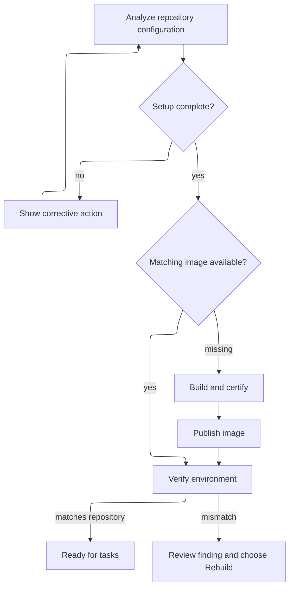

# Repositories and runtimes

A repository connection gives Ayni Orchestrator access to source. Its runtime
provides the tools and dependencies needed to work on that source. A connected
repository can still need runtime setup before tasks can start.

Connect repositories in the global **Repositories** catalog. Add an existing
connection from a workspace’s **Repositories** view to make it available to that
workspace’s projects. Connections and runtime configuration are shared across
workspaces; removing workspace membership retains the connection and history.

## Registry connection status

Registry details separate **Current credentials** from **Last test results**. Passing
results describe the last probe; they do not confirm current access when the
connection is unavailable or being checked. If configured credential Secrets
become unavailable, the controller rechecks automatically. Restoring the same
verified credentials restores readiness; changed credentials require a new probe.
**Cleanup required** is separate: a temporary test image could not be deleted.

## Prepare a runtime

A missing image is built automatically after a successful registry lookup.
Access failures and outages need repair before that lookup can establish whether
an image is missing. Successful builds publish, then undergo separate verification.

A runtime becomes **Ready** only when its environment matches the repository's
configuration, platform and selected certificate. Existing mismatches require an
explicit **Rebuild**; rebuilding cannot bypass missing setup.

## Make changes

| Change | What happens |
| --- | --- |
| Source or committed environment changes | Future tasks wait for the matching runtime to be verified |
| Registry selection changes | That runtime's new destination must be verified |
| Certificate selection or key changes | Review the proposed trust update, then wait for verification |
| A task was already admitted | It keeps its selected source, runtime and limits |

An approved task can update repository dependencies and regenerate `.ayni.lock`
when its plan includes that work. Review and merge its pull request as usual.
Periodic reconciliation observes the default branch, marks the shared environment
**Updating**, and prepares and verifies the matching runtime. A matching image
can be reused; a missing image is built. New tasks in every project sharing the
repository wait for verification. The task that proposed the change keeps its
original runtime.

Use **Analyze repository** to inspect setup, **Sync** to reconcile source, and
**Rebuild** when you explicitly want to replace a mismatching image. Findings
stay visible until resolved; stale background work cannot restore an older selection.

## Share or remove a repository

Several projects can use the same repository runtime. A runtime change affects
future work in all of them, while their existing tasks keep their admitted inputs.

Removing a repository clears its local connection and runtime records. It keeps
GitHub content, registry images, integrations and certificates. Project references,
retained tasks or active preparation can block removal; review those dependencies
before confirming the repository name in the removal dialog.
