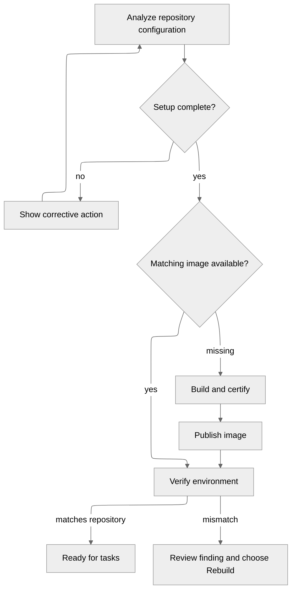

# Repositories and runtimes

A repository connection gives Ayni Orchestrator access to source. Its runtime
provides the tools and dependencies needed to work on that source. A connected
repository can still need runtime setup before tasks can start.

## Prepare a runtime

A missing image is built automatically after a successful registry lookup.
Access failures and outages need repair before that lookup can establish whether
an image is missing. Successful builds publish, then undergo separate verification.

A runtime becomes **Ready** only when its environment matches the repository's
configuration, platform and selected certificate. Existing mismatches require an
explicit **Rebuild**; rebuilding cannot bypass missing setup.

## Make changes

| Change | What happens |
| --- | --- |
| Source or committed environment changes | Future tasks wait for the matching runtime to be verified |
| Registry selection changes | That runtime's new destination must be verified |
| Certificate selection or key changes | Review the proposed trust update, then wait for verification |
| A task was already admitted | It keeps its selected source, runtime and limits |

Use **Analyze repository** to inspect setup, **Sync** to reconcile source, and
**Rebuild** when you explicitly want to replace a mismatching image. Findings
stay visible until resolved; stale background work cannot restore an older selection.

## Share or remove a repository

Several projects can use the same repository runtime. A runtime change affects
future work in all of them, while their existing tasks keep their admitted inputs.

Removing a repository clears its local connection and runtime records. It keeps
GitHub content, registry images, integrations and certificates. Project references,
retained tasks or active preparation can block removal; review those dependencies
before confirming the repository name in the removal dialog.
