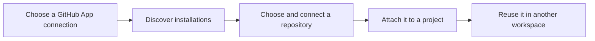

# Connect a repository

Connect a GitHub repository once, then attach it to projects in any workspace.
This local operator flow establishes source access and supports exact-commit static
Ayni inspection. With a configured Kubernetes runtime profile, you can also
prepare and verify an immutable runtime image.

## Connect source access

1. In **Configuration → Source control → GitHub**, save and validate an existing GitHub App connection.
2. Install that App on the GitHub account that owns your repository, with **Contents: read** permission and access to that repository.
3. Open **Settings → Repositories** in the sidebar, expand **Find repositories on GitHub**, and choose the source connection.
4. Choose **Discover installations**, select the owning account, then choose **Discover repositories**.
5. Choose **Connect repository** for the repository you want to use.

Available repositories appear as compact cards, like projects. Open a connected
repository card to see its **Source code** and **Ayni runtime** tabs. The card’s
three-dot menu also opens either tab directly.

**Source code** shows the GitHub connection and configuration status. Expand
**Source integration details** for GitHub IDs and connection time. Connected source
access does not mean a runtime is ready or a task can execute.

## Use it from a project

The current UI attaches catalog repositories directly. Alpha will add workspace
repository availability so projects select a subset; that restriction is not yet
enforced. See [the planned workflow](alpha.md).

Open **All workspaces**, choose a workspace card, then choose **Repositories** from the project card’s three-dot menu. Select a
catalog repository and choose **Attach repository**. Repeat this in another
workspace to reuse the same repository without sharing conversations or credentials.

## Recover a failed or interrupted check

Expand **Connection history** on the repository list to see the source-access stage, its safe failure reason and the
operation identity. An unavailable or rate-limited GitHub check can resume through
**Resume source check**. If the browser loses a save response, **Recover status**
reads its retained result; **Retry same connection** retries the exact selection.

If you change or disable the source connection during a check, refresh and connect
again using the current configuration. Failed authentication requires correcting
the saved App connection or its installation access.

## Check runtime status

Open a repository card and choose **Ayni runtime**. The tab loads saved status
without starting a preparation. It shows the inspected commit, known setup issues
and the next step before the preparation form. Inspection findings include their
saved date and Ayni version. Choose **Recheck default branch** to resolve GitHub’s
current default branch and inspect its latest commit. Each click resolves the
branch again; cached repository metadata and a previously entered SHA do not
choose the commit. Preparation history and configuration are refreshed afterward.

If inspection is interrupted, recover or retry that exact request before another
recheck. Recovery keeps its original SHA even if the branch has advanced. A new
recheck creates a fresh request. You can still inspect a specific SHA explicitly
in the inspection form.

A ready result applies to the exact inspection and platform shown. It does not
establish readiness for another commit. Interrupted commands show receipt recovery;
failed preparations show their reason; pending cleanup and uncertain publication
remain separate from readiness. Deployment prerequisites are checked when a
preparation is requested.

## Inspect Ayni setup

Open a connected repository card, choose **Ayni runtime**, then **Inspect Ayni setup**. Paste the full lowercase
commit SHA from GitHub, and choose **Inspect commit**. The result shows the exact
commit and next steps for missing or invalid inputs. Expand **Inspection technical
details** for policy and lock digests, locked tools and trusted public key IDs.

If the response is interrupted, reopen the repository’s **Ayni runtime** tab and choose **Recover inspection**. Use
**Retry same inspection** when GitHub becomes available again. A new commit needs
a new inspection; earlier results remain in history.

Static inspection does not start tasks or build images.

## Set up a signer

Open **Configuration → Runtime signing** and choose **Add signing key**. Enter a
name and Key ID. You can add multiple named keys and manage each one from the
list. Choose
**Generate a new key** to let the server create and store a private key, or
**Import an existing key** to paste or select a file containing the raw value of
`AYNI_ENV_CERTIFICATE_SIGNING_KEY`: 64 lowercase hexadecimal characters, with an
optional final newline. Do not include an environment assignment or quotes.

The server stores the key in an immutable signing Secret and returns its public
identity. Imported private material is cleared after submission and is never saved
in browser storage. Generated private keys are never returned to the browser.
If a response is interrupted, reload and choose **Recover signer setup**. Recovery
continues the same request. If an import needs material again, re-enter the same
seed; a different seed cannot replace that retained identity. If a rejected setup
has no receipt, correct its public name or Key ID and resume with the same recovery
key. An interrupted request must be recovered before starting another.

Expand **Repository trust policy** on the saved signer and copy its public entry
into the existing `environment.certificate.trusted_keys` configuration in
`.ayni.toml`, preserving other trusted keys. If it uses inline tables, edit that
configuration rather than adding a duplicate table. Commit the policy and regenerate
the lock with the supported Ayni version, then inspect that commit again. Signer
setup does not automatically trust the key or authorize a build.

Signer setup must be enabled by the deployment administrator. The advanced
**existing Secret reference** option remains available for a signing identity
already provisioned by an administrator. Disabling a signer prevents new use
without deleting its stored key. Deployment removal also retains signing keys;
ask the administrator to review any permanent cleanup separately.

## Prepare a runtime

Your deployment administrator must first enable a qualified Kubernetes runtime
profile. In **Configuration**, select a registry connection and set up a signer.
The committed repository policy must trust that signer.

On the repository, open **Runtime preparation**, select a completed inspection,
registry, signer and platform, and set the time/build allowance. Leave building
disabled to check an existing image. Enable building for a confirmed missing image;
replacing an invalid image requires the separate replacement choice.

The operation shows source, build, certification, publication, verification and
cleanup progress. **Ready** requires independent content and managed compatibility
checks plus completed cleanup. A connected repository or a successful build alone
does not establish readiness. Runtime compatibility is separate from whether the
repository's quality checks pass.

Reload to recover retained operations and exact save receipts. Cancel stops the
workload and cleans its resources. Retry preserves the original inputs and
allowance; change the inputs or allowance by starting a new operation. If publication
was interrupted, recovery reads back the intended image before trying another action.
Registry access failures are reported when registry operations execute; correct the
configured connection before starting a new operation when its credentials changed.

Verified runtime selection for project plans and tasks follows in the next slice.
