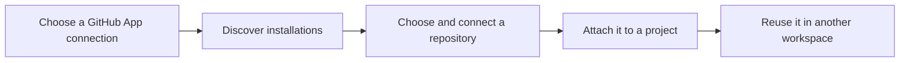

# Connect a repository

Connect a GitHub repository once, then attach it to projects in any workspace.
This local operator flow establishes source access. Ayni inspection and runtime
preparation are still planned.

## Connect source access

1. In **Configuration → Source control → GitHub**, save and validate an existing GitHub App connection.
2. Install that App on the GitHub account that owns your repository, with **Contents: read** permission and access to that repository.
3. Open **Settings → Repositories** in the sidebar and choose the source connection.
4. Choose **Discover installations**, select the owning account, then choose **Discover repositories**.
5. Choose **Connect repository** for the repository you want to use.

The shared catalog shows the repository identity, installation, default branch and
connection time. **Connected** records source access at that time; it does not mean
a runtime is ready or a task can execute.

## Use it from a project

Open **All workspaces**, choose a workspace card, then choose **Repositories** from the project card’s three-dot menu. Select a
catalog repository and choose **Attach repository**. Repeat this in another
workspace to reuse the same repository without sharing conversations or credentials.

## Recover a failed or interrupted check

Connection history shows the source-access stage, its safe failure reason and the
operation identity. An unavailable or rate-limited GitHub check can resume through
**Resume source check**. If the browser loses a save response, **Recover status**
reads its retained result; **Retry same connection** retries the exact selection.

If you change or disable the source connection during a check, refresh and connect
again using the current configuration. Failed authentication requires correcting
the saved App connection or its installation access.
