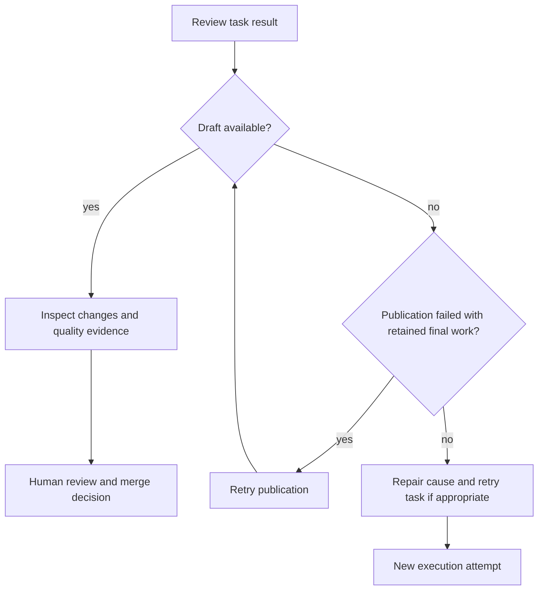

# Results and recovery

Read a task's execution, quality and publication results separately. Work can be
delivered as a draft even when quality checks fail, so review the evidence before
approving the change.

| Result | What to look for |
| --- | --- |
| Progress | Whether execution completed, failed, was cancelled or exceeded its deadline |
| Quality | Full repository-check outcome, completion counts and actionable findings |
| Pull request | Draft link, publication failure or an outcome where publication did not apply |

## Choose the next action

**Retry publication** uses the retained final work. It does not start another coding
session. If delivery cannot safely continue, such as when the remote branch has
conflicting changes, the result needs operator attention.

**Retry task** creates a new attempt. Use it when another execution is appropriate
after reviewing the previous result and repairing its cause.

**Cancel** stops active work. Cleanup can continue after a result appears; waiting
for cleanup does not change an already accepted quality or publication outcome.

## Read quality evidence

The full Ayni check covers the final source and commit. Focused checks help during
coding but do not replace that final check. If checks change publishable files,
the task must commit and check them again before finalizing evidence.

The draft discloses failed or unavailable checks. A quality report measures the
repository's configured tools and tests; it is one input to your review, alongside
the actual changes and [trust boundaries](trust-and-quality.md).
