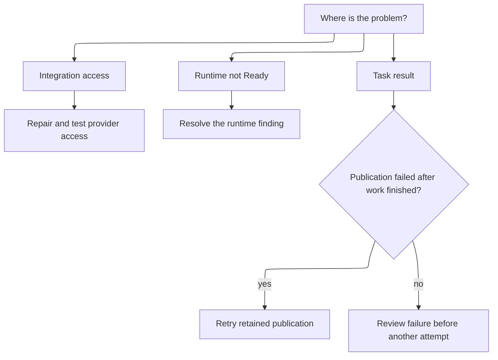

# Troubleshooting

Start with the finding on the affected repository, runtime or task. Repair its
cause before retrying, and keep the recorded result available for review.

## Setup and readiness

| Finding | Next action |
| --- | --- |
| GitHub access failed | Check App installation, repository access and connection status |
| Registry access failed | Repair push/pull access and rerun the connection tests |
| Registry cleanup warned | Inspect and retry cleanup independently of access tests |
| Policy or lock missing/incompatible | Commit supported Ayni configuration with the CLI |
| Certificate trust missing | Review and merge the linked trust-update PR |
| Existing environment mismatches | Inspect the finding, then explicitly choose Rebuild |
| Preparation exhausted its retries | Repair the cause, then use the explicit Retry or Rebuild action |

## Execution and delivery

| Result | Next action |
| --- | --- |
| Quality failed | Read the findings and inspect the draft if one was delivered |
| Quality unavailable | Investigate missing check evidence or infrastructure; do not read it as passed |
| Deadline exceeded | Review consumed limits and cause before submitting another attempt |
| Publication failed | Retry publication when retained final work is available |
| Conflicting remote branch | Ask an operator to resolve it; recovery must not overwrite it |
| Cleanup pending | Allow owned-resource cleanup to finish; contact the deployment operator if it stalls |

A deployment restart preserves admitted work and retained results. Avoid deleting
retained data or credentials to make a retry appear successful. Contact your
deployment operator for infrastructure failures, inaccessible administrator-managed
integrations or recovery that needs stored data inspection.
