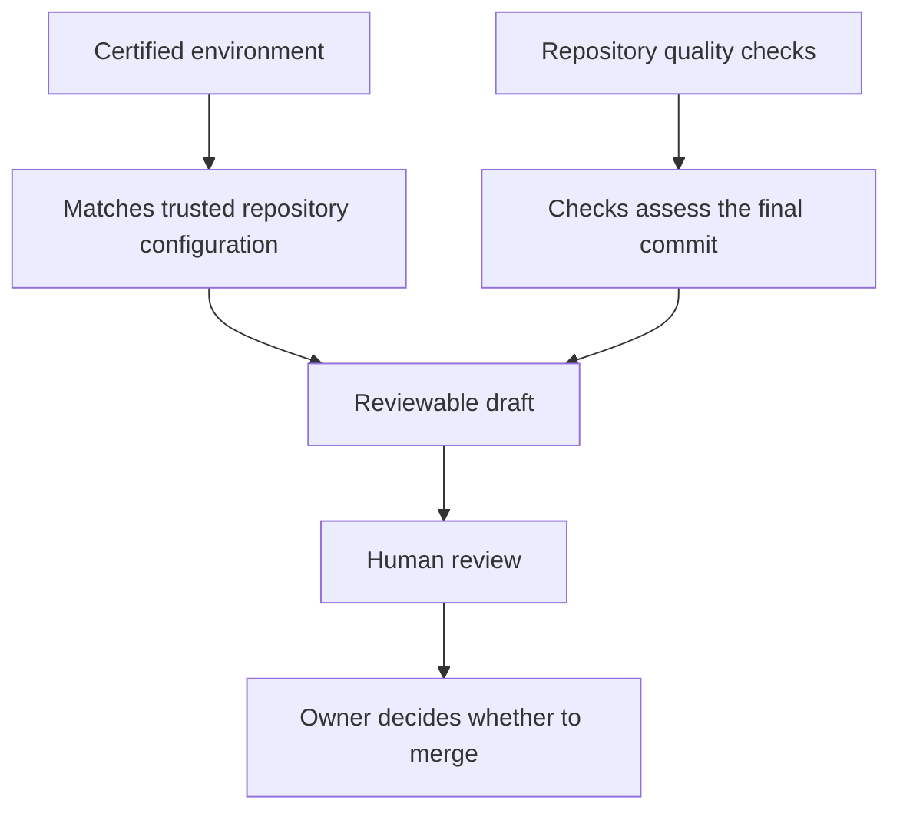
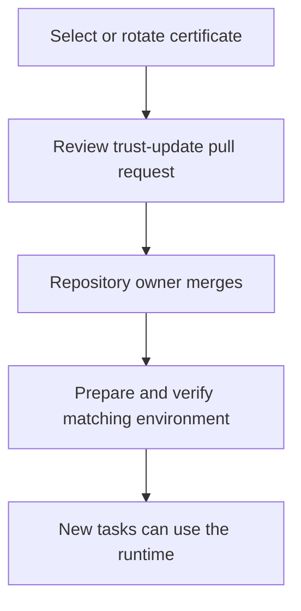

# Trust and quality

Environment certification, repository checks and merge approval answer different
questions. Review each before relying on a delivered change.

| Evidence | What it establishes |
| --- | --- |
| Verified runtime | Expected environment identity, trusted certificate and compatible tools/platform |
| Final quality report | Results for the selected repository policy and final commit |
| Draft pull request | A delivered change ready for inspection |
| Merge approval | Your repository's authorized review decision |

A certificate covers the environment's protected content. Tests and checks assess
editable source according to repository policy; their coverage and assertions
matter. A later commit needs its own evidence.

The task's commands and tests run in a restricted workspace. Final evidence is
retained outside their write access, and task code receives no environment-signing
key or registry-push credential. Your deployment administrator remains responsible
for infrastructure access and isolation.

## Certificate changes

A changed certificate can make a runtime temporarily unavailable. Review the trust
update and wait for verification. Already admitted tasks retain their selected image.

Independent assessment under separate authority is a planned capability. The
current worker's checks and any repository CI should be evaluated under your own
review policy; this documentation does not claim independent assessment or regulatory compliance.
