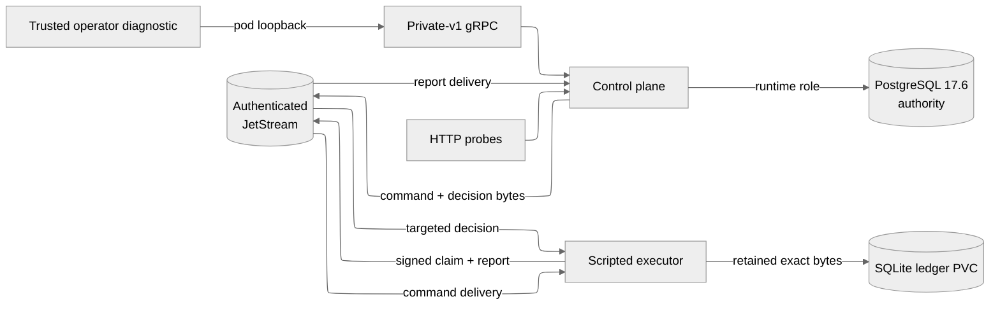

# M1 Slice 2 architecture

M1 Slice 2 extends the clean PostgreSQL workflow authority with authenticated durable delivery and one retained scripted executor. PostgreSQL decides admission, ownership, report acceptance, and visible conversation state. JetStream retains transport copies; no broker ACK independently changes application authority.

The complete M1 contract and later-slice boundary are defined in the [durable foundation contract](../research/project-workflow-m1-durable-foundation.md).

## Runtime boundary

The Kubernetes Service exposes HTTP only. Workflow gRPC binds to `127.0.0.1:50051` in the control-plane Pod. The executor has no listener, database credential, or Kubernetes API token.

## Canonical private-v1 surface

`ProjectService` supports `CreateWorkspace` and `CreateProject`. `ProjectConversationService` supports `CreateConversation`, `SendMessage`, `GetConversationSnapshot`, and `ListConversationHistory`. `WatchConversation` remains present but returns `UNIMPLEMENTED` until Slice 3.

There is no compatibility adapter for removed RPCs, SQLite workflow, browser/BFF path, or custom-client workflow listener.

## PostgreSQL authority

Repository-owned forward migrations live in `backend/servers/control-plane/crates/workflow-postgres/migrations`:

1. version 1 creates hierarchy, receipts, FIFO turns, activity/update projections, dispatch intents, exact command outbox bytes, snapshots, and history;
2. version 2 adds immutable signed-report receipts and exact targeted-decision bytes.

Startup takes a transaction-scoped advisory lock, validates contiguous history and every checksum, applies missing migrations, installs explicit runtime grants, and verifies a deterministic catalog manifest. The migration and runtime credentials are separate. Runtime has only the table/column/sequence/function privileges required by current transactions.

`SendMessage` commits its scoped idempotency receipt, user message, FIFO turn, activity/update, dispatch intent, and exact command event atomically. A broker storage ACK moves dispatch from `pending` to `stored`; only an accepted signed claim moves it to `transferred` and execution to `processing`.

The report consumer commits the immutable report receipt, acceptance or rejection decision, targeted decision outbox, and any accepted state change before its consumer ACK. An accepted terminal report inserts one assistant message, terminal state/activity, and the next FIFO command in one transaction. Promoted context contains the bounded newest predecessor records that fit plus the current user message, never later queued input.

## Durable transport and ownership

The isolated broker uses three file-backed `limits` streams:

| Stream | Publisher | Consumer | Local capacity |
| --- | --- | --- | --- |
| `ORCHESTRATOR_WORKFLOW_COMMAND_V1` | application outbox | scripted executor | 25,000 / 256 MiB |
| `ORCHESTRATOR_WORKFLOW_REPORT_V1` | executor ledger | application | 50,000 / 192 MiB |
| `ORCHESTRATOR_WORKFLOW_DECISION_V1` | application outbox | targeted executor and harness | 50,000 / 64 MiB |

Each uses `discard=new`, file storage, one local replica, seven-day age, a two-minute duplicate window, denied delete/purge, and a 260-KiB stored-message limit. `Nats-Msg-Id` derives from producer source plus event ID, but correctness does not depend on the broker duplicate window.

Anonymous access is disabled. Application, executor, acceptance, and administrative passwords are distinct. Subject ACLs prevent the executor from publishing decisions or reading PostgreSQL and prevent the application from consuming commands. The admin identity is unavailable to workloads.

The executor persists its instance identity, Ed25519 seed, exact command, and signed claim in a full-synchronous SQLite ledger before command ACK. It executes only after durably recording the matching targeted acceptance. Terminal bytes are retained before publication. A decision is committed locally before its delivery ACK; restart reconciliation uses the retained consumer sequence and server ACK floor.

## Read projections

`GetConversationSnapshot` uses repeatable read and returns recent messages, nonterminal turns, bounded terminal summaries, current activity, counts, a resume cursor, and a short-lived history snapshot ID. `ListConversationHistory` provides stable reverse pagination from that boundary. Pages are bounded at 100 records; expired boundaries return `HISTORY_SNAPSHOT_EXPIRED`.

Slice 2 diagnostics poll these authoritative reads. Notification-backed resumable streaming enters Slice 3.

## Failure and rollout model

PostgreSQL unavailability prevents a durable command receipt. Broker unavailability leaves accepted outbox work visible and pending without making database readiness false. Command ACK, report ACK, broker storage ACK, application decision, and targeted decision ACK remain separate boundaries.

Before any replacement admission, rollback may revert the runtime. After admission, preserve PostgreSQL, JetStream, and executor-ledger authority and repair forward. Return to Slice 1 only when no handoff is unresolved; otherwise intentionally reset the disposable namespace. Slice 3 adds quarantine, complete restart/capacity/version-skew acceptance, retention cleanup, metrics, and resumable watches.
