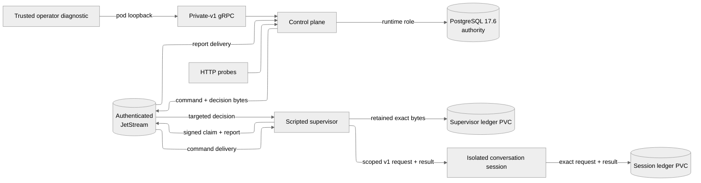

# Durable workflow architecture

The M1 runtime extends the clean PostgreSQL workflow authority with authenticated durable delivery and one retained scripted executor. PostgreSQL decides admission, ownership, report acceptance, and visible conversation state. JetStream retains transport copies; no broker ACK independently changes application authority.

The complete M1 contract and later-slice boundary are defined in the [durable foundation contract](../research/project-workflow-m1-durable-foundation.md).

## Runtime boundary

The Kubernetes Service exposes HTTP only. Workflow gRPC binds to `127.0.0.1:50051` in the control-plane Pod. The scripted supervisor has no listener or database credential. Its Kubernetes
service account can provision Pods, PVCs and scoped bearer Secrets only in the
dedicated session namespace. Session workers expose an authenticated internal
HTTP listener and mount only their own ledger and bearer Secret; they have no
broker/database credentials or Kubernetes API token.

## Configuration and session execution

The [conversation execution contract](conversation-execution.md) consolidates M2
configuration, isolation and recovery decisions. Workspace configuration has one
immutable revision ID covering instructions, desired provider/model, budgets and
idle policy. Admission freezes that revision; eligibility freezes bounded
conversation-only context references and a digest. All interfaces stay v1.

A trusted scripted supervisor owns broker claims and signed reports. It provisions
conversation-scoped Kubernetes workers with separate retained result ledgers.
The session workers have no PostgreSQL credential, broker credential or Kubernetes
API token. Session generation comes from PostgreSQL; replacement fences the old
generation only after admitted work and report handoffs have settled. Explicitly
enabled OpenAI sessions use the [provider request contract](provider-requests.md)
to retain sending intent, results, nullable usage and uncertain outcomes.

## Canonical private-v1 surface

`ProjectService` supports `CreateWorkspace`, `CreateProject`, `ListWorkspaces`, and `ListProjects`. `ProjectConversationService` supports `CreateConversation`, `SendMessage`, `GetConversationSnapshot`, and `ListConversationHistory`. `ListConversations` provides scoped bounded discovery. `WatchConversation` streams an atomic snapshot boundary or replays accepted updates strictly after a scoped cursor.

`ProjectService` also supports `GetAgentConfiguration`, `UpdateAgentConfiguration`,
`GetTurnInputs` and bounded `GetTurnContextInputs`. `ProjectConversationService`
exposes `ListConversationSessions`, idempotent `ReplaceConversationSession`,
`ListProviderCalls` and durable scoped `CancelTurn`.

There is no compatibility adapter for removed RPCs, SQLite workflow, browser/BFF path, or custom-client workflow listener.

## PostgreSQL authority

Repository-owned forward migrations live in `backend/servers/control-plane/crates/workflow-postgres/migrations`:

1. migration 1 creates hierarchy, receipts, FIFO turns, activity/update projections, dispatch intents, exact command outbox bytes, snapshots, and history;
2. migration 2 adds immutable signed-report receipts and exact targeted-decision bytes;
3. migration 3 adds bounded transport quarantine;
4. migration 4 adds retained watch watermarks;
5. migration 5 records broker storage sequences for targeted ACK reconciliation;
6. migration 6 retains detached wrong-scope and conflicting-report rejection decisions;
7. migration 7 records conservative broker capacity observations;
8. migration 8 freezes immutable workspace configuration and turn input revisions;
9. migration 9 retains conversation session generations and replacement receipts.

These ordinals are installation history within the v1 interface, not parallel
schema interfaces.

Startup takes a transaction-scoped advisory lock, validates contiguous history and every checksum, applies missing migrations, installs explicit runtime grants, and verifies a deterministic catalog manifest. The migration and runtime credentials are separate. Runtime has only the table/column/sequence/function privileges required by current transactions.

`SendMessage` commits its scoped idempotency receipt, user message, FIFO turn, activity/update, dispatch intent, and exact command event atomically. A broker storage ACK moves dispatch from `pending` to `stored`; only an accepted signed claim moves it to `transferred` and execution to `processing`.

The report consumer commits the immutable report receipt, acceptance or rejection decision, targeted decision outbox, and any accepted state change before its consumer ACK. An accepted terminal report inserts one assistant message, terminal state/activity, and the next FIFO command in one transaction. Promoted context contains the bounded newest predecessor records that fit plus the current user message, never later queued input.

## Durable transport and ownership

The isolated broker uses three file-backed `limits` streams:

| Stream | Publisher | Consumer | Local capacity |
| --- | --- | --- | --- |
| `ORCHESTRATOR_WORKFLOW_COMMAND_V1` | application outbox | scripted executor | 25,000 / 256 MiB |
| `ORCHESTRATOR_WORKFLOW_REPORT_V1` | executor ledger | application | 50,000 / 192 MiB |
| `ORCHESTRATOR_WORKFLOW_DECISION_V1` | application outbox | targeted executor and harness | 50,000 / 64 MiB |

Each uses `discard=new`, file storage, one local replica, seven-day age, a two-minute duplicate window, denied delete/purge, and a 260-KiB stored-message limit. `Nats-Msg-Id` derives from producer source plus event ID, but correctness does not depend on the broker duplicate window.

Anonymous access is disabled. Application, executor, acceptance, and administrative passwords are distinct. Subject ACLs prevent the executor from publishing decisions or reading PostgreSQL and prevent the application from consuming commands. The admin identity is unavailable to workloads.

The executor persists its instance identity, Ed25519 seed, exact command, and signed claim in a full-synchronous SQLite ledger before command ACK. It executes only after durably recording the matching targeted acceptance. Terminal bytes are retained before publication. A decision is committed locally before its delivery ACK; restart reconciliation uses the retained consumer sequence and server ACK floor.

## Read projections

`GetConversationSnapshot` uses repeatable read and returns recent messages, nonterminal turns, bounded terminal summaries, current activity, counts, a resume cursor, and a short-lived history snapshot ID. `ListConversationHistory` provides stable reverse pagination from that boundary. Pages are bounded at 100 records; expired boundaries return `HISTORY_SNAPSHOT_EXPIRED`.

`WatchConversation` selects the snapshot and its cursor in a repeatable-read transaction. Notifications wake readers; durable update rows supply ordered replay, including recovery after lost notifications. Cursor validation binds the conversation and fixed operator scope before lookup.

Replay deltas remain for seven days. Cleanup persists a per-conversation watermark before deleting expired rows. An older cursor returns `FAILED_PRECONDITION` with `WATCH_CURSOR_EXPIRED`; a cursorless watch returns the current snapshot. Slow readers receive `RESOURCE_EXHAUSTED`, while cancellation releases only observation resources.

## Failure and rollout model

PostgreSQL unavailability prevents a durable command receipt. Broker unavailability leaves accepted outbox work visible and pending without making database readiness false. Command ACK, report ACK, broker storage ACK, application decision, and targeted decision ACK remain separate boundaries.

Before any replacement admission, rollback may revert the runtime. After admission, preserve PostgreSQL, JetStream, and executor-ledger authority and repair forward. Return to Slice 1 only when no handoff is unresolved; otherwise intentionally reset the disposable namespace. The application quarantine stores malformed-event identity/digest evidence and exact bytes for valid unsupported versions. It deduplicates bounded identities and fails closed at its count or byte quota. Unsupported exact bytes survive until successful replay. Quarantine pressure is separate from PostgreSQL availability and appears in readiness. A terminal report that precedes its claim enters a bounded durable pending store; ordered reconciliation accepts it after ownership becomes authoritative. Wrong-scope and conflicting reports receive immutable targeted rejections without acquiring domain authority.

A bounded maintenance pass runs every minute. It compacts expired watch deltas and malformed quarantine diagnostics after their retention periods. Immutable domain records and unresolved handoff evidence remain authoritative. HTTP `/metrics` exposes safe process timing/counters and durable backlog projections; message bodies and credentials never become metric labels.

## Local browser access

The [contributor console](contributor-console.md) forwards an allowlisted local JSON/SSE surface to canonical pod-loopback gRPC. It owns no workflow authority or credentials.
