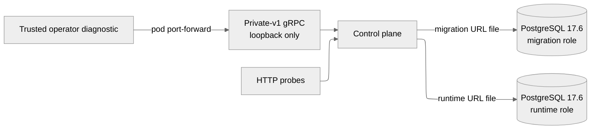

# M1 Slice 1 architecture

M1 Slice 1 is a clean replacement workflow foundation. It provides durable hierarchy creation, message admission, conversation snapshots, and bounded history. PostgreSQL is the only workflow authority.

The binding scope and later-slice boundaries are defined in the [durable foundation contract](../research/project-workflow-m1-durable-foundation.md). This page describes only the implemented Slice 1 runtime.

## Runtime boundary

The control plane exposes:

- `/healthz`, which reports process liveness without consulting dependencies;
- `/readyz`, which validates the current migration version and schema through the runtime database role;
- `ProjectService` and `ProjectConversationService` on `127.0.0.1:50051` inside the pod.

The Kubernetes Service exposes HTTP only. Workflow gRPC is intentionally absent from Services and custom-client listeners. Operators opt into diagnostic access with a pod port-forward.

## Canonical private-v1 surface

`ProjectService` supports `CreateWorkspace` and `CreateProject`.

`ProjectConversationService` supports:

- `CreateConversation`;
- `SendMessage`;
- `GetConversationSnapshot`;
- `ListConversationHistory`;
- `WatchConversation`, which is present in the canonical contract but returns `UNIMPLEMENTED` until Slice 3.

The reset has no compatibility adapter for removed RPCs. Browser/BFF callers, the old workflow owner, and its SQLite tests were deleted together.

## PostgreSQL authority

Repository-owned forward SQL migrations live in `backend/servers/control-plane/crates/workflow-postgres/migrations`. A startup init container takes a transaction-scoped advisory lock, checks contiguous migration history and checksums, applies version 1 once, and validates a deterministic catalog manifest covering workflow relations, columns, defaults, constraints, indexes, sequences, and functions. Future, missing, modified, extra, and malformed schema states fail closed. The init container mounts only the migration credential and must complete before the serving container starts.

Serving traffic uses a separate named runtime role. The local database bootstrap grants only connection and schema use initially; the migration runner removes blanket defaults, grants explicit DML on application tables plus required sequence/function use, and keeps migration history read-only. Runtime startup and readiness verify those privileges and reject schema-creation authority. The PostgreSQL administrator credential is never mounted into the control plane.

Every accepted command commits its receipt and authoritative mutation in one transaction. The receipt key is scoped by principal, method, parent, and idempotency key. An exact replay returns the original command ID, accepted time, resource IDs, revision, cursor, and presentation state. Reusing a key with a different request digest returns `IDEMPOTENCY_CONFLICT`.

`SendMessage` locks the conversation row before assigning FIFO turn, history, and conversation revisions. It atomically creates the user message, turn, activity, update, dispatch intent, and exact command-event outbox bytes. The nonterminal queue is bounded at 100 turns.

## Read projections

`GetConversationSnapshot` uses a repeatable-read transaction. It returns the recent message window, nonterminal turns, bounded terminal summaries, current activity, counts, a resume cursor, and a short-lived history snapshot ID.

`ListConversationHistory` uses that snapshot ID and boundary for stable reverse pagination. Pages are bounded at 100 records. Expired boundaries fail with `HISTORY_SNAPSHOT_EXPIRED`; the caller requests a new snapshot rather than silently changing views.

## Failure and rollout model

There is no SQLite import, dual write, old-schema migration, shared broker adaptation, or compatibility namespace. Before the first accepted PostgreSQL command, rollback means reverting the binary and chart. After admission, this disposable replacement slice rolls forward or explicitly resets its isolated namespace; an old runtime must never open the PostgreSQL workflow store.

JetStream delivery, executor ownership/results, resumable watch replay, providers, browser UX, and public/custom-client workflow access enter later slices. The retained feasibility harnesses do not make those paths production runtime behavior.
