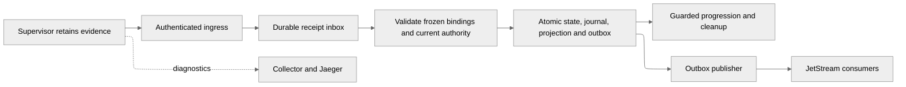

# Event platform

The supervisor retains result evidence before reporting it to the control plane.
Receipt, controller acceptance, broker delivery and physical cleanup are separate
states. Accepted application decisions remain valid during broker or telemetry outages.

## Implemented contracts

| Flow | Authoritative documentation |
| --- | --- |
| Runtime verification | [Verification events](../reference/verification-events.md) |
| Discovery, builder resolution, trust, build and publication | [Runtime operations](../reference/runtime-operation-events.md) |
| Coding progress, final results, usage and publication | [Coding events](../reference/coding-events.md) |
| Connections, certificates, repositories and projects | [Operator lifecycle facts](../reference/operator-projections.md) |
| Envelope identity and compatibility | [CloudEvents](../reference/cloudevents-contract.md) |
| Logs, metrics and trace propagation | [Observability](../reference/observability-and-events.md) |

Reporting authority is frozen at admission. Current event-selected executions
use authenticated reporting and retained evidence; reachable older generations
retain their original readers. A receipt or broker acknowledgement cannot grant
runtime readiness, source quality or permission for an external action.

SQLite owns acceptance and transactional outbox data. The local Helm chart
provides a bounded persistent JetStream lifecycle stream, outbox publisher and
verification cleanup consumer. Kubernetes watches accelerate reconciliation;
repair scans, provider readback and observed stopped writers preserve convergence.

## Operations and limits

Use [event compatibility](../operations/event-compatibility.md) for reader drain
and rollback boundaries, [operations](../operations/operations.md) for schema
upgrades, and [local development](../operations/local-development.md) for broker
recovery checks. The local single-instance topology does not establish production
availability. NATS replication does not make SQLite or the control plane highly available.

Separate coding, check and publication pods, independent assessment and a database
replacement require their own decisions. The [dated research](../history/event-platform/index.md)
records the original reasoning and source inventory, rather than current delivery status.
