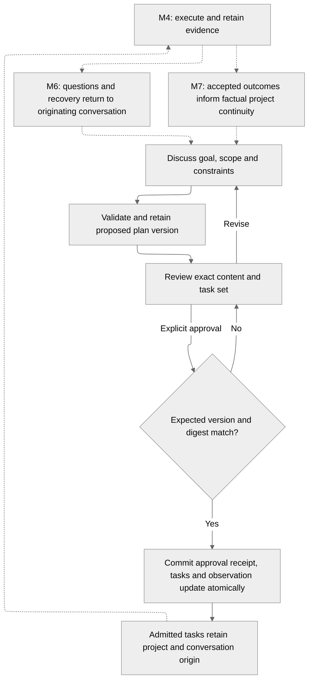

# Plans and approval

> UI status: the console and initial product workspace are removed. Browser steps
> and evidence below describe the retired UI and are historical reference only.
> Browser-dependent acceptance profiles are unavailable until replacement coverage
> is implemented. The current local API adapter is `dev/ctl gateway`; it serves
> no UI. See [the retained UI example](../../../examples/web/EXAMPLE.md).

Date: 2026-10-21. Status: M3 implementation contract; operator-authored review, agent proposals and approval/task admission are implemented. Final cumulative M3 acceptance remains planned.

| Term | Meaning |
| --- | --- |
| Plan | A conversation-owned proposal for a bounded set of changes. |
| Plan version | Immutable reviewed content, including the complete proposed task set. |
| Approval receipt | The retained result of authorizing one exact plan version. |
| Task | Admitted work with immutable scope and origin; distinct from an execution attempt. |

## What this decides

- The agent discusses scope, constraints and unresolved questions before proposing tasks.
- Users approve an exact immutable version through an explicit operator command.
- PostgreSQL records approval and the complete task set atomically, once.
- Every task retains its project and originating conversation for later feedback.
- M3 ends at admission. M4 executes tasks; M6/M7 close the feedback and learning loop.

## Why now

M2 provides durable conversations, isolated sessions and bounded provider execution.
M3 must turn that discussion into authorized work without losing its origin or changing reviewed scope.

The [durable plan review reference](plan-review.md) specifies the first slice’s exact content, limits, API and transaction semantics. The [agent proposal reference](agent-proposals.md) specifies the structured provider handoff and retained provenance. The [task admission reference](task-admission.md) specifies exact-version approval, receipt replay and task reads.

## How it works today

- PostgreSQL owns conversation state, scoped command receipts and frozen turn inputs.
- Retained provider results and signed reports survive interruption without resending uncertain paid calls.
- The console supports conversation review and resumable observation.
- Current tools read instructions, project status and conversation history; they cannot inspect repositories or approve work.

## The contract

Dashed edges are later delivery scopes. The [delivery plan](../research/project-workflow-m3-delivery-plan.md) defines implementation order and acceptance evidence.

### Ownership and frozen content

| Record | Required retained content |
| --- | --- |
| Plan | Server-assigned identity, workspace, project, originating conversation and current version reference. |
| Version | Plan identity, ordinal, predecessor, canonical content digest, author/provenance, objective, scope, constraints, unresolved questions and ordered task specifications. |
| Proposed task | Version-local key, objective, included/excluded scope, acceptance criteria, declared repository/source references, execution limits and explicit unresolved inputs. |
| Agent proposal | Originating turn, frozen configuration/context references, retained provider result and authenticated assignment/generation. |
| Approval | Operator identity, command identity, request digest, exact version/digest, timestamp and stable admitted task identities. |
| Admitted task | Workspace, project, originating conversation, plan, version/digest, approval receipt, proposed-task key and frozen specification. |

The server derives parent scope from the authenticated command or execution assignment.
Relational constraints enforce the complete ownership chain; model-supplied identities cannot widen it.
Ownership cannot be reassigned, and referenced records cannot be deleted while tasks or unresolved feedback need them.

Editing creates a new version with an expected current-version precondition.
Older content remains readable; only the current unapproved version is eligible for first approval.
M3 allows one successful approval per plan; further work uses a new, explicitly linked follow-up plan.
Approved plans reject further version creation.
Post-approval replacement and reconciliation of existing tasks require a later confirmed recovery contract.

### Discussion and proposal authority

The agent identifies assumptions and missing evidence in the conversation.
Open scope or acceptance questions block approval; unresolved execution prerequisites remain visible as execution blockers.
The console distinguishes declared repository references from verified source evidence.
M3 does not claim repository inspection or execution readiness from user-supplied names or commits.

Use a bounded structured proposal result, retained before signed reporting to the application.
Application validation creates the version; model text and tool calls cannot authorize approval.
Replaying the same accepted proposal creates one version; fenced or cancelled producers cannot create new versions.
Proposal failures remain visible without silently converting prose into tasks.

### Approval and admission

Approval supplies scope, idempotency key, plan identity, expected current version and exact content digest.
The transaction validates ownership, required content and bounds, then records the receipt, all tasks and the conversation update.
Uniqueness covers the plan approval and each approved version/task-key pair, including different-key approval races.
Failure admits no partial task set.

Receipt lookup precedes mutable precondition checks for an exact retry.
Same-key, same-content retries return the original receipt and task identities after restart or later state changes.
Changed content under the same key conflicts; another key cannot authorize a second admission for the plan.
Stale reviews require a fresh review; approval never means approval of whatever version is latest.

Tasks remain visibly admitted and awaiting execution capability in M3.
No coding command, worktree, provider call or publication is dispatched by approval.
M4 must verify and freeze missing execution inputs without silently changing approved scope.
Missing source verification, runtime selection or authorized execution budget blocks execution until resolved under the M4 contract.
Approval does not authorize merge or unrestricted repository access.

### Observation and feedback continuity

Extend canonical v1 snapshots, bounded reads, history and watch updates with plan and admission references.
Reconnect reconstructs accepted state; stream disconnect does not revoke approval.
The console keeps local edits separate from streamed versions and retains exact unresolved approval commands for retry.
Project indexing exposes scoped factual status without importing another conversation's plan into agent context.

| Later consumer | Contract inherited from M3 |
| --- | --- |
| M4 worker | Each attempt and report carries the immutable task origin; accepted authority derives from the task, not producer-supplied routing. |
| M6 attention/recovery | Route questions and failures to the originating conversation and project activity using one durable attention identity. A user answer supplies context; confirmed recovery authorizes changed work. |
| M7 assessment/continuity | Accepted outcomes and evidence inform factual project summaries. Originating agents may propose follow-ups; shared status never grants access to other transcripts or reasoning. |

Feedback distinguishes progress, findings, questions, execution failure, quality failure and publication failure.
Later report contracts bind stable report identity, task/attempt identity, writer generation and evidence references for deduplication and fencing.
Reports are observations until accepted by application authority; they cannot rewrite approved tasks.
Ordinary progress updates the UI without invoking the model; meaningful outcomes may trigger bounded, deduplicated assessment in M7.
M3 establishes correlation and retention requirements without adding feedback consumers or automatic learning.

## The plan

The [M3 delivery plan](../research/project-workflow-m3-delivery-plan.md) specifies four cumulative PRs: durable review, agent proposals, approval/admission and deployed acceptance.

## Whys

### Why retain both project and conversation?

The project groups shared factual outcomes; the conversation owns discussion and decisions.
Keeping both prevents later routing from depending on a live Pod, browser selection or inferred parent.

### Why only one approval per plan in M3?

Reapproving an edited task set requires deciding which existing tasks to retain, replace or cancel.
A linked follow-up plan keeps new authorization explicit until that recovery behavior is defined.

### Why use the existing control plane?

Plan approval needs one authoritative transaction beside conversation updates.
A separate planning service would add a consistency boundary without an independent deployment requirement.

## Where the detail lives

- [Roadmap](../../../ROADMAP.md): milestone boundaries and agreed product direction.
- [Conversation execution](conversation-execution.md): inherited isolation, frozen inputs, fencing and bounded authority.
- [Provider requests](provider-requests.md): retained results, budgets, cancellation and uncertain paid calls.
- [Design worksheets](../research/project-workflow-design-worksheets.md): research provenance for task feedback and project continuity.
- [M3 delivery plan](../research/project-workflow-m3-delivery-plan.md): code ownership, contract completion gates and failure scenarios.
