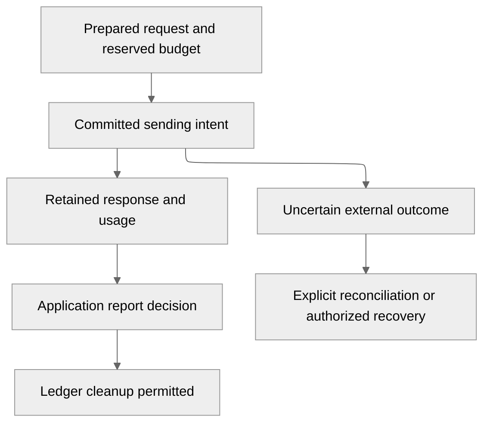

# Provider request contract

This is the provider safety mechanism required by the
[conversation execution contract](conversation-execution.md). It is a binding
entry contract for M2 PR 3, not a claim of implemented provider execution.
All Orchestrator-owned types and retained formats remain v1 through alpha.

## Provider selection

The initial provider is **OpenAI**. The repository already has a bounded OpenAI
client constructor in `backend/libs/providers`; retaining that boundary avoids
adding another provider or agent framework. It is evidence of client setup,
not evidence that M2 requests, persistence or cancellation work.

PR 3 uses an explicitly configured model with the Responses API, foreground
execution and `store: false`. Supply the frozen context on each call; do not use
provider conversation IDs or `previous_response_id` as conversation authority.
OpenAI documents both client-managed and provider-managed
[conversation state](https://developers.openai.com/api/docs/guides/conversation-state).
Choosing client-managed context is this project's isolation decision. The
adapter must prove request mapping with fixtures before the first live call.

### Provider guarantees

The initial adapter does not depend on provider create-request idempotency or a
provider cancellation guarantee. A client request ID is correlation, not proof
that retrying cannot charge twice. OpenAI documents polling and cancellation for
[background responses](https://developers.openai.com/api/docs/guides/background);
that does not establish cancellation of this foreground execution profile.
There is no automatic provider failover, model substitution or fresh request
identity after an ambiguous outcome.

## Request lifecycle

Before sending any paid request, durably retain:

- workspace/project/conversation, turn, assignment and executor generation;
- configuration revision, provider/model and bounded context digest;
- stable call ID, exact request digest and authorized input references;
- reserved input/output/total token allowance and its owning turn; and
- a prepared request state, followed by a committed sending state before network I/O.

### Retry and recovery

SDK, HTTP and worker automatic create-request retries must be disabled. A crash
between committing sending and retaining a response is conservatively uncertain,
even when the process might have crashed before sending bytes. If a complete
response was retained, recovery republishes its exact result instead of calling
the provider.

A definitive rejection may release a reservation only when the
adapter establishes that no generation was accepted. Rate limiting, timeout or a
connection error alone is not that proof.

### Results and usage

Retain the response identity, bounded result, reported model and nullable token
usage in the assigned session ledger before report publication. Missing usage is
unknown, never zero. Accepted usage settles the reservation once; unresolved
usage keeps its reservation charged against the turn budget. Exceeding the
remaining allowance prevents further calls.

Do not infer currency cost from unversioned price assumptions. The application
accepts a terminal result only
through the existing signed report/decision handoff. Cleanup waits for the
matching application decision.

## Cancellation

Cancellation is a durable scoped command with an idempotency receipt. Closing a
browser watch or a provider HTTP connection is not that command. The application
serializes cancellation with terminal acceptance so exactly one visible outcome
wins, while provider result/usage evidence remains factual.

| Request state | Cancellation result and recovery |
| --- | --- |
| Queued, no assignment | Prevent eligibility and later calls; record a terminal cancellation and advance FIFO. |
| Claimed or preparing, no sending intent | Fence further call admission, retain cancellation, and settle unused reservation. |
| Sending or in flight | Stop scheduling further calls and tools; request local interruption. Report cancellation requested, with external outcome unconfirmed until retained evidence resolves it. Do not promise remote revocation or refund. |
| Uncertain | Keep the request identity, reservation and recovery evidence. Cancellation suppresses future work but cannot declare the external call absent. Require explicit reconciliation or an operator-authorized new attempt that acknowledges possible duplicate cost. |
| Result retained, not accepted | Preserve result and usage. The application decision records whether terminal acceptance or cancellation won; replay never publishes a second assistant result. |
| Completed or cancelled | Replay the original receipt/outcome without new work. Cancellation cannot erase an accepted response or usage. |

Neither idle expiry, Pod loss nor automatic retry resolves uncertainty. Any
operator recovery action binds the exact call and observed evidence. Unknown
results remain visible with a safe reason and no raw provider error body.

