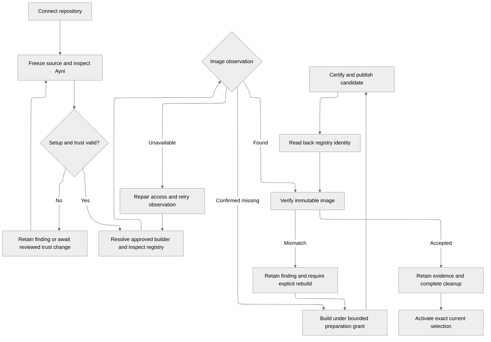

# Shared repository and runtime preparation

Status: shared repository discovery, catalog connection and project associations are implemented for the trusted local operator. Exact-commit static policy/lock/input/trust inspection is implemented; full adapter discovery, setup and runtime gates remain planned. See [integration connections](integration-connections.md) for the current source-access boundary.

## What this decides

- Repository integrations form a shared catalog alongside workspaces. Projects select repositories directly, including reuse across workspaces.
- Onboarding produces verified, immutable runtime artifacts through explicit source, tooling, trust, registry and execution gates.
- PostgreSQL owns commands, receipts, generations and accepted evidence. Scoped workers perform external operations under trusted supervision.
- The new UI ships with each backend slice. Maintainers can inspect and exercise each delivered journey locally.
- Historical `main` behavior informs the contract; its persistence, workers, API and UI are not restored as compatibility layers.

## Why now

The product journey needs a trusted way to prepare repositories and runtime images before tasks can use them.
Current local task preparation asks an operator to supply those inputs manually.
The [roadmap](../../../ROADMAP.md#next-focus-repository-preparation-with-a-usable-ui) makes replacing that manual gap the next focus.

## Current boundary

- Approved tasks retain repository/source declarations; those declarations are not verified source evidence.
- The trusted local helper verifies Git objects and lock bytes, while the operator supplies a runtime digest.
- Prepared attempts retain immutable inputs, but preparation does not establish image availability or compatibility.
- Isolated workers perform separate managed quality; coding, quality and publication remain independent outcomes.
- The local gateway serves APIs only. The new local product supports manual App connections, installation/repository discovery, a shared source catalog and project associations. Runtime preparation follows. The retained web example supplies design reference only.

## Ownership and records

| Record | Ownership and meaning |
| --- | --- |
| Integration connection | Shared source, registry or signing capability with safe status and PostgreSQL credential revision references. |
| Repository | Stable provider repository identity and source connection reference, independent of any workspace. |
| Project association | Explicit use of a catalog repository by one project; several workspaces' projects may reference the same repository. |
| Source observation | Exact repository commit, inspected policy/lock bytes or protected references, and their digests. |
| Environment revision | Immutable Ayni contract, lock identity, platform, builder, destination and trust expectations. |
| Preparation operation | Frozen inputs, bounded allowance, generation, stage, workload binding, receipts, findings and cleanup state. |
| Verified runtime artifact | Registry digest and accepted verification evidence bound to the environment revision and inspected source. |
| Attempt selection | Task-owned source, artifact and verification references, budgets and upstream selections frozen for execution. |

An association does not expose credentials, another project's history or integration administration.
Define local-operator grants before exposing mutations; remote tenancy and multi-user access remain separate scope.
Removing an association cannot erase retained task provenance or delete a shared repository.
Removal of catalog records requires dependency checks; external repositories and images need separate deletion authority.

## Preparation gates

| Gate | Required evidence or decision |
| --- | --- |
| Source access | Validate provider repository/installation identity and scoped read access. Connection success does not imply Ayni readiness. |
| Committed inputs | Inspect policy and lock from the same exact commit with bounded reads. Missing or malformed inputs retain corrective findings. |
| Ayni compatibility | Admit an explicitly supported CLI, lock/recipe and artifact contract. Resolve the official builder for that contract/platform and freeze its digest. |
| Full input validation | Use supported Ayni tooling for policy/lock consistency, runtime identity and certification. Parsing an envelope or fingerprint grants no readiness. |
| Configuration | Validate the chosen platform, isolated build capacity, registry destination and enabled signing certificate. Keep configured credentials separate from observed operation success. |
| Registry access | Check permissions during the actual discovery, build, push or independent pull operation. Do not publish a disposable test image. Show the failed stage and corrective action; an outage, denial or rate limit cannot become a missing-image result. |
| Repository trust | Validate the selected public signing identity against committed trust. If changes are needed, separately authorize a narrow PR and inspect the merged source again. |
| Image discovery | Resolve the candidate to an immutable manifest/platform identity. Confirmed absence permits an opted-in bounded build; an invalid existing image requires replacement authority. |
| Build/publication | Invoke Ayni's supported build/certification contract. Separate publication credentials and guard destination replacement; reconcile uncertain publication through readback. |
| Verification | Independently pull the exact digest, verify trusted certification and protected content, and bind fresh managed evidence to source, lock, platform and expected tooling. |
| Activation | Accept only the exact current generation and immutable digest binding. Retain verification before resumable cleanup; pending cleanup cannot appear ready. |

Runtime verification establishes environment compatibility, not passing source quality or merge approval.
A source-only change may reuse an image after applicable verification; a changed environment contract selects new preparation.
Keep desired revision, active verified artifact and historical readiness distinct.
New selection blocks new admissions until its gates pass, while existing attempts keep their frozen inputs.

## Authority and execution

Connection/read, automatic preparation, trust PR creation, replacement, task execution and task publication are separate grants.
Enabling Ayni preparation records explicit resource/time/retry bounds and the permitted registry destination.
General policy bootstrap and unrelated repository edits remain owner-reviewed work.
A retry recovers the same accepted operation; changed inputs or an additional allowance require a new authorized identity.

The control plane admits commands and accepts reports transactionally in PostgreSQL.
Supervisors provision and reconcile narrowly scoped workloads; workers have no database or broker credentials.
Freeze intent before external actions, authenticate workload/generation reports, fence cancellation and adopt only the exact owned workload after restart.
Transport selection follows this authority model; conversation messages do not become build commands.

Separate source-read, signing, push, pull and task-provider capabilities by stage.
Repository-controlled code must not receive signing or push authority through shared processes, volumes or a build engine.
Qualify a bounded build topology and its egress, scheduling, storage and cleanup before enabling it.
Historical privileged-engine deployment modes are research input, not an approved alpha default or proof of isolation.

The supported Ayni onboarding matrix must be qualified explicitly.
Historical `main` admitted 0.15.0; alpha's development CLI pin alone establishes no repository-builder compatibility.
Keep this integration in Orchestrator and consume Ayni's supported CLI/artifacts without reimplementing adapters or lock generation.

## Kubernetes runtime delivery prerequisite

Deliver preparation through Kubernetes supervisors with separate source, build,
certification, publication and verification workloads. The first build profile to
qualify is rootless Podman with an operation-local image store and `vfs` storage.
Qualification must establish user-namespace support, engine execution under the
selected seccomp/AppArmor policy, bounded storage/egress and reliable cleanup;
this profile is not qualified yet. No host engine socket or privileged fallback
is enabled when those requirements fail.

The builder explicitly selects `AYNI_OCI_RUNTIME=podman`, an exact executor
image digest and a matching Linux node architecture. Kernel and storage support
are deployment prerequisites; a rootless engine label alone is not isolation
evidence.

### Pinned Ayni boundary

Ayni 0.16.2 at
[`8eb4c7c8abcbd7ecb4bbda26e0140b58ffcfc6dc`](https://github.com/ayni-oss/ayni/tree/8eb4c7c8abcbd7ecb4bbda26e0140b58ffcfc6dc)
supports Docker and Podman engines. Its
[build implementation](https://github.com/ayni-oss/ayni/blob/8eb4c7c8abcbd7ecb4bbda26e0140b58ffcfc6dc/environment/src/runtime/engine.rs#L197)
assembles an image, runs inventory/validation containers, signs certification,
assembles the certified image and records its local image identity in one engine
workflow. The
[CLI build command](https://github.com/ayni-oss/ayni/blob/8eb4c7c8abcbd7ecb4bbda26e0140b58ffcfc6dc/cli/src/environment_backend.rs#L36)
can add a local tag; it does not publish to a registry. A BuildKit-only service
cannot replace the engine's image execution and inspection operations.

[Certificate creation and signing material](https://github.com/ayni-oss/ayni/blob/8eb4c7c8abcbd7ecb4bbda26e0140b58ffcfc6dc/environment/src/certificate.rs)
and the build inventory/finalization helpers are private implementation details.
Ayni correctly
[removes signing variables from child tools](https://github.com/ayni-oss/ayni/blob/8eb4c7c8abcbd7ecb4bbda26e0140b58ffcfc6dc/adapters/common/src/exec.rs#L428),
but the signing parent still shares an engine and lifecycle with repository-derived
build work. That does not satisfy this preparation contract's separate signing
stage. The public
[certificate types](https://github.com/ayni-oss/ayni/blob/8eb4c7c8abcbd7ecb4bbda26e0140b58ffcfc6dc/core/src/environment_certificate.rs)
and [content verifier](https://github.com/ayni-oss/ayni/blob/8eb4c7c8abcbd7ecb4bbda26e0140b58ffcfc6dc/environment/src/prebuilt.rs#L107)
provide useful contracts, but do not expose a complete independent certify/export
workflow. Orchestrator must not copy those private image semantics to close the gap.

### Standalone Ayni prerequisite

Add an independently useful staged image workflow in a separate Ayni PR, with
public fixtures and tests for local/offline signing and external builders:

- **Unsigned build/export:** preserve existing adapter discovery, lock checks,
  dependency preparation and executor validation; export an immutable OCI layout
  with a supported report binding the candidate to source, lock, platform, executor
  and tooling identities. Export grants no portable trust or runtime readiness.
- **Offline certify/finalize:** accept that immutable export and the reviewed
  policy/lock, independently inspect actual protected bytes and the expected Ayni
  executable, and produce the supported certificate, final OCI image and provenance
  report. This stage runs no repository commands and shares no engine, writable
  storage or processes with the builder. It must reject tampered exports and
  unsupported inputs before using signing authority.
- **Contract and recovery:** retain the ordinary local build workflow while
  exposing staged CLI/artifact contracts. Test unsigned export round trips,
  mismatched inputs, offline key handling, final digest readback and interrupted
  finalization. Keep Kubernetes and provider credential management in Orchestrator.

This improvement lets Ayni users build on one machine and certify offline on
another, without giving a build executor a signing key. Its scope and compatibility
must be accepted upstream before Orchestrator selects the resulting release.

### Workload and admission contract

| Workload | Authority and retained output |
| --- | --- |
| Source acquisition | Repository-scoped read access only; publish the complete frozen checkout and input digests before removing access. |
| Unsigned builder | Qualified rootless engine, frozen source and bounded dependency downloads; retain an immutable export. No signing or registry push credentials. |
| Certifier | Fresh isolated filesystem, immutable export and reviewed signer reference; independently inspect and finalize with the new Ayni contract. No repository execution, source credentials or registry push access. |
| Publisher | Final certified export and destination-scoped push credentials only; retain the registry digest and reconcile uncertain publication by readback. |
| Independent verifier | Separate pull capability, exact platform digest and frozen inputs; verify actual certification/protected content and applicable managed compatibility evidence. No signing or push access. |

Use the existing
[supervisor authority pattern](conversation-execution.md) and
[task isolation boundaries](task-quality.md) for operation generations, exact pod
UID adoption, deadlines and authenticated evidence. Implement resumable cleanup
for pods, temporary credentials and storage, and confirm it before admission.
The [integration foundations](integration-connections.md#runtime-preparation-foundations)
are configuration, discovery and content-verification building blocks; they do
not establish this executor or the staged Ayni contract.

Until the upstream contract and the Kubernetes profile pass deployment acceptance,
retain an actionable prerequisite failure and keep runtime preparation unavailable.
Missing user-namespace support, denied engine startup, unavailable credentials,
registry denial/outage, invalid existing images and pending cleanup cannot produce
readiness or silently select a different execution mode. Build remains limited to
confirmed absence under its grant; replacing an invalid image needs explicit
replacement authority.

## Task handoff and feedback

Trusted server-side preparation resolves the approved repository/ref through its project association.
It verifies exact Git objects, original lock and reviewed upstream ancestry, then produces the existing frozen source handoff.
An arbitrary browser digest or catalog selection cannot attest source or authorize execution.
Preserve current snapshot/context bounds and fail explicitly when the repository exceeds supported limits.

Preparation records the verified artifact/evidence references alongside existing immutable attempt inputs.
Approval still admits awaiting-execution tasks; preparation still dispatches no coding; explicit start still owns execution.
Execution-time checks and credential-free managed quality remain mandatory even after onboarding verification.
Recovery preserves the selected source/runtime and creates fresh linked outcomes under its separate confirmation boundary.

Repository preparation has durable history independent of any conversation and separate from replay retention.
Project blockers link to the shared operation; task failures and questions link back to their originating conversation.
The inspector connects operation, source, environment, artifact, plan approval, task, attempt, provider/tool activity and publication where applicable.
Accepted records explain authority; traces diagnose execution and metrics summarize it without replacing those records.

## Where the detail lives

- [Delivery and acceptance](../research/repository-runtime-workspace-delivery.md) defines UI slices, interruption gates and evidence requirements.
- [Task preparation](task-execution.md), [dependencies](task-dependencies.md) and [quality](task-quality.md) define the existing downstream boundaries.
- [Code organization](code-organization.md) and [tracing](../operations/execution-tracing.md) define current authority and diagnostic responsibilities.
- Historical [onboarding](https://github.com/ayni-oss/orchestrator/blob/c279a7bcdf340f5479cc292c1571bba22af04b27/docs/technical/guides/operator-onboarding.md) and [builders](https://github.com/ayni-oss/orchestrator/blob/c279a7bcdf340f5479cc292c1571bba22af04b27/docs/technical/reference/repository-builders.md) record main's behavior, including its workspace-membership layer, which this design does not retain.
- Historical [activation](https://github.com/ayni-oss/orchestrator/blob/c279a7bcdf340f5479cc292c1571bba22af04b27/backend/servers/control-plane/crates/application/src/runtime_activation.rs) and [runtime evidence](https://github.com/ayni-oss/orchestrator/blob/c279a7bcdf340f5479cc292c1571bba22af04b27/backend/libs/runtime/profiles/ayni/src/managed_runtime.rs) show guarded selection and environment/quality separation.
