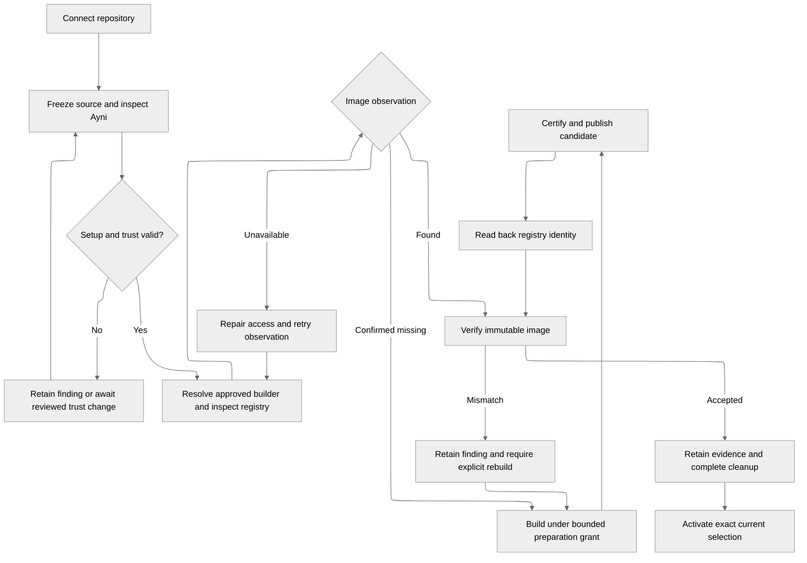

# Shared repository and runtime preparation

Status: shared repository discovery, catalog connection and project associations are implemented for the trusted local operator. Exact-commit static policy/lock/input/trust inspection and gated Kubernetes runtime preparation are implemented; full setup assistance and project/task runtime handoff remain planned. See [integration connections](integration-connections.md) for the current source-access boundary.

## What this decides

- Repository integrations form a shared catalog. Alpha adds workspace availability; projects select a subset of their workspace repositories. Current direct catalog associations do not yet enforce that requirement.
- Onboarding produces verified, immutable runtime artifacts through explicit source, tooling, trust, registry and execution gates.
- PostgreSQL owns commands, receipts, generations and accepted evidence. Scoped workers perform external operations under trusted supervision.
- The new UI ships with each backend slice. Maintainers can inspect and exercise each delivered journey locally.
- Historical `main` behavior informs the contract; its persistence, workers, API and UI are not restored as compatibility layers.

## Why now

The product journey needs a trusted way to prepare repositories and runtime images before tasks can use them.
Current local task preparation asks an operator to supply those inputs manually.
The [roadmap](../../../ROADMAP.md#a-workspace-scope-and-execution-ready-repositories) makes replacing that manual gap the next focus.

## Current boundary

- Approved tasks retain repository/source declarations; those declarations are not verified source evidence.
- The trusted local helper verifies Git objects and lock bytes, while the operator supplies a runtime digest.
- Prepared attempts retain immutable inputs, but preparation does not establish image availability or compatibility.
- Isolated workers perform separate managed quality; coding, quality and publication remain independent outcomes.
- The local gateway serves APIs only. The new local product supports manual App connections, installation/repository discovery, a shared source catalog and project associations. Runtime preparation has retained stages, evidence and explicit recovery in this UI.

## Ownership and records

| Record | Ownership and meaning |
| --- | --- |
| Integration connection | Shared source, registry or signing capability with safe status and PostgreSQL credential revision references. |
| Repository | Stable provider repository identity and source connection reference, independent of any workspace. |
| Workspace availability (planned) | Catalog repositories available for projects in a workspace; several workspaces may reuse the same catalog identity. |
| Project association | Selected project repositories. Current associations are direct; alpha enforces selection from workspace availability. |
| Source observation | Exact repository commit, inspected policy/lock bytes or protected references, and their digests. |
| Environment revision | Immutable Ayni contract, lock identity, platform, builder, destination and trust expectations. |
| Preparation operation | Frozen inputs, bounded allowance, generation, stage, workload binding, receipts, findings and cleanup state. |
| Verified runtime artifact | Registry digest and accepted verification evidence bound to the environment revision and inspected source. |
| Attempt selection | Task-owned source, artifact and verification references, budgets and upstream selections frozen for execution. |

The [alpha product contract](alpha-product.md#workspace-project-and-task-scope) owns
workspace availability and project-subset semantics, including changes/removal.
The forward transition must preserve current retained PostgreSQL associations and
attempt provenance; prior SQLite membership schemas are not implementation requirements.

An association does not expose credentials, another project's history or integration administration.
Define local-operator grants before exposing mutations; remote tenancy and multi-user access remain separate scope.
Removing an association cannot erase retained task provenance or delete a shared repository.
Removal of catalog records requires dependency checks; external repositories and images need separate deletion authority.

## Preparation gates

| Gate | Required evidence or decision |
| --- | --- |
| Source access | Validate provider repository/installation identity and scoped read access. Connection success does not imply Ayni readiness. |
| Committed inputs | Inspect policy and lock from the same exact commit with bounded reads. Missing or malformed inputs retain corrective findings. |
| Ayni compatibility | Admit an explicitly supported CLI, lock/recipe and artifact contract. Resolve the official builder for that contract/platform and freeze its digest. |
| Full input validation | Use supported Ayni tooling for policy/lock consistency, runtime identity and certification. Parsing an envelope or fingerprint grants no readiness. |
| Configuration | Validate the chosen platform, isolated build capacity, registry destination and enabled signing certificate. Keep configured credentials separate from observed operation success. |
| Registry access | Check permissions during the actual discovery, build, push or independent pull operation. Do not publish a disposable test image. Show the failed stage and corrective action; an outage, denial or rate limit cannot become a missing-image result. |
| Repository trust | Validate the selected public signing identity against committed trust. If changes are needed, separately authorize a narrow PR and inspect the merged source again. |
| Image discovery | Resolve the candidate to an immutable manifest/platform identity. Confirmed absence permits an opted-in bounded build; an invalid existing image requires replacement authority. |
| Build/publication | Invoke Ayni's supported build/certification contract. Separate publication credentials and guard destination replacement; reconcile uncertain publication through readback. |
| Verification | Independently pull the exact digest, verify trusted certification and protected content, and bind fresh managed evidence to source, lock, platform and expected tooling. |
| Activation | Accept only the exact current generation and immutable digest binding. Retain verification before resumable cleanup; pending cleanup cannot appear ready. |

Runtime verification establishes environment compatibility, not passing source quality or merge approval.
A source-only change may reuse an image after applicable verification; a changed environment contract selects new preparation.
Keep desired revision, active verified artifact and historical readiness distinct.
New selection blocks new admissions until its gates pass, while existing attempts keep their frozen inputs.

## Authority and execution

Connection/read, automatic preparation, trust PR creation, replacement, task execution and task publication are separate grants.
Enabling Ayni preparation records explicit resource/time/retry bounds and the permitted registry destination.
General policy bootstrap and unrelated repository edits remain owner-reviewed work.
A retry recovers the same accepted operation; changed inputs or an additional allowance require a new authorized identity.

The control plane admits commands and accepts reports transactionally in PostgreSQL.
Supervisors provision and reconcile narrowly scoped workloads; workers have no database or broker credentials.
Freeze intent before external actions, authenticate workload/generation reports, fence cancellation and adopt only the exact owned workload after restart.
Transport selection follows this authority model; conversation messages do not become build commands.

Separate source-read, signing, push, pull and task-provider capabilities by stage.
Repository-controlled code must not receive signing or push authority through shared processes, volumes or a build engine.
Qualify a bounded build topology and its egress, scheduling, storage and cleanup before enabling it.
Historical privileged-engine deployment modes are research input, not an approved alpha default or proof of isolation.

The supported Ayni onboarding matrix must be qualified explicitly.
Historical `main` admitted 0.15.0; alpha's development CLI pin alone establishes no repository-builder compatibility.
Keep this integration in Orchestrator and consume Ayni's supported CLI/artifacts without reimplementing adapters or lock generation.

## Compatibility and product acceptance

Ayni owns runtime and tool compatibility within a repository configuration
context. Its [current version-selection contract](https://github.com/ayni-oss/ayni/blob/main/docs/contributing/tooling-reconciliation.md)
preserves native project authority for project tools. Ayni's agreed direction is
a catalog of qualified exact language/runtime, package-manager and signal-tool
combinations. Universal enforcement remains planned; an exact lock alone does
not establish qualification.

Orchestrator owns a separate integration matrix: the exact Ayni release/source,
CLI and artifact contracts, trusted executable/image identities and qualified
worker/deployment profile. Consume the contracts of the admitted release. An
upstream feature or dependency bump does not qualify this integration or change
an attempt's frozen selection.

Environment verification establishes lock/content association. A signed
certificate additionally authenticates a statement from a trusted key under the
consumer's trust policy. Managed quality evaluates the frozen source against
repository policy. None of those facts authorizes task execution or publication.

Product acceptance needs evidence against the approved task's requested behavior
and acceptance criteria. A passing Ayni quality result does not establish user
or business outcomes. Broader outcome measurement remains planned.

## Kubernetes runtime delivery prerequisite

Deliver preparation through Kubernetes supervisors with separate source, build,
certification, publication and verification workloads. The first build profile to
qualify is rootless Podman with an operation-local image store and `vfs` storage.
Qualification must establish user-namespace support, engine execution under the
selected seccomp/AppArmor policy, bounded storage/egress and reliable cleanup;
qualification is deployment-specific. The
[runtime operation contract](runtime-preparation.md#deployment-and-qualification)
and packaging evidence record measured limits. No host engine socket or privileged
fallback is enabled when those requirements fail.

The builder explicitly selects `AYNI_OCI_RUNTIME=podman`, an exact executor
image digest and a matching Linux node architecture. Kernel and storage support
are deployment prerequisites; a rootless engine label alone is not isolation
evidence.

### Pinned Ayni boundary

Ayni 0.17.1 provides supported public policy, lock, certificate, protected-content
verification and offline filesystem certification contracts. Orchestrator consumes
these contracts rather than copying private image inventory/signature semantics.
The exact source revision is pinned in Cargo manifests and the executable/image
identities are frozen in each admitted profile. The rootless Podman builder uses
Ayni's ordinary adapter preparation/build lifecycle without a signing key; its
local unsigned certificate does not grant runtime readiness.

After the builder is deleted, an independent stage copies and checks the immutable
OCI export and freezes its unsigned digest/protected root outside builder storage.
A separate signer-only stage uses `ayni_environment::staged::certify_filesystem`
against read-only inputs and emits the public certification layer/report. A fresh
finalizer applies that layer using standard OCI tooling and verifies the retained
lineage before publication. No signer stage executes repository code or shares a
builder engine. See the [runtime operation contract](runtime-preparation.md) for
the executable topology and acceptance limits.

### Workload and admission contract

| Workload | Authority and retained output |
| --- | --- |
| Source acquisition | Repository-scoped read access only; publish the complete frozen checkout and input digests before removing access. |
| Unsigned builder | Qualified rootless engine, frozen source and bounded dependency downloads; retain an immutable export. No signing or registry push credentials. |
| Certifier | Fresh isolated filesystem, immutable export and reviewed signer reference; independently inspect and certify with Ayni’s supported offline contract. No repository execution, source credentials or registry push access. |
| Publisher | Final certified export and destination-scoped push credentials only; retain the registry digest and reconcile uncertain publication by readback. |
| Independent verifier | Separate pull capability, exact platform digest and frozen inputs; verify actual certification/protected content and applicable managed compatibility evidence. No signing or push access. |

Use the existing
[supervisor authority pattern](conversation-execution.md) and
[task isolation boundaries](task-quality.md) for operation generations, exact pod
UID adoption, deadlines and authenticated evidence. Implement resumable cleanup
for pods, temporary credentials and storage, and confirm it before admission.
The [integration foundations](integration-connections.md#runtime-preparation-foundations)
describe the retained connections used by these stages.

Until the deployment’s Kubernetes profile is explicitly qualified, retain an
actionable prerequisite failure and keep runtime preparation unavailable.
Missing user-namespace support, denied engine startup, unavailable credentials,
registry denial/outage, invalid existing images and pending cleanup cannot produce
readiness or silently select a different execution mode. Build remains limited to
confirmed absence under its grant; replacing an invalid image needs explicit
replacement authority.

## Task handoff and feedback

This handoff remains planned; current tasks use the trusted local preparation helper.

Trusted server-side preparation resolves the approved repository/ref through its project association.
It verifies exact Git objects, original lock and reviewed upstream ancestry, then produces the existing frozen source handoff.
An arbitrary browser digest or catalog selection cannot attest source or authorize execution.
Bound source acquisition and fail explicitly on unsupported inputs. The current
64-file/128-KiB model snapshot is an implementation limit, not alpha's engineering
capability contract; the [planned agent loop](alpha-product.md#reviewed-plans-and-autonomous-execution)
uses bounded research/retrieval and tools over the approved repository scope.

Preparation records the verified artifact/evidence references alongside existing immutable attempt inputs.
Current approval admits awaiting-execution tasks; preparation dispatches no coding
and explicit start owns execution. Alpha may review bounded execution/publication
grants with the plan so ready tasks proceed autonomously. Preserve distinct
retained grants and authoritative action decisions rather than making approval
itself an unbounded dispatch permission.
Execution-time checks and credential-free managed quality remain mandatory even after onboarding verification.
Recovery preserves the selected source/runtime and creates fresh linked outcomes under its separate confirmation boundary.

Repository preparation has durable history independent of any conversation and separate from replay retention.
Project blockers link to the shared operation; task failures and questions link back to their originating conversation.
The inspector connects operation, source, environment, artifact, plan approval, task, attempt, provider/tool activity and publication where applicable.
Accepted records explain authority; traces diagnose execution and metrics summarize it without replacing those records.

## Where the detail lives

- [Delivery and acceptance](../research/repository-runtime-workspace-delivery.md) defines UI slices, interruption gates and evidence requirements.
- [Task preparation](task-execution.md), [dependencies](task-dependencies.md) and [quality](task-quality.md) define the existing downstream boundaries.
- [Code organization](code-organization.md) and [tracing](../operations/execution-tracing.md) define current authority and diagnostic responsibilities.
- Historical [onboarding](https://github.com/ayni-oss/orchestrator/blob/c279a7bcdf340f5479cc292c1571bba22af04b27/docs/technical/guides/operator-onboarding.md) and [builders](https://github.com/ayni-oss/orchestrator/blob/c279a7bcdf340f5479cc292c1571bba22af04b27/docs/technical/reference/repository-builders.md) record main's behavior. Alpha's workspace availability is a new product requirement, not a requirement to restore those historical schemas or APIs.
- Historical [activation](https://github.com/ayni-oss/orchestrator/blob/c279a7bcdf340f5479cc292c1571bba22af04b27/backend/servers/control-plane/crates/application/src/runtime_activation.rs) and [runtime evidence](https://github.com/ayni-oss/orchestrator/blob/c279a7bcdf340f5479cc292c1571bba22af04b27/backend/libs/runtime/profiles/ayni/src/managed_runtime.rs) show guarded selection and environment/quality separation.
