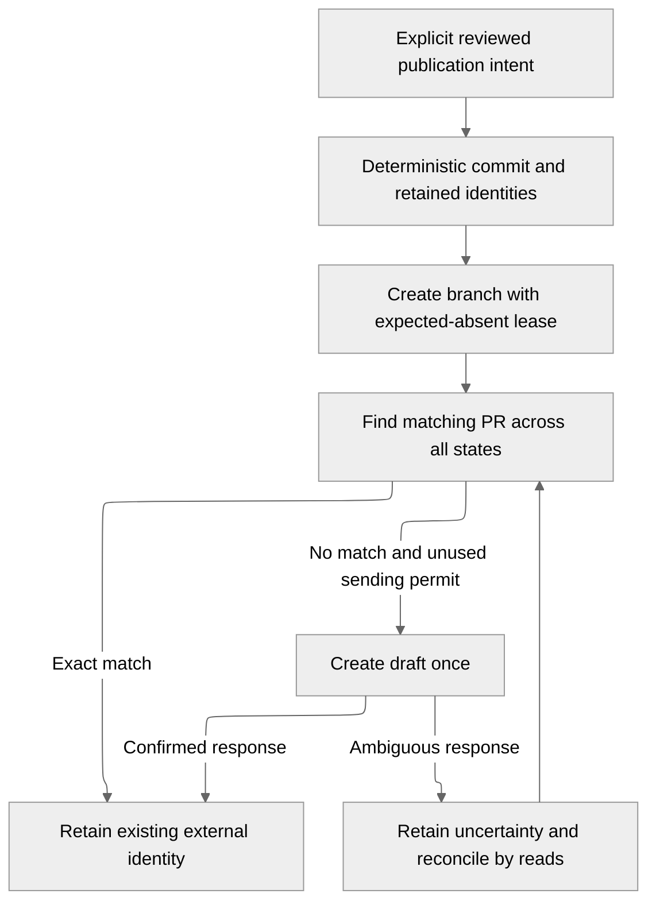

# Task draft publication

An operator can publish one exact completed task as a GitHub draft pull request.
Publication requires accepted changes and passing managed quality evidence.
Coding, quality and publication retain separate outcomes; publication never
reruns coding or merges a pull request.

## Operator authority

`StartTaskPublication` freezes the full originating scope, attempt, patch digest
and quality digest under an idempotency key. Admission rejects failed quality,
empty changes, changed digests, unsupported repository identities and competing
publication keys. The immutable task preparation supplies repository, base ref
and source commit; callers cannot redirect publication.

The first profile supports canonical `https://github.com/owner/repo.git` repositories and branch refs. GitHub Enterprise endpoints are unsupported. A separately configured publisher is authorized for
one workspace and repository. Its dedicated application capability differs from
conversation and task-worker authority.

In the contributor console, select a task under **Tasks**, inspect its accepted
patch and managed quality evidence, then choose **Review draft publication**.
Review the exact preview and explicitly consent before **Authorize draft
publication**. The console can cancel publication before draft creation begins;
creating or uncertain requests remain under read-only reconciliation. The
[console contract](contributor-console.md#task-observation-and-publication-controls)
defines pending-command recovery and stale-review fencing.

Alternatively, use the trusted local helper to review the exact title, body, repository, source,
branch and evidence before submission:

```sh
dev/ctl publish-task prepare selection.json frozen-publication.json
dev/ctl publish-task submit frozen-publication.json
```

`selection.json` contains the full `GetTaskAttemptRequest` scope. Preparation
writes a new file and does not authorize external actions. Retain that file and
resubmit it after a lost response; it contains the original key and digests.

## Durable external actions



PostgreSQL retains publication ownership, generations, leases, commit/tree IDs,
receipts and the consumed sending permit. Before a create permit is consumed, publisher restarts reconstruct the same
commit from frozen Git objects and the accepted patch. Creating or uncertain
publication recovers through reads using retained commit/tree IDs. Neither path
needs the coding workspace or its retained volume.

Each intent has a fixed ten-minute write window and a ninety-second ownership
lease. Expiry stops new Git pushes and PR creation. A consumed permit still
allows read-only reconciliation of a possibly completed external action.

### Commit and branch

The publisher uses Git object operations without checking out source. It runs no
project hooks, dependency preparation or quality commands. Commit metadata and
timestamp are frozen, so recovery produces the same commit and tree.

The fixed service identity is `Ayni Orchestrator <orchestrator@ayni.build>`.
Commits carry its DCO sign-off and an `ai-generated: true` trailer. They have no
personal cryptographic signature; a remote policy requiring one rejects this
publication profile. Runtime publication never uses an operator's SSH agent or
personal signing key.

The deterministic branch is `task/<attempt-id>`. An expected-absent lease creates
it once, and an existing different head blocks publication. Recovery verifies the
same expected commit without overwriting another branch value.

### Draft and uncertain results

The publisher queries pull requests in every state using repository, head branch
and base. It verifies the exact head commit, repository and retained marker before
accepting a match. A closed or merged matching PR preserves its existing identity
and does not authorize another create request.

Creating a draft requires a consumed application-owned sending permit. A lost
response permits reconciliation reads, not another POST. A consumed permit with
no observable PR remains uncertain even if the request may never have reached
GitHub. Drafts disable maintainer branch modification in the creation request.

## Credentials and cancellation

The dedicated publisher Pod receives only its scoped application capability and
operator-provided repository publication token. The GitHub token is mounted
directly there; coding, quality, the console and the database receive none of it.
Git uses an in-memory authorization header, without putting tokens in repository
URLs, command arguments or retained metadata.

The publisher has no Kubernetes API token or coding/provider credential. Its
scratch volume is disposable. The original source snapshot and publication
receipts remain authoritative in PostgreSQL.

Queued or pre-create publication can be explicitly cancelled with
`dev/ctl publish-task cancel cancel.json`. Cancellation fences late workers;
a branch already created may remain. Once the create permit is consumed,
cancellation cannot claim that no external action occurred.

## Observation and validation

`GetTaskAttempt` and the console expose publication separately from execution and
quality. Retained fields include branch, base, commit/tree IDs, PR identity,
external PR state, blockers and evidence digests under the full originating scope.

The [cumulative publication profile](../operations/local-development.md#task-publication-acceptance)
uses actual Git transport and an explicitly enabled GitHub protocol fixture.
It covers response loss, retained identity after owner restarts, quality rejection,
queued cancellation and branch collision. Fixture evidence does not establish
live GitHub authentication or remote repository policy compatibility.
