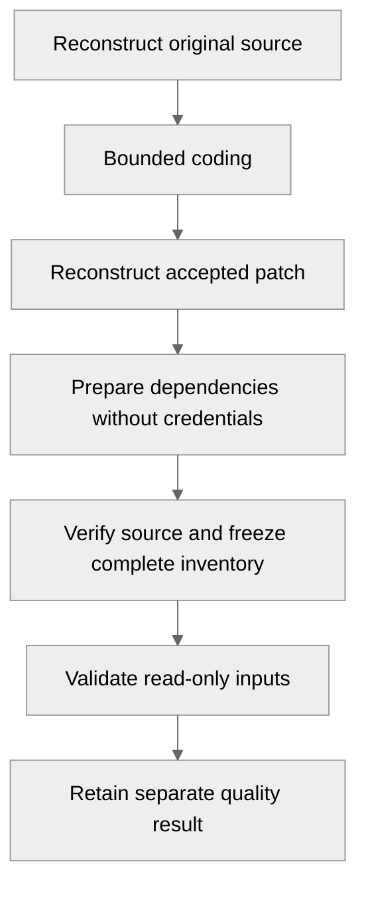

# Task quality and retained evidence

Coding completion and quality acceptance are separate outcomes on the same frozen
attempt. A completed coding result retains its patch when validation fails or is
interrupted. Publication remains a separate authority and delivery slice.

## Frozen validation inputs

The trusted worker reconstructs a fresh checkout from the original source pack
and accepted coding patch. The source commit, source-pack digest, original lock
digest and exact patch identify the snapshot. The selected runtime remains the
preparation request's immutable OCI digest pin.

The worker verifies the original lock before validation. Changes to configuration,
repository refs or the coding directory cannot replace these inputs. Validation
does not refresh dependency locks, select another runtime or repair code.

## Runtime and credential boundary

The Pod executes these stages sequentially. Coding alone receives its provider
capability. Preparation can write to the fresh reconstruction while Git metadata
remains read-only. Validation mounts sealed source read-only and writes build
products and caches to bounded temporary storage.

### Trusted launcher

The launcher uses Ayni's image entrypoint to prepare dependencies and runs
`/usr/local/bin/ayni check --output json` in that actual runtime. Ayni verifies
its lock, protected runtime content, platform and executable identity. The
orchestrator consumes Ayni's evidence without reimplementing adapters or policy.

`ayni env doctor` diagnoses image lifecycle state on an engine host. It does not
verify in-container compatibility. A host check inside an arbitrary pod cannot
pass the managed quality gate.

### Project processes

Preparation and checks receive no provider credential, task capability,
database/broker identity or Kubernetes token. Only the fixed trusted prepare and
quality launchers run as UID 0 with primary
group 10001 and only `SETUID`/`SETGID` capabilities. Their root filesystem stays
read-only and they receive no credentials. The launcher uses Rust's process API
to drop UID/GID to 10002 and clear supplementary groups **before exec**; the child
checks that all IDs, groups and capabilities match that isolated identity.
No-new-privileges prevents regaining authority. A fail-closed Landlock rule
confines new writable file opens to stage-specific source/artifact paths,
temporary storage and `/dev/null`, preventing procfs process-memory writes.
Cross-directory dependency materialization requires Landlock ABI 2 or later;
unsupported kernels fail closed.

A process-level seccomp filter allows only Unix sockets. It also blocks io_uring
and cross-process descriptor acquisition. Preparation, checks and their
descendants inherit this filter regardless of cluster NetworkPolicy enforcement.

### Retention and resources

The launcher captures output in root-owned mode-0600 regular files. The trusted
freezer creates their mode-0770 parent directory for UID/GID 10001; the project
child has UID/GID 10002 and no supplementary groups. The collector reads the
mode-0644 bounded result JSON and cannot alter the root-owned raw captures.
Landlock prevents project descendants from reopening these report descriptors
through procfs; anonymous pipes would not provide this protection. The launcher
bounds stdout at 512 KiB and diagnostics at 8 KiB, stopping oversized producers. The collector retains the result before reporting it to PostgreSQL.
The serial task slot and bounded attempt deadline cover all stages.

The initial supported runtime profile uses four CPU and 8 GiB memory limits,
matching Ayni 0.16.2's generated lock defaults. Managed preparation and quality
share an 8-GiB bounded scratch volume for dependency caches and complete repository
build output. This permits full Rust repository validation without exceeding the
previous 2-GiB scratch cap. The unsigned local fixture
certificate establishes runtime consistency. Trusted builder certification also
requires the project's configured signing keys.

## Acceptance and evidence

| Retained value | Meaning |
| --- | --- |
| Snapshot, lock and image digests | Immutable reviewed source plus accepted changes and selected runtime |
| Validation input digest | Complete sealed source and prepared dependency inventory |
| Managed source and lock fingerprints | Ayni's own input identities |
| Contract, executable and runtime metadata digests | Policy and actual runtime identities |
| Platform and process exit code | Runtime architecture and trusted completion status |
| Expected/completed targets | Repository-wide completion accounting |
| Original JSON artifact and digest | Bounded evidence retained outside project-writable storage |

Artifacts are bounded at 512 KiB. The retained encoded outcome and frozen recovery
command are each bounded at 2 MiB. Task authority accepts at most 2 MiB plus 64 KiB for the worker-request
envelope. Supervisor replies are bounded at 4 MiB plus 256 KiB to carry both the
retained recovery context and current quality evidence with their coding outcome
and JSON envelope. The existing 3-MiB operator gRPC
response bound carries one complete artifact; recovery lists contain evidence
digests rather than duplicate artifact bodies. Missing, malformed, oversized or unsupported
evidence cannot become a pass.

A passing result requires all of:

- managed execution with a zero process exit code;
- repository-wide complete accounting with nonzero expected targets;
- every expected target completed, with no skipped targets or completion issues;
- passing aggregate status and signal rows.

Runtime or source mismatches block acceptance. A real quality failure retains its
failed signals while coding remains completed. Unknown or interrupted validation
never becomes a successful quality result.

## Recovery and observation

Reports enforce the attempt's immutable origin, generation and Pod UID.
Cancellation and deadline expiry reject late acceptance. Conflicting retries fail;
exact retries recover retained evidence.

Owner restarts preserve source, patch, report and receipt. Pod loss records an
interruption and does not authorize a replacement or another paid coding call.
`GetTaskAttempt` and the console expose quality separately from execution and
provider state under the full originating scope.

See [isolated execution](isolated-task-execution.md) for dispatch and cancellation,
[execution preparation](task-execution.md) for frozen authority, and
[local acceptance](../operations/local-development.md#managed-task-quality-acceptance)
for deployment and evidence reproduction.

A [confirmed recovery](task-recovery.md) may seed a linked attempt with the accepted
patch and run one bounded repair pass. It creates fresh coding and quality outcomes;
this attempt's retained quality result and patch remain unchanged.
