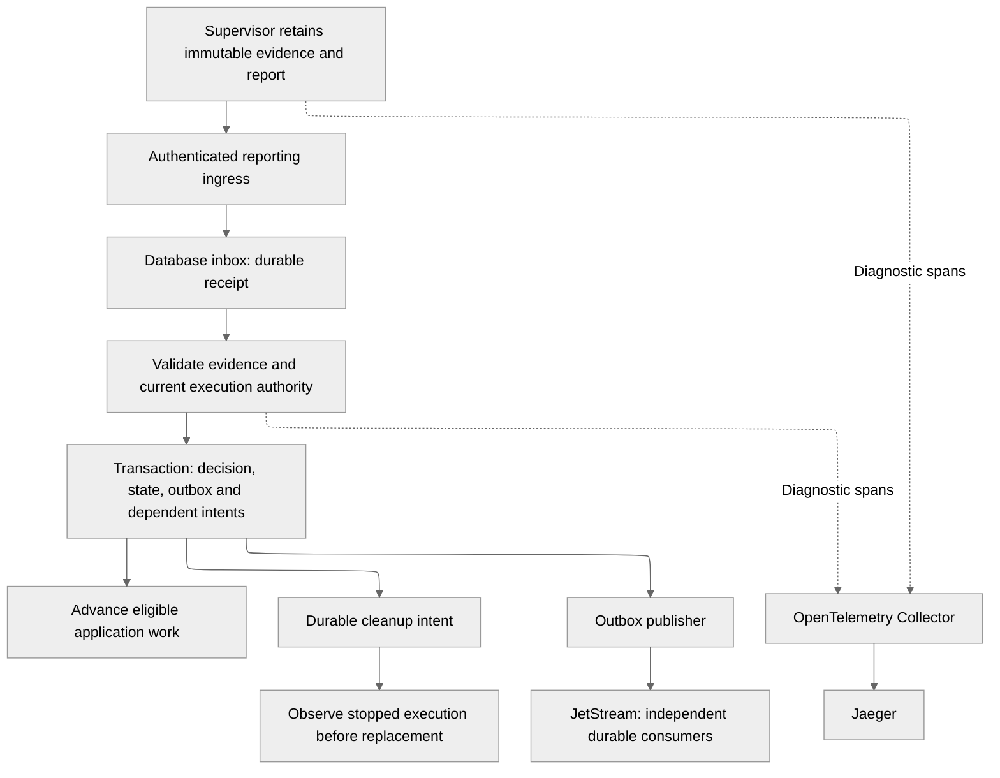

# Event platform implementation proposal

> Historical research from 11 October 2026. Start with the [current event platform](../../architecture/event-platform.md) for implemented behavior. The proposal and source inventory below preserve provenance.

Status: proposal, 11 October 2026. Application source audited at
`1f4e03a44e3217d6e3cf14b9848096e0ca03c8ac`; no implementation or cluster
validation is claimed. Delivery requirements and status belong in GitHub issues. The repository is
public; [retained verification evidence](https://github.com/ayni-oss/orchestrator/issues/139)
tracks the first slice of milestone A.

## What this proposes

- Make runtime results and diagnostics survive Pod deletion before changing transport.
- Define typed payloads in Protobuf and common metadata in CloudEvents.
- Keep accepted state, evidence references and dependent intents in the database.
- Distribute durable facts through NATS JetStream after transactional ingestion.
- Add OpenTelemetry tracing through a Collector and Jaeger, preserving logs and metrics.
- Migrate one flow at a time; retire old readers only after their execution generations drain.

## Why now

Current reporting can hide a usable verification result behind a generic error.
Changing transport first would distribute that same ambiguity. The
[flow inventory](control-plane-event-flows.md) identifies the current authority
levels and recovery behavior that each migration must preserve.

## How it works today

- Runtime reports use bounded termination messages; trust results use Pod logs.
- Coding retains results, evidence and publication receipts outside repository authority.
- Kubernetes completion triggers much of final result collection.
- Resource mutations already append transactional snapshots for resumable client streams.
- Reconciliation, provider readback and stopped-Pod checks repair uncertain execution.

## Proposed execution path

### Ingestion and database transactions

Start with a trusted control-plane reporting endpoint, using generated payload
types and per-execution authorization. Supervisors retain a stable event identity
and retry until the endpoint confirms durable receipt. Receipt means persisted
inbox data; acceptance follows identity, evidence and controller-policy validation.
Repository children receive neither reporting credentials nor broker credentials.

Drain the persisted inbox on restart, with notifications accelerating normal
processing. Do not wait for JetStream to receive or accept a worker result.

Fetch evidence outside the SQLite write transaction. Recheck generation,
selection, cancellation and deadline inside the acceptance transaction. Record
the decision, accepted transition, resource projection, dependent action and
outbox entry atomically. Conflicting reuse of an event identity is rejected.

| Proposed durable record | Responsibility |
| --- | --- |
| Event inbox | Unique source/ID, validated producer binding, bounded payload and processing decision |
| Accepted event journal | Domain transition, causation, aggregate revision and evidence reference |
| Event outbox | Stable event identity, publish attempts and confirmed broker storage |
| Execution identity | Physical generation, frozen inputs and result/stop authority |
| Cleanup intent | Owned resources, prerequisite checks, retries and completion |

Extend existing preparation, task and `durable_actions` records where they own
these facts. Do not create a second action scheduler. JetStream consumers use
the same guarded application handlers; broker sequence never grants authority.
Existing client snapshots remain projections rather than a replacement journal.

### Contracts and encoding

Add versioned lifecycle payloads alongside the existing
[protocol tooling](../../../../proto/README.md). A registry maps each event type to its
payload descriptor, producer role, validator, ordering scope and progression
gate. CloudEvents context carries identity and correlation; typed payloads carry
frozen bindings and operation-specific evidence.

Use generated ProtoJSON codecs inside structured CloudEvents JSON for the initial
NATS contract. Test optional presence, unknown enums and supported schema versions.
Enforce JSON compatibility alongside Buf checks; binary compatibility alone is
insufficient. See the [payload and envelope contract](../../reference/cloudevents-contract.md#typed-payloads).

Separate activity sequence from authoritative aggregate revision. Missing advisory
updates cannot block a final result; terminal acceptance uses current state and
frozen evidence. Enforce a bounded envelope and retain large evidence separately.

### Delivery and observability

Use a file-backed lifecycle stream with bounded Limits retention and independent
durable consumers. Put advisory activity in a separate bounded stream. Configure
storage caps, message caps, deduplication, consumer limits and backpressure before
enabling producers. Retained database facts and evidence outlive broker replay.
[NATS retention policies](https://docs.nats.io/learn/jetstream/retention-policies).

The outbox awaits publish acknowledgement and retries with the same source/ID.
Consumers commit idempotent handling before acknowledgement. Broker outage queues
outbox work without invalidating accepted results. Queue saturation is visible;
critical records are never silently discarded. New admission can pause at a
configured storage threshold while cancellation and result ingestion remain available.

Add OpenTelemetry at the shared Rust logging boundary and instrument verification
first. Propagate creation context, link retries and flush short-lived workers
within a bounded timeout. Collector failure does not consume execution retries.
Keep JSON logs and Prometheus; use the separate
[observability proposal](../../reference/observability-and-events.md) for instrumentation boundaries.

## Implementation order

These are dependency milestones, not promised calendar dates. Each row becomes
small linked issues with its own end-to-end validation.

| Milestone | Deliverable | Gate before expanding |
| --- | --- | --- |
| A: runtime evidence | Retained full report, safe diagnostics, execution identity, reporting errors and explicit retry eligibility | Oversized reports, restart and repeated observation preserve truthful outcomes |
| B: contracts and ingestion | Protobuf payloads, CloudEvents validation, authenticated inbox, journal and transactional outbox | Duplicate, stale, conflicting and cancellation-racing results cannot advance twice |
| C: observability | Rust tracing bridge, OTLP Collector, Jaeger and verification spans | A single operation is traceable; telemetry outage changes no application decision |
| D: JetStream | Local persistent deployment, publisher, consumers, retention and lag metrics | Lost acknowledgements, broker restart and saturation recover without duplicate actions |
| E: runtime cutover | Verification first, then probes, discovery, trust, build and publication readback | New generations advance from accepted reports; cleanup cannot obscure verification |
| F: coding cutover | Progress, final result, usage and publication milestones | Early results, late results, publication recovery and writer fencing preserve existing outcomes |
| G: other flows and UI | Connections, certificates, onboarding, projects, watches and status projections | All implemented flows have explicit authority and consistent operator status |
| H: retirement | Remove drained collectors, redundant polling and ambiguous legacy status | Every affected compatibility gate in the migration document passes |

C can proceed once A supplies correlation identity. Broker work does not block
the first diagnostic improvement. Separate coding/check/publication Pods and a
database replacement require independent architecture decisions.

## First end-to-end milestone

Give verification a retained output location owned by the supervisor. Atomically
write the full report and safe diagnostic record before cleanup. Keep termination
messages as compact references during compatibility. Distinguish check failure,
unavailable evidence, serialization failure and reporting failure.

Count each failed physical execution once. Observation failures, report delivery
retries and cleanup retries have separate state and backoff. Expose retry eligibility,
the last classified error and an explicit retry action; hide the scheduled retry
timestamp when exhausted. Preserve existing runtime trust versus source-quality policy.

Do not reset execution failure history through unrelated analysis. A changed
frozen identity creates an explicit new preparation; an operator retry records
its admission and retained history. The analysis UI can offer that action.

## Operational rollout

The local Helm chart now provisions a persistent, bounded lifecycle JetStream
stream, an accepted-event outbox publisher, a durable verification cleanup consumer
and Grafana backlog metrics;
see [local broker operations](../../operations/local-development.md#persistent-local-jetstream)
for implemented limits, replay expiry, access boundaries and recovery checks.

Evaluate on the explicit Docker Desktop Kubernetes context with the existing
local Helm chart. Use one persistent NATS instance locally. A production profile
needs replicated storage, failure-domain placement, authenticated subjects,
encryption, backup/restore and tested availability; local success does not establish it.

Keep SQLite's current deployment model for this migration. NATS replication does
not make the control plane or its database highly available. Size inbox, evidence,
journal and outbox retention together before production admission.

## Why retain reconciliation?

Kubernetes watches improve response time but require relisting after expired
history. Provider readback, deadlines and drift still need periodic repair.
Replace frequent full scans with watches and targeted queues after convergence
tests pass. [Kubernetes watch semantics](https://kubernetes.io/docs/reference/using-api/api-concepts/).

## Where the detail lives

- [Migration and retirement](../../operations/event-compatibility.md) defines per-flow cutover, compatibility gates and rollback.
- [Flow inventory](control-plane-event-flows.md) records current behavior and its source locations.
- [CloudEvents contract](../../reference/cloudevents-contract.md) defines identity, encoding and tracing metadata.
- [Observability approach](../../reference/observability-and-events.md) defines signals, instrumentation and diagnostic limits.
