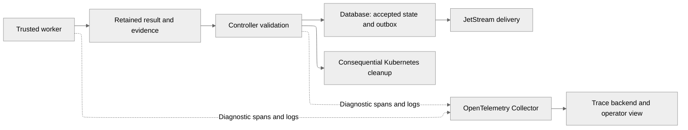

# Observability and lifecycle events

Verification tracing extends the shared Rust subscriber with an optional
OpenTelemetry bridge and OTLP/HTTP protobuf exporter. JSON logs and Prometheus
metrics remain enabled independently. Runtime-operation and coding supervision also propagate diagnostic context.
Accepted facts use the independent lifecycle outbox and JetStream transport.

## Verification tracing

Set `telemetry.tracesEndpoint` in the reusable application chart to an
administrator-controlled OTLP trace URL, including `/v1/traces`. An empty endpoint
keeps structured logging without trace export. The local chart supplies the
endpoint through an optional ConfigMap while `observability.enabled` is true;
turning local observability off also omits that endpoint on newly started Pods.
Changing exporter configuration requires a control-plane restart. Existing Jobs
retain their launch configuration.

The local stack sends verification traces through an OpenTelemetry Collector to
Jaeger. Grafana provisions both Prometheus and Jaeger: use Explore and select
Jaeger to search `runtime-worker` or `control-plane` traces. Jaeger retains up to
1,000 traces in memory; a Jaeger restart loses them. Jaeger 2.20 retains the HTTP search endpoints required by pinned Grafana 12.1.1;
Jaeger 2.21 and later require a compatible datasource upgrade. These diagnostic limits are
for local evaluation and do not define production retention or availability.

Verification spans cover launch, worker execution, runtime metadata validation,
Ayni invocation, artifact validation, report writing, delivery, authenticated
receipt, evidence reads, decisions, acceptance transactions and cleanup. The
worker receives optional W3C context in trusted launch inputs. Its persisted event
keeps originating context across delivery retries without changing source/ID,
request digests or payload bindings. Recovery creates new spans linked to retained
originating context. Missing or malformed context does not reject an application
result.

Optional context uses `trace:verification:<execution>` records in the existing
SQLite cursor store. These records confer no authority, do not advance resource
versions or client events, and preserve the first originating context. Diagnostic
read/write errors are ignored by the application handlers. Older executions
without context continue normally.

Only allowlisted verification instrumentation enters the exporter. Parameters,
repository command output and unrelated log events are excluded. Export buffers
hold at most 512 spans, batches at most 128, and requests have a two-second
timeout. Normal worker/control-plane exit attempts a three-second bounded flush
after spans close. Collector loss or abrupt Pod termination can lose traces;
neither changes accepted results, retry accounting or cleanup decisions.

`dev/tests/verification-tracing.sh CONTROL_PLANE_IMAGE PINNED_WORKER_IMAGE WEB_IMAGE`
uses the existing reporting harness in disposable Docker Desktop namespaces. It
checks connected worker/receipt/decision/recovery spans and the same acceptance
with the Collector stopped. Its synthetic launch is labeled
`verification-test-launcher`; provider admission and signed Ready acceptance are
separate from that fixture.

## Architecture and remaining instrumentation

Durable results and accepted transitions establish what happened and authorize
the next action. Telemetry explains execution paths, elapsed time and failures.
Tracing can improve diagnosis before introducing a message broker.

## Responsibilities and authority

| Signal | Question it answers | Role in Orchestrator |
| --- | --- | --- |
| Durable command/result/domain event | What was requested, reported and accepted? | Frozen identity, validated outcomes, recovery and dependent actions |
| Trace and spans | Which operations ran, how were they connected, and where was time spent? | Diagnosis across API, controller, worker and provider calls |
| Structured logs | What safe detail was recorded at this point? | Correlated errors and diagnostic context |
| Metrics | How often, how slow, and how much is waiting? | Aggregate health, trends and alerts |
| Kubernetes observation | Does execution exist, fail or stop? | Infrastructure availability, failure investigation and replacement safety |

An OpenTelemetry *span event* is a timestamped annotation inside a trace. It
does not provide the durable lifecycle contract proposed for worker results.
The same accepted outcome can appear in both forms, with telemetry referencing
its durable event identity. [OpenTelemetry traces](https://opentelemetry.io/docs/concepts/signals/traces/).

Telemetry can be sampled or lost through bounded queues, exporter failures and
retention. Neither a successful span nor receipt by a Collector establishes
accepted task completion. Trace absence does not establish execution failure.
Control-plane decisions must remain valid during a telemetry outage.
[Sampling](https://opentelemetry.io/docs/concepts/sampling/),
[Collector resiliency](https://opentelemetry.io/docs/collector/resiliency/).

## Separate execution and telemetry paths

JetStream transports application contracts under their own durability and
acknowledgement rules. OTLP exports diagnostic signals to the Collector.
Keep these pipelines independent; telemetry export failure must not consume a
runtime retry budget or prevent result acceptance, publication or cleanup.

## Correlation across asynchronous work

Retain task, attempt, operation/preparation and physical execution-generation
identities in events, evidence and telemetry. Add event and causation identities
to the durable envelope. Trace/span IDs provide diagnostic links;
they must not become idempotency keys, admission authority or execution fences.

Propagate W3C `traceparent` and optional `tracestate` through request metadata,
trusted worker launch inputs and future message headers. Persist the relevant
creation context alongside durable intents so reconciliation can link work after
a restart. Context is optional and untrusted; malformed or missing trace context
must not invalidate an otherwise valid application result.
[Context propagation](https://opentelemetry.io/docs/concepts/context-propagation/).

The [CloudEvents contract](cloudevents-contract.md) retains originating
trace context in event extensions. Protocol headers can describe individual
delivery hops; the immutable event keeps its original context.

Use bounded spans for API handling, each useful reconciliation operation, worker
stages, provider calls, result acceptance and cleanup. Start new spans for retries
and resumed execution, linking them to the originating work. Avoid one open span
covering days of review or the control-plane process lifetime. Messaging span
links support asynchronous, batched and independently consumed work.
[Messaging conventions](https://opentelemetry.io/docs/specs/semconv/messaging/messaging-spans/).

## Instrumentation targets and remaining flows

| Flow | Useful spans and measurements | Durable fact kept separately |
| --- | --- | --- |
| Runtime preparation | Discovery, build, publication, readback, verification and report writing | Candidate/digest identity, evidence acceptance and retry eligibility |
| Coding task | Checkout, model calls, tools, full check, repair, finalization and publication | Independent execution, quality and publication outcomes |
| Result ingestion | Evidence reads, validation, database commit and future consumer acknowledgement | Accepted/rejected result and dependent intents |
| Recovery and cleanup | Recovery eligibility, delete request, stop observation and cleanup retry | Fencing, cancellation/deadline precedence and retained cleanup state |

For the verification issue, instrument Ayni execution, artifact validation and
report serialization separately. Record safe error class and report byte count;
retain detailed diagnostics outside Pod lifetime. This can distinguish a failed
check from failed reporting. The 4 KiB termination-message report limit found in the original source audit
was not a proven diagnosis of the historical attempt. Current verification retains
bounded evidence separately; instrumentation reports its size and classified outcome.

Use histograms for stage duration and observation/acceptance delay; counters for
classified failures and physical executions; gauges for queue age and cleanup
backlog. Task/attempt IDs belong in traces and logs, rather than metric labels.
Heartbeat age and time since meaningful progress require separate measurements.

## Integration and operational boundaries

Verification extends the shared Rust subscriber with `tracing-opentelemetry` and
an OTLP trace exporter, preserving the existing JSON log output. The bridge does not export
logs automatically; retain stdout collection or deliberately add a log exporter.
Compatible crates are pinned; shutdown/flush behavior is tested for short-lived Jobs.
[Tracing bridge](https://docs.rs/tracing-opentelemetry/latest/tracing_opentelemetry/).

The local tracing path uses an OTLP Collector and Jaeger, retaining existing
Prometheus metrics. Jaeger is a
[CNCF Graduated project](https://www.cncf.io/projects/jaeger/).
Its [all-in-one setup](https://www.jaegertracing.io/docs/2.22/getting-started/)
provides the local evaluation path with bounded in-memory storage. Production
retention, storage and availability need a separate deployment decision.

Initially retain all traces for the selected low-volume diagnostic flows, within
explicit resource limits. Sampling can later favor failed or slow traces; it must
never sample away durable outcomes. Export asynchronously with bounded buffers,
timeouts and a bounded shutdown flush. Abrupt Pod loss can leave traces incomplete.

Trusted supervisors emit telemetry using allowlisted metadata. Preserve existing
redaction and content boundaries: prompts, repository content, command payloads
and credentials do not enter telemetry by default. Trace context never grants
repository processes authority to publish lifecycle results. Validate collector
outage, worker interruption and restart without changing application decisions.
