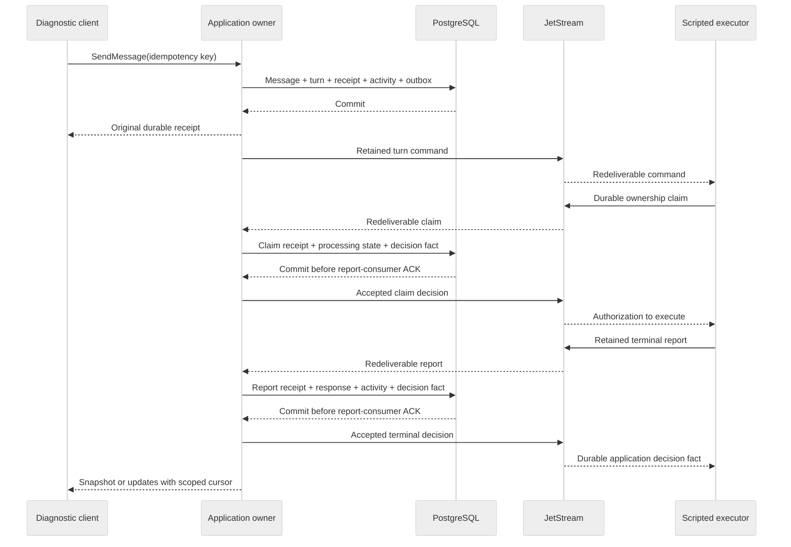

# M1 durable foundation contract

Date: 2026-10-19. Status: reviewed clean-slate contract; runtime implementation has not started.
Current-system source audit: Orchestrator `e128a51088d5879108119783a0d3adf7774dd43c` on `alpha`, retained only as historical risk evidence.

This document applies the [project workflow runbook](project-workflow-refactor-runbook.md)
and its [design worksheets](project-workflow-design-worksheets.md) to
[M1 in the roadmap](../../../ROADMAP.md#m1-executable-slice). It defines the first
replacement slice, not current deployed behavior. If a feasibility experiment
invalidates a contract, update this document and the roadmap before widening the
implementation.

## Clean-slate authority decision

The replacement has no adopted users or production data, so prior SQLite workflow
schemas, retained state, RPC behavior, tests, and broker topology are not compatibility
requirements. They supply failure lessons and reusable mechanisms only. Do not add a
migration, dual write, legacy baseline, shared-broker adaptation, or compatibility
shim. Runtime slice 1 deletes the superseded workflow implementation and tests while
installing the PostgreSQL-owned private-v1 boundary. Every later slice and milestone
uses only the replacement contracts and cumulative acceptance harness.

The rollback boundary is before the first replacement PostgreSQL admission. Before
that point the slice can be reverted. After replacement data is admitted, rollback
means resetting the disposable replacement namespace; it never restores SQLite
authority or translates replacement data into an old schema.

## Outcome

M1 is complete when a diagnostic client can submit one conversation message,
receive a durable receipt, observe honest execution state, and receive one scripted
response through a resumable watch. The flow uses PostgreSQL as authoritative
state, JetStream as durable transport, and gRPC for commands and observation. It
continues correctly across application, executor, and broker restarts.

The slice is independent of the SQLite conversation, planner-session, and provider
execution paths. Existing generic protocol, CloudEvents, gRPC, observability, and
JetStream mechanisms may be adapted when their authority and failure behavior match
this contract.

M1 establishes a required identity hierarchy:

```text
Workspace -> Project -> Conversation
Conversation -> Message
User Message -> Turn
```

Workspace is an identity and ownership boundary in M1. Workspace instructions,
shared agent configuration, provider bindings, and isolated live sessions enter in
M2.

### Non-goals

M1 does not provide:

- a real model provider, model credentials, or paid calls;
- a browser conversation interface or a decision on browser streaming transport;
- plans, approvals, tasks, Ayni execution, worktrees, or publication;
- cross-conversation memory or project-agent outcome assessment;
- production tenancy, user management, or a new identity platform;
- a SQLite data migration, dual writes, or production cutover;
- automatic reassignment after permanent loss of an accepted executor's retained
  ledger; M1 restart tests preserve that PVC;
- final retention policy for conversation history; or
- evidence for worker isolation, checkpoint recovery, quality, or publication.

## User-visible flow



The application returns the gRPC admission receipt only after its PostgreSQL
transaction commits. That receipt does not wait for a broker storage ACK, any
consumer ACK, an application report decision, or any future provider. A
watch is observation only: disconnecting or cancelling it never cancels the turn.
The diagram shows an immediately eligible message. A later message is still
admitted durably with its gRPC receipt, reports `waiting_on=predecessor`, and receives its command
outbox only when the preceding Turn becomes terminal.

## Current-system evidence and reuse

The source audit at `e128a51088d5879108119783a0d3adf7774dd43c` found mechanisms to adapt, but no existing M1 slice:

| Area | Current evidence | M1 disposition |
| --- | --- | --- |
| Persistence | The workspace depends on `rusqlite`; deployment sets `ORCHESTRATOR_DATABASE_PATH=/data/orchestrator.sqlite`; no PostgreSQL chart or Rust dependency exists. | Build a new PostgreSQL authority and migrations; do not span SQLite and PostgreSQL in one operation. |
| Conversation admission | The current `SendProjectMessage` resolves real provider defaults and credentials before saving a run. | Replace with provider-independent durable admission and `scripted-v1` binding. |
| Conversation watch | `WatchProjectConversation` polls the full SQLite aggregate every two seconds and has no retained replay or expiry contract. | Replace with append-only PostgreSQL updates, notification wake-up, scoped cursor replay, and snapshots. |
| JetStream | The current outbox publishes controller-accepted lifecycle, runtime, verification, and coding facts. The only application consumer handles verification cleanup. | Reuse tested connection, storage/consumer-ACK, message-ID, metrics, and fault-proxy patterns; add explicit workflow command/report/fact lanes. |
| Script fixtures | Evaluation provider stubs exercise planner behavior but are not a durable JetStream executor. | Build one separately restartable deterministic executor using the production M1 protocol. |
| API tooling | Tonic generation, reflection, health, grpcurl checks, and TypeScript generation already exist. | Reuse the mechanisms while replacing product contracts that conflict with M1. |

Tests are evidence of those mechanisms, not evidence that PostgreSQL conversation
admission, command/report delivery, or replay already works.

## Domain and authority

| Record | Parent and meaning | Authoritative writer | M1 history |
| --- | --- | --- | --- |
| Workspace | Root scope for shared project ownership. | Application owner | Durable; no automatic deletion. |
| Project | Goal-oriented scope belonging to exactly one workspace. | Application owner | Durable; no automatic deletion. |
| Conversation | Isolated discussion belonging to exactly one project. | Application owner | Durable; no automatic deletion. |
| Message | Immutable user or assistant content in one conversation. | Application owner after validating its source | Durable; no automatic deletion. |
| Turn | One FIFO conversation execution admitted from one user message, with an immutable admission binding and context frozen at eligibility. | Application owner | Durable; no automatic deletion. |
| Command receipt | Immutable result of one idempotent RPC admission. | Application owner in the command transaction | Durable with the conversation. |
| Activity | Safe, append-only accepted observation used by snapshots and watches. | Application owner | Delta replay for seven days; current state remains in snapshots. |
| Dispatch intent | Durable promise that an admitted Turn becomes eligible in FIFO order and transfers exact command bytes to a durable executor owner. | Application owner with the Turn admission transaction | Never expires before an accepted ownership claim; then retained with the Turn. |
| Outbox record | Immutable bytes and publication state for a command or accepted decision fact. | Same transaction that materializes an eligible dispatch or accepts a report | Pending records never expire. PostgreSQL publication-attempt evidence may compact after eight days only when the separate next-owner transfer is satisfied or remains retryable; the broker copy has its own seven-day limit. |
| Report receipt | Immutable transport identity, digest, exact acceptance or rejection decision, and causal Turn state for one executor report. | Application owner before the report-consumer ACK | Durable with the Turn; delivery-attempt evidence may compact after eight days. |
| Executor ledger entry | Exact command, claim, reports, and application decision receipts needed to resume safely. | Scripted executor before the corresponding command- or decision-consumer ACK | Unresolved entries never expire; exact report bytes may be removed only after the matching application decision is durably recorded. |

Public resource identifiers are server-issued opaque strings backed by UUIDv7
values. Event identifiers are stable opaque strings issued by their authorized
producer. Neither form encodes authorization, and a resource keeps its identifier
for its complete lifetime.

### Invariants

- A Project has one immutable `workspace_id`; a Conversation has one immutable
  `project_id`.
- Message, Turn, receipt, activity, outbox, and report-receipt rows carry enough parent
  identity for PostgreSQL constraints and scope checks. A caller cannot select a
  parent by supplying only a globally unique child ID.
- A user Message admits at most one Turn. A Turn accepts at most one terminal
  executor outcome and at most one assistant Message.
- Turns receive a monotonic FIFO sequence within their Conversation. Any number up
  to the explicit queue bound may be nonterminal, but only the head Turn is eligible,
  dispatched, or processing. M1 does not steer an already active Turn.
- M1 freezes `execution_binding_revision` at admission. The scripted binding is
  `scripted-v1`. Only Turns admitted after an explicit M2 authority cutover may
  receive an M2 binding; an already admitted Turn's binding, admission identity,
  and receipt never change. `context_revision` is frozen once when the Turn reaches
  the head and includes all accepted predecessor outcomes plus its user Message.
- Frozen context contains only records from the originating Conversation through
  the accepted predecessor revision plus the current user Message. Later queued
  Messages are excluded even though they are already durable. M1 includes bounded
  recent records and explicit history counts/references. M2 may add summaries and
  workspace-owned instructions, but never another conversation's transcript, plans,
  or reasoning.
- PostgreSQL is the source of truth. Broker presence, delivery, storage ACK, and
  consumer ACK are not application acceptance or transfer to the next durable
  owner. A command remains recoverable from PostgreSQL until an executor ownership
  claim is accepted.
- Each eligible Turn has an application-issued assignment ID and monotonically
  increasing executor generation. The first valid durable ownership claim for that
  generation wins; no executor begins work until it durably observes the matching
  application decision. Later contenders and prior generations cannot advance state.
- Conversation history is not reconstructed from JetStream. M1 applies no
  automatic deletion to accepted messages or responses.
- Every accepted mutation advances a conversation revision and appends a
  conversation-scoped update in the same transaction.
- Orchestrator-managed long-lived credentials, executor signing private keys,
  provider secrets, unrestricted logs, and prompts from other scopes never enter
  command receipts, activity, gRPC
  responses, or JetStream payloads. User and assistant content is sensitive and may
  itself contain pasted secrets; it is bounded, authorized like conversation history,
  excluded from logs and telemetry, and intentionally copied only to the scoped
  command and executor ledger needed for execution.

## State and activity

Admission, dispatch, and execution are related but independent dimensions. They
must not be collapsed into a single transition whose order depends on a broker
storage-ACK race.

| Dimension | States | Authority |
| --- | --- | --- |
| Admission | `accepted` | Set by the message transaction and never reversed. |
| Scheduling | `waiting_for_predecessor`, `eligible` | FIFO sequence and terminal predecessor state select exactly one eligible Turn. |
| Dispatch | `not_eligible`, `pending`, `stored`, `transferred`, `degraded` | `pending` starts when eligibility and command outbox commit together. `stored` means only that JetStream returned a broker storage ACK. `transferred` requires an accepted executor ownership claim; `degraded` never discards the durable intent. |
| Execution | `not_started`, `processing`, `completed`, `failed` | `processing` begins only when the winning durable ownership claim is accepted. A claim retained only by the executor is still presented as queued. Later changes require correctly fenced reports; terminal state is immutable. |

The user-facing presentation is derived as follows:

| Presentation | Durable evidence |
| --- | --- |
| Accepted | Admission committed. The Turn may be waiting for a named predecessor or eligible for delivery. |
| Queued | The eligible Turn is pending or stored for delivery; this does not claim executor ownership. |
| Processing | The application accepted the winning durable ownership claim and emitted its decision receipt. |
| Completed | The terminal success report and one assistant response were accepted together. |
| Failed | The terminal failure report was accepted. |

Activity records contain a stable ID, conversation revision, scoped cursor,
turn ID when applicable, typed stage, state, safe reason code, `waiting_on`,
accepted timestamp, and bounded safe details. `waiting_on` starts with `predecessor`,
`delivery`, and `executor`; M2 may add `provisioning`, `agent_wakeup`, `provider`,
and `tool`.
The application records the waiting state before or in the same transaction that
makes an external action eligible.

A transport heartbeat is never activity and never changes the displayed stage.
Unknown activity or state enum values fail closed at a contract boundary rather
than becoming successful generic progress.

### Responsiveness owned by Orchestrator

The maintainer approved the following M1 acceptance thresholds on 2026-10-20.
They are local deterministic delivery gates, not production SLOs. Infrastructure
and future provider duration is observed separately; controlled M1
acceptance measures both internal boundaries and what the diagnostic client sees.

| Boundary | M1 target under a healthy, non-backpressured fixture |
| --- | --- |
| PostgreSQL commit to the gRPC receipt being handed to Tonic | p95 at or below 50 ms; no deliberate batching or polling. |
| Accepted commit notification to a connected watch update being queued | p95 at or below 100 ms. |
| Scripted executor command receipt to ownership-claim publication attempt | p95 at or below 100 ms. |
| Accepted claim decision receipt to terminal-report publication attempt | p95 at or below 250 ms. |
| Accepted report commit to a connected watch update being queued | p95 at or below 100 ms. |
| Diagnostic-client RPC start to durable receipt received | p95 at or below 250 ms. |
| Diagnostic-client RPC start to accepted activity observed | p95 at or below 500 ms. |
| Diagnostic-client RPC start to terminal scripted update observed | p95 at or below 2 s. |

Dependency calls are timed separately. The product always exposes a durable named
state while waiting, including the dependency, the time that state began, the last
safe failure reason, and the next retry time when known. PostgreSQL unavailability
cannot produce a durable gRPC admission receipt; it returns an unavailable command
error rather than a false success. Dependency timeout and error cases remain pass/fail
correctness checks even when excluded from healthy-fixture latency percentiles.

Every p95 check uses at least 100 warmed deterministic samples. Internal
checks replace dependency calls with bounded fakes; end-to-end checks run the pinned
local stack from the diagnostic client. Any failed correctness sample fails the run
independently of the percentile. Reports retain all three client-visible
distributions and their PostgreSQL, JetStream, executor, and watch sub-durations so
slow infrastructure is diagnosed rather than hidden.

## gRPC contract

M1 deliberately resets the private `ayni.orchestrator.v1` workflow surface instead
of introducing a second package. Server and every known client upgrade together;
there is no mixed-version compatibility promise at this cutover. This is an explicit
exception to normal Buf compatibility, after which the refreshed baseline again
uses the repository's `FILE` breaking policy.

The replacement process registers these RPCs only on the trusted loopback operator
listener. It treats every call as one fixed local operator principal; the diagnostic
needs no credential inside that trust boundary. The capability-authorized
custom-client listener does not register M1 workflow services. Exposing them there later
requires a separate capability/resource-scope contract, `UNAUTHENTICATED` behavior,
and denial-before-lookup tests.

`ProjectService` and `ProjectConversationService` keep their service names; their M1
method sets are only those listed below.

| Existing v1 surface | M1 disposition and authority switch |
| --- | --- |
| `ProjectService.CreateWorkspace`, `CreateProject` | Keep RPC names but replace request/response contracts with the minimal hierarchy and immutable receipts. On authority cutover they use PostgreSQL only. |
| Other `ProjectService` RPCs | Do not register them in the M1 replacement process. Reintroduce a PostgreSQL-backed read or mutation only when a milestone requires it. |
| `CreateProjectConversation`, `SendProjectMessage`, `GetProjectConversationContext`, `ListProjectConversationHistory`, `WatchProjectConversation` | Replace with `CreateConversation`, `SendMessage`, `GetConversationSnapshot`, `ListConversationHistory`, and `WatchConversation`; no alias or dual write remains. |
| Remaining `ProjectConversationService` RPCs | Remove from the replacement v1 surface; later milestones add contracts from their owning behavior rather than routing to SQLite. |

The same authority-switch PR regenerates Rust descriptors and
`clients/typescript`; updates or removes calls in the control-plane gRPC adapters,
project-agent coordinator and tests, `packages/bff`, and `apps/web/e2e`; refreshes
`proto/BASELINE` and the intentional breaking fixture; and updates `proto/README.md`.
It deletes the SQLite-backed workflow service, its workflow tests, and old RPC
registration before registering the PostgreSQL replacement; old and new owners never
serve the same RPC path, and no legacy deployment is retained.

Field numbers are fixed before generated code changes:

| Message | Field-number contract |
| --- | --- |
| `CreateWorkspaceRequest` | `idempotency_key=1`, `display_name=2`; old fields 3–5 are reserved. |
| `CreateProjectRequest` | Preserve `idempotency_key=1`, `display_name=2`, `workspace_id=5`, `goal=6`; old fields 3–4 are reserved. |
| `CreateConversationRequest` | `idempotency_key=1`, `workspace_id=2`, `project_id=3`, `title=4`. |
| `SendMessageRequest` | `idempotency_key=1`, `workspace_id=2`, `project_id=3`, `conversation_id=4`, `content=5`. |
| Snapshot/history/watch requests | `workspace_id=1`, `project_id=2`, `conversation_id=3`; snapshot identity or `after_cursor=4`, history position `=5`, page limit `=6` where applicable. |
| `CommandReceipt` | `command_id=1`, `kind=2`, scope IDs `=3..5`, created Message/Turn IDs `=6..7`, `accepted_at=8`, conversation revision `=9`, resume cursor `=10`, presentation state `=11`. |
| Create responses | Created resource `=1`, original `CommandReceipt=2`; `SendMessageResponse` carries only `CommandReceipt=1`. |
| `Workspace` | Preserve `id=1`, `display_name=2`, `created_at=5`, `updated_at=6`, `resource_version=7`; reserve old fields 3–4 and 8–9. |
| `Project` | Preserve `id=1`, `display_name=2`, `created_at=5`, `updated_at=6`, `resource_version=7`, `workspace_id=9`, `goal=10`; reserve old fields 3–4 and 8. |
| `Conversation` | `id=1`, `workspace_id=2`, `project_id=3`, `title=4`, `created_at=5`, conversation revision `=6`. |
| `Message` | `id=1`, `conversation_id=2`, source Turn `=3`, role `=4`, content `=5`, accepted time `=6`, stable sequence `=7`. |
| `Turn` | `id=1`, `conversation_id=2`, input Message `=3`, FIFO sequence `=4`, binding revision `=5`, context revision `=6`, assignment ID `=7`, executor generation `=8`, scheduling/dispatch/execution states `=9..11`, response Message `=12`, safe failure reason `=13`, accepted/updated times `=14..15`. |
| `Activity` | `id=1`, `conversation_id=2`, revision `=3`, cursor `=4`, Turn `=5`, stage/state `=6..7`, `waiting_on=8`, safe reason `=9`, accepted time `=10`, bounded safe detail `=11`. |
| `ConversationSnapshot` | Scope IDs `=1..3`, conversation revision `=4`, recent Messages `=5`, nonterminal Turns `=6`, terminal summaries `=7`, history counts `=8`, history snapshot identity `=9`, current activity `=10`, resume cursor `=11`, title `=12`, created time `=13`. |
| `ConversationHistoryRecord` | Sequence `=1`, ID `=2`, kind `=3`, role/state `=4`, bounded content/outcome `=5`, source Turn `=6`, accepted time `=7`. |
| `ConversationUpdate` | Update ID `=1`, activity ID `=2`, cursor `=3`, conversation revision `=4`, kind `=5`, affected resource IDs `=6`, state `=7`, `waiting_on=8`, safe reason `=9`, accepted time `=10`. |

Removed message fields and names are reserved where protobuf syntax permits. Existing
Workspace and Project resource fields retain numbers only where the semantics above
are unchanged. Enum values are package-safe and fixed: scheduling uses
`SCHEDULING_STATE_UNSPECIFIED=0`, `SCHEDULING_STATE_WAITING_FOR_PREDECESSOR=1`,
`SCHEDULING_STATE_ELIGIBLE=2`; dispatch uses `DISPATCH_STATE_UNSPECIFIED=0`,
`DISPATCH_STATE_NOT_ELIGIBLE=1`, `DISPATCH_STATE_PENDING=2`,
`DISPATCH_STATE_STORED=3`, `DISPATCH_STATE_TRANSFERRED=4`,
`DISPATCH_STATE_DEGRADED=5`; execution uses `EXECUTION_STATE_UNSPECIFIED=0`,
`EXECUTION_STATE_NOT_STARTED=1`, `EXECUTION_STATE_PROCESSING=2`,
`EXECUTION_STATE_COMPLETED=3`, `EXECUTION_STATE_FAILED=4`; presentation uses the
same `PRESENTATION_STATE_` prefix with `UNSPECIFIED=0`, `ACCEPTED=1`, `QUEUED=2`,
`PROCESSING=3`, `COMPLETED=4`, `FAILED=5`; and activity uses the
`ACTIVITY_STAGE_` prefix with `UNSPECIFIED=0`, `ADMISSION=1`, `SCHEDULING=2`,
`DISPATCH=3`, `EXECUTION=4`, `TERMINAL=5`. Removed values are never repurposed. Nested count/page summaries use new
message types with sequential fields starting at 1 and no old wire identity.

| RPC | Durable behavior |
| --- | --- |
| `CreateWorkspace` | Idempotently creates the required root scope and returns its original receipt. |
| `CreateProject` | Requires a Workspace and idempotently creates a Project under it. |
| `CreateConversation` | Requires a Project and idempotently creates a Conversation under it. |
| `SendMessage` | Atomically writes the user Message, sequenced Turn, frozen execution binding, dispatch intent, original receipt, and accepted activity. If it is the FIFO head, the same transaction also freezes context and materializes its command outbox; otherwise it records visible predecessor waiting. |
| `GetConversationSnapshot` | Returns a transactionally consistent bounded current projection, recent history, history snapshot identity, and resume cursor. |
| `ListConversationHistory` | Pages immutable older messages and terminal turn records against one stable history snapshot. |
| `WatchConversation` | Returns accepted conversation updates after a scoped cursor, or an initial snapshot boundary when no cursor is supplied. |

Required boundary projections are:

| Projection | Required safe fields |
| --- | --- |
| `CommandReceipt` | Command ID and kind; Workspace, Project, and Conversation scope; created Message and Turn IDs when applicable; original accepted time, conversation revision, resume cursor, and presentation state. |
| `ConversationSnapshot` | Scope IDs, title and creation time, conversation revision, recent Messages, all bounded nonterminal Turns in FIFO order, recent terminal summaries, history counts and snapshot identity, current activity, and resume cursor. |
| `ConversationHistoryRecord` | Stable sequence and ID, kind, role/state, bounded content or safe outcome, source Turn, and accepted time. |
| `ConversationUpdate` | Stable update and activity IDs, cursor, conversation revision, kind, affected resource IDs, state, `waiting_on`, safe reason, and accepted time. |

Commands carry their authoritative parent IDs explicitly. Responses never return
credential bindings, broker subjects, PostgreSQL keys, or executor ledger paths.
Expected error mapping is stable even if prose changes:

| gRPC code | Domain reasons |
| --- | --- |
| `INVALID_ARGUMENT` | Malformed IDs/content, invalid or wrong-kind cursor, unsupported request. |
| `NOT_FOUND` | Resource absent within the caller's authorized scope. |
| `ALREADY_EXISTS` | `IDEMPOTENCY_CONFLICT`. |
| `FAILED_PRECONDITION` | `WATCH_CURSOR_EXPIRED`, `HISTORY_SNAPSHOT_EXPIRED`, or invalid retained transition. |
| `RESOURCE_EXHAUSTED` | Message/snapshot/history/turn-queue/outbox bound or watcher backpressure. |
| `UNAVAILABLE` | Authoritative PostgreSQL state cannot be committed or read. |
| `PERMISSION_DENIED` | Reserved for a future authenticated custom-client contract; the fixed M1 operator principal is not denied by caller capability. |

### Idempotent commands

An idempotency identity is scoped by the fixed local operator principal, RPC method,
authoritative parent ID, and an opaque key of at most 128 bytes.

- The first successful command stores a canonical request digest and immutable
  response fields in its transaction.
- Repeating the same request returns those original fields, including original
  IDs, acceptance time, revision, and cursor. It does not return the aggregate's
  newer current state.
- Reusing the key for a different canonical request returns `ALREADY_EXISTS` with
  reason `IDEMPOTENCY_CONFLICT` and changes nothing.
- Concurrent equal commands converge on one receipt through a PostgreSQL unique
  constraint, not an in-memory lock.
- A database error before commit returns no receipt and leaves no partial Message,
  Turn, activity, or outbox row.
- `SendMessage` during an active Turn durably appends another FIFO Turn and returns
  its receipt immediately. A per-Conversation limit of 100 nonterminal Turns returns
  `RESOURCE_EXHAUSTED` before admitting more work.
- Accepting a terminal report and promoting the next Turn mark its dispatch intent
  eligible and freeze its context in the same PostgreSQL transaction. That
  transaction materializes the immutable command outbox when capacity permits;
  otherwise the eligible intent is visibly degraded and reconciliation retries it.
  A crash cannot lose or hide the promoted successor.
- Concurrent message admission and predecessor completion lock the Conversation
  sequence, so exactly one transaction promotes the next eligible Turn.

### Snapshots, cursors, and watches

A cursor is opaque, versioned, conversation-scoped, and bound to the fixed operator
scope. Clients compare or persist it but never parse it.

- An empty cursor produces one consistent snapshot frame, a snapshot boundary
  cursor, and then later updates.
- A valid cursor produces strictly ordered updates after that cursor.
- Update rows remain replayable for seven days. A cursor older than the retained
  watermark returns `FAILED_PRECONDITION` with reason `WATCH_CURSOR_EXPIRED`.
  Reconnect without a cursor to obtain an authoritative snapshot and new boundary.
- A cursor from another conversation or malformed scope returns `INVALID_ARGUMENT`
  without revealing whether the other scope exists.
- Snapshot read and boundary selection occur in one PostgreSQL transaction, so an
  update cannot fall between snapshot and replay.
- Durable update rows are authoritative. PostgreSQL notification and in-process
  fan-out are wake-up mechanisms only; reconnect always reads the rows.
- A bounded server buffer protects each watcher. A slow watcher is closed with
  `RESOURCE_EXHAUSTED` and can resume from its last accepted cursor.
- Heartbeats carry no cursor, do not advance state, and are not execution progress.
- Cancelling the RPC releases only observation resources.

A snapshot contains complete current metadata, every nonterminal Turn in FIFO order,
the latest accepted state of recent terminal Turns, and the 16 most recent Messages.
It also returns total counts, `has_older_history`, and a stable history snapshot
identity. `ListConversationHistory` returns at most 100 immutable records per page
and preserves that snapshot boundary for 15 minutes while paging. An expired
history snapshot returns `HISTORY_SNAPSHOT_EXPIRED` and the client starts a new
read; it does not change the live watch cursor. A snapshot or history response is
limited to 3 MiB; exceeding the byte bound returns a typed capacity error rather
than silently claiming complete history. User and assistant message content is
limited to 16 KiB and activity safe detail to 8 KiB. Limits here count the exact
serialized CloudEvent body before NATS headers: a command body is limited to 256
KiB, a claim or decision to 16 KiB, and a terminal report to 32 KiB. Producers also
cap the NATS header block at 4 KiB. Broker `max_msg_size` therefore permits 260 KiB;
the subject/protocol frame is outside the application body limit, and broker-reported
stored bytes remain authoritative for stream capacity.

## JetStream contract

M1 uses separate file-backed limits streams so command, report, and decision
capacity cannot evict one another:

| Lane and stream | Subject | Publisher | Durable consumer | Local limit |
| --- | --- | --- | --- | --- |
| `ORCHESTRATOR_WORKFLOW_COMMAND_V1` | `orchestrator.workflow.command.conversation.v1` | Application outbox | Scripted executor | 25,000 messages / 256 MiB |
| `ORCHESTRATOR_WORKFLOW_REPORT_V1` | `orchestrator.workflow.report.conversation.v1` | Executor retained ledger | Application | 50,000 messages / 192 MiB |
| `ORCHESTRATOR_WORKFLOW_DECISION_V1` | `orchestrator.workflow.accepted.conversation.v1.>` | Application outbox | Executor decision consumers and acceptance harness | 50,000 messages / 64 MiB |

Every stream has `retention=limits`, file storage, one local replica, seven-day
`max_age`, a two-minute duplicate window, 260 KiB `max_msg_size`, deletion and purge
denied, and `discard=new`.
Capacity pressure therefore rejects a new publish rather than deleting an older
message, while age expiry remains possible. The publisher reports stream-full as
visible degraded delivery and retries without mutating retained bytes.

A broker storage ACK changes dispatch to `stored`; it does not finish
the application-to-executor handoff. PostgreSQL retains the exact command and its
dispatch intent until an executor's durable ownership claim is accepted. The
reconciler republishes the same event identity and bytes when no accepted claim
exists, including after broker age expiry or an outage longer than seven days.
Executor deduplication, not the broker duplicate window, makes that safe.

The reverse handoff uses accepted decision facts on
`orchestrator.workflow.accepted.conversation.v1.<executor_instance_id>`. The
acceptance harness reads the wildcard; each executor has a durable consumer named
from and filtered to its retained instance ID. The application maps each published
stream sequence to that consumer's ACK state. The executor retains exact claim and
terminal-report bytes until it writes the matching application acceptance or
rejection decision to its ledger, and republishes the same report identity/bytes
after outage or age expiry. Before ACKing, it retains the decision consumer-delivery
sequence with the decision. After the server confirms the ACK, it records that ACK
locally; a restart in between reconciles the retained sequence against the consumer's
contiguous ACK floor before retirement. The application retains each immutable report
receipt and decision-publication intent until that durable consumer ACK; if the fact
ages out first, it republishes the same decision. Report bytes may then be removed from the executor
ledger, while bounded report identity, digest, and decision metadata remain for
reconciliation.

M1 provisions a new isolated broker profile rather than adapting the legacy chart
or publisher:

- set and test server `max_payload` at or above 327,680 bytes so a 262,144-byte
  event plus NATS headers fits without weakening the event bound;
- disable anonymous access and provision distinct application, per-executor,
  acceptance-harness, and administrative password identities with least-subject ACLs;
- inject each password through its own immutable Kubernetes Secret, mount only that
  Secret into the owning Pod, and refuse executor retirement until every targeted
  decision is durably ACKed;
- reserve 512 MiB for the three workflow streams under a 1-GiB server budget and
  2-GiB PVC, leaving at least 512 MiB of logical server headroom and 512 MiB of
  measured filesystem headroom at the full configured profile; and
- render-fail any stream total above its server/PVC budget and test exact maximum
  payloads, unauthorized publish/subscribe, full `discard=new` behavior, and oldest
  record survival.

Plaintext password transport is an explicit local-development corner cut confined
to the isolated Docker Desktop namespace. TLS is mandatory before any production
secret or traffic is admitted. NKeys/JWT may replace passwords later only with an
explicit credential-lifecycle contract; they are not implied by M1.

Each admitted Turn reserves application backlog capacity for one 264-KiB command
and two 24-KiB report decisions until the corresponding handoffs complete. Each
figure includes its body maximum, the 4-KiB header allowance, and a further 4-KiB
per-record margin for subject/broker storage metadata. An event not yet encoded uses
that maximum; exact body/header bytes plus the margin replace it after materialization,
and the broker-reported stored-byte delta replaces the estimate after storage ACK.
The feasibility experiment increases the margin if any measured record exceeds it.
PostgreSQL admission returns `RESOURCE_EXHAUSTED` before
current retained usage plus outstanding obligations would exceed either the command
lane's 25,000-record/256-MiB limit or the decision lane's
50,000-record/64-MiB limit; it does not assume future stream compaction. A raced or
stale broker-capacity sample may still leave an accepted Turn visibly degraded, but
the retained reservation prevents loss and new admission stops when reconciliation
observes the shortage. The executor likewise reserves one 24-KiB claim and one
40-KiB terminal report, including header and storage margins, against its
50,000-record/192-MiB stream and ledger limits before accepting a command. Every report, including a losing, stale, conflicting,
or otherwise rejected one, must reserve one decision record and its bounded bytes in
the same PostgreSQL transaction as its report receipt. If that reservation is
unavailable, the application commits neither receipt nor decision and does not ACK
the report-consumer delivery; the executor ledger remains the durable owner and
retries. Both sides expose backpressure and discard no accepted work to regain
capacity.

### Envelope and payload

Messages use CloudEvents 1.0 and the canonical `build.ayni` event prefix:

- `build.ayni.orchestrator.conversation.turn.requested.v1`
- `build.ayni.orchestrator.conversation.turn.started.v1`
- `build.ayni.orchestrator.conversation.turn.completed.v1`
- `build.ayni.orchestrator.conversation.turn.failed.v1`
- `build.ayni.orchestrator.conversation.report.decided.v1`

Every envelope carries stable event ID, source/producer identity, schema version,
workspace, project, conversation, turn, assignment, causation, correlation, trace
reference, and produced time. A known schema rejects unknown payload fields. The
command also carries its application-issued executor generation, input Message,
conversation-only context manifest, context revision, and execution binding
revision. Reports carry that assignment and binding, command event ID/digest,
executor instance identity, signing-key digest, monotonic report sequence, safe
outcome, and an Ed25519 signature over the canonical envelope/payload bytes. The
ownership claim additionally carries the public key; later reports must use its
bound digest. Decision facts carry report identity/digest, target executor instance,
accepted claimant when one exists, immutable accepted or rejected result, and
authoritative Turn state; they do not copy transcript content. The initial closed
report failure vocabulary is `script_failed`. Rejection uses only `claim_lost`,
`stale_generation`, `wrong_scope`, `wrong_binding`, `invalid_signature`,
`event_conflict`, or `terminal_conflict`; adding a code requires a reviewed contract
change.

A report event ID is stable across retries. The executor persists the event ID and
exact bytes before publication. The signature input is a domain-separated digest of
the event type, source, ID, assignment/generation, sequence, causation ID, and exact
canonical payload bytes with the signature field omitted; shared cross-language
fixtures fix canonicalization. `Nats-Msg-Id` is derived from both CloudEvent source
and ID. The application additionally enforces unique
`(turn_id, assignment_id, executor_generation, report_sequence)` semantics.

Malformed bytes are poison: retain bounded transport identity and digest in the
consumer's quarantine store, ACK only after that record commits, and create no
activity. A well-formed event with a valid but unsupported schema version retains
its exact bounded bytes, marks the consumer degraded, and is ACKed only after that
commit so it can be replayed after upgrade.

The application owns a PostgreSQL transport quarantine capped at 1,024 records and
256 MiB for consumed reports. Each executor owns a ledger quarantine capped at 256
records and 64 MiB for commands/decisions. Both deduplicate by consumer role,
CloudEvent source/ID, and digest; one source/ID with another digest is a conflict.
Valid unsupported entries do not expire before successful replay or an explicit
audited administrative purge. Malformed digest-only entries remain for at least
eight days and then compact. If either count or byte quota is full, the consumer
pauses without ACKing the new delivery, readiness reports the exact full store, and
the PostgreSQL outbox or
executor ledger on the producing side remains responsible for republishing after
broker age expiry. Purge authority is available only to the administrative identity
and records identity, digest, reason, operator, and time before deleting exact bytes.
Deploy consumers before producers, prevent a new producer version until every
consumer reports support, and test old/new rolling order in both directions.

### Assignment and producer fencing

When a Turn becomes eligible, the application issues an opaque assignment ID and
executor generation 1 in the same transaction as its frozen context and command.
The assignment ID remains stable for the Turn. Only the application can increment
the generation, and only before any ownership claim has been accepted. An explicit
retained recovery decision may abandon an unaccepted generation; timeout or redelivery
alone changes neither value. Once a claim is accepted, M1 cannot rotate that Turn to
a different executor generation.

Before an executor starts, the administrative provisioner assigns one canonical
UUIDv7 instance ID, a NATS identity restricted to the shared command/report lanes
and that instance's decision subject, and its durable filtered decision consumer.
The workload stores the ID and a generated Ed25519 signing key pair in its retained
ledger. The ID is one validated NATS subject token; the private key never leaves
that workload or enters an event. On command delivery it atomically stores the exact
command and a signed sequence-1
`turn.started` ownership claim before sending the command-consumer ACK. The application
uses strict Ed25519 verification that rejects small-order public keys, then atomically
accepts the first valid claim for the current
assignment/generation, binds that public-key digest, records its immutable report
receipt, marks dispatch `transferred` and execution `processing`, and creates the
claim-decision fact. Every later report must verify under the bound key. Competing
instances, stale generations, wrong bindings, invalid signatures, and changed-byte
replays receive immutable rejection decisions.

An executor must durably record the matching accepted claim decision before running
the script or any future external effect. A restarted executor with the same ledger
reuses its instance, key, assignment, generation, and report bytes. A replacement
without that ledger has a new key and can win only when no claim was accepted. If an
accepted executor loses its ledger/PVC, the Turn remains visibly blocked until that
same retained owner returns; automatic or operator-driven reassignment is outside M1.
This avoids pretending that credential revocation can fence an offline process that
already received execution authorization. The provisioner cannot retire an instance key,
decision consumer, credential, or ledger while any decision targeted to that
instance lacks its decision-consumer ACK. The per-instance NATS identity
authenticates the supervised workload and limits its subjects; the bound signing key
fences retained instance ownership. Sharing either private credential outside its
workload is a security violation. Split-brain, tampered-signature, and old/new
overlap tests must prove only the accepted claimant proceeds.

### Authority, ordering, and ACK boundaries

- The application identity may publish commands/decisions and consume reports. The
  executor identity may consume commands/decisions and publish reports. The harness
  has a read-only accepted-fact consumer. Administrative stream rights use a fourth
  identity unavailable to workloads.
- The executor cannot publish accepted facts or write PostgreSQL. Repository code,
  future model tools, and diagnostic clients receive no NATS identity.
- The command-consumer ACK is sent only after exact command bytes and the ownership
  claim are durable in the executor ledger. PostgreSQL nevertheless retains and
  reconciles the command until that claim is accepted.
- A report-consumer delivery is ACKed only after its immutable receipt and acceptance
  or rejection decision commit in PostgreSQL. Every decision targets the executor
  instance that produced that report and separately names the accepted claimant when
  relevant. Only the target ACKs its decision-consumer delivery, and only after its
  ledger commit. The target releases exact report bytes only after recording that
  accepted or rejected result.
- A duplicate with matching identity and bytes returns and republishes the prior
  decision. A reused identity with different bytes is a conflict and never changes
  accepted state.
- Ownership claim sequence 1 precedes terminal sequence 2. An otherwise valid gap is
  retained as pending and applied only after its predecessor; reconciliation, not
  broker redelivery, repairs committed pending report receipts.
- A stale generation, losing claim, terminal conflict, wrong scope, or wrong binding
  is rejected, recorded with a safe reason, and report-consumer ACKed after its
  durable decision exists so it cannot block the stream.
- Broker storage ACK, command-consumer ACK, report-consumer ACK, application report
  decision, and decision-consumer ACK are five distinct metrics and fault boundaries.

## PostgreSQL and migration contract

PostgreSQL owns all M1 application state. The schema uses relational parent keys
and unique constraints for authority; serialized envelopes may be retained as
immutable evidence but are not the only index of domain state.

Migrations:

- are ordered, forward-only repository files and run under a PostgreSQL advisory
  lock before the application becomes ready;
- are transactional when PostgreSQL permits it;
- support a fresh database and every prior M1 schema version;
- reject an unknown future version and malformed retained state;
- use a migration owner with DDL authority while the runtime role has only required
  DML privileges;
- have tests for successful upgrade, rollback on injected failure, concurrent
  startup, and preservation of immutable receipts, dispatch intents, and outbox bytes; and
- do not import SQLite state or silently delete a retained database.

The application becomes ready only after migration and contract validation. Broker
unavailability does not make PostgreSQL unready; it produces visible dispatch
backlog and degraded delivery status. Database unavailability makes command and
snapshot APIs unavailable because no other component can claim acceptance.

### Retention and sensitive content

- Workspace, Project, Conversation, Message, Turn, terminal outcome, assistant
  response, command receipt, and report receipt have no automatic deletion in M1.
- PostgreSQL watch deltas and JetStream messages are retained for seven days.
- PostgreSQL publication/delivery-attempt evidence and malformed digest-only
  quarantine diagnostics remain for at least eight days, covering the broker horizon
  plus cleanup grace; these are not the seven-day broker copies.
- Eligible/unmaterialized dispatch intents, command bytes without an accepted claim,
  pending outbox, unresolved report receipts, decision facts without their target's
  decision-consumer ACK, valid-version quarantine within its explicit quotas, and
  unapplied ordered reports never expire.
- The local executor ledger has a 256-MiB logical cap on a 512-MiB PVC, including
  its 64-MiB quarantine subquota, and applies admission backpressure before that cap.
  It retains its signing private key until the instance is explicitly retired,
  exact commands while ownership/execution is unresolved, and exact reports until the matching
  application decision is durable. After that handoff it deletes content bytes
  within 24 hours and retains only bounded identity/digest/decision metadata for
  eight days.
- Compaction first advances and persists a per-conversation watermark. A cursor is
  expired only after every older update is outside the seven-day horizon and an
  authoritative snapshot can reconstruct current state.

User and assistant content is sensitive, potentially secret-bearing data. Access is
limited to the fixed operator, application runtime, assigned executor, and migration/
administrative identities; it is never emitted to logs, traces, metrics, quarantine
summaries, or Kubernetes events. Local Docker Desktop volumes have no production
encryption claim. A production milestone must select transport and at-rest encryption
before handling production secrets.

Normal namespace cleanup retains PostgreSQL and JetStream claims plus unresolved
executor-ledger data. An explicit permanent purge must remove all three PVC classes,
Secrets, quarantined bytes, and backups under a later backup policy, then report any
external copy it cannot erase. M1 has no per-conversation delete API. A later
retention milestone may add deletion only after defining user controls, referential
behavior, external effects, backup treatment, and a measured deletion deadline.

## Logical components and dependency direction

M1 chooses a modular application owner with an independently restartable executor.
It does not justify separate admission, projection, or persistence services.

| Logical owner | Owned behavior and state | Permitted dependencies |
| --- | --- | --- |
| Workflow domain | Identities, states, transition policy, safe bounds, and failure vocabulary. | No transport, database, Kubernetes, provider, or server policy. |
| Admission application | Parent scope, command validation, idempotency, FIFO turn sequencing, frozen binding, eligibility, and receipt policy. | Domain and persistence ports. |
| Report acceptance | Producer fencing, immutable report receipts, claim/terminal decisions, response creation, successor promotion, and decision facts. | Domain, persistence, and event contracts. |
| Activity projection | Snapshot construction, cursor/watermark policy, and accepted update reads. | Domain and persistence ports. |
| PostgreSQL adapter | Migrations and transactions implementing application ports. | PostgreSQL client only; no provider or executor policy. |
| JetStream adapter | Immutable outbox delivery, consumers, storage/consumer-ACK handling, and transport metrics. | Event contracts and application ports. |
| gRPC adapter | Authentication context, request validation, error mapping, snapshots, and watches. | Application interfaces; no SQL policy. |
| Scripted executor | Deterministic fenced command handling and retained report publication. | Shared event contract and JetStream; no application database. |

The first implementation may compose admission, report acceptance, activity,
PostgreSQL, JetStream, and gRPC in one replacement control-plane process. The
scripted executor runs as another process or workload so restart and redelivery
are real failure boundaries. It uses the same provider-neutral turn/report seam
that M2 will implement with isolated sessions.

Do not add PostgreSQL beside `CleanStore` inside one business transaction. The
replacement owner must not call legacy SQLite conversation or planner execution
paths. Generic `tonic`, `async-nats`, CloudEvents, message-ID, fault-proxy, and
observability mechanisms can be reused after removing legacy subject and store
assumptions.

### Alternatives and reversal conditions

| Decision | M1 choice and evidence | Cost, unresolved risk, and reversal condition |
| --- | --- | --- |
| Application topology | One modular replacement control-plane process owns admission, acceptance, projection, and PostgreSQL transactions. Splitting those owners adds distributed transactions without an M1 scaling or security requirement. | A process failure affects all control-plane roles. Split a role only when measured availability, scaling, or security needs justify an independent data/failure contract. |
| Clean-slate replacement | Runtime slice 1 deletes the SQLite workflow owner, its workflow tests, and old RPC registrations before PostgreSQL takes authority. No data migration, dual write, compatibility shim, baseline namespace, or shared-broker adaptation is permitted. | Generic mechanisms may be reimplemented only when they satisfy the replacement contract. Roll back before first PostgreSQL admission; afterward reset the disposable replacement namespace. |
| Executor boundary | Run the scripted executor separately because command ownership, restart, and report replay are real failure and future credential boundaries. | Adds one workload and retained ledger. M2 may replace it with isolated session workloads while preserving the protocol. |
| JetStream topology | Use three limits-policy streams with separate command, report, and decision capacities, all with `discard=new` and a seven-day horizon. | More stream administration, but one lane cannot evict another. Recombine only if measured capacity and privacy evidence proves isolation unnecessary. |
| Conversation history | PostgreSQL remains authoritative; JetStream retains only bounded command/report copies for seven days. | Frozen command context and executor response still exist in broker storage during that horizon. Revisit inline payloads if production privacy analysis requires encrypted or reference-based dispatch. |
| Browser transport | Keep M1 native gRPC and a diagnostic client. | M2 must compare SSE with browser-compatible gRPC without weakening snapshot/cursor semantics. |
| Provider framework | Keep the executor protocol provider-neutral and use no provider framework in M1. | M2 selects one real adapter from evidence; it cannot change admission, fencing, or the named ACK/decision boundaries. |

The maintainer approved PostgreSQL 17.6, `tokio-postgres 0.7.18`, repository-owned
forward migrations, and transaction-scoped advisory locking from the retained
feasibility evidence. Runtime code must preserve async cancellation, TLS-capable
connections, pinned dependencies, and tests without a network database at compile
time. Active-project and conversation
capacity beyond the M1 stream/database bounds remains open and is measured before
an operational scale claim.

## Local stack and diagnostic surface

The M1 Docker Desktop stack contains:

- one pinned PostgreSQL 17 image, a retained PVC, readiness check, migration role,
  runtime role, and namespace-scoped credentials in Secrets;
- a revised pinned file-backed NATS/JetStream deployment with three M1 streams,
  anonymous access disabled, separate application/per-executor/harness/admin
  identities, calculated capacity, persistence, and metrics;
- one replacement control-plane workload exposing workflow RPCs only on the trusted
  loopback operator listener;
- one independently restartable scripted executor replica with a 512-MiB retained
  ledger PVC and 256-MiB logical cap for exact handoff replay; and
- a credential-free diagnostic script executed in the control-plane Pod's network
  namespace, or through an explicit localhost-only port-forward, using the trusted
  gRPC listener as the fixed operator principal; no cluster-wide unauthenticated
  workflow Service is created.

The implementation PR pins exact image digests and records their source. Normal
cleanup follows the retention section: it retains PostgreSQL, JetStream, and any
unresolved executor-ledger claims; permanent deletion is an explicit all-store
purge action. M1 acceptance uses an isolated namespace and the explicit
`docker-desktop` context, never the ambient Kubernetes context.

The diagnostic surface can create the minimal hierarchy, send a message, print the
original receipt, render state/activity updates, deliberately disconnect, resume
from a cursor, and request a new snapshot after cursor expiry. It does not require
the browser or model credentials.

Metrics expose migration/readiness state; command outcomes; per-conversation queue
age/depth; dispatch-intent and outbox count, bytes, and oldest age; publication
outcomes; per-stream capacity; consumer lag; pending report receipts and executor
ledger pressure; turns by scheduling/dispatch/execution state; time waiting
on each dependency; watch delivery
and backpressure; and cursor-expiry recovery. Structured logs correlate safe
Workspace, Project, Conversation, Turn, command, and event IDs without recording
message content or credentials.

## Acceptance and failure matrix

Domain scenarios begin through gRPC and inspect the same accepted state visible to
the diagnostic client. Transport authorization, malformed/version, and capacity
fixtures may inject only at their named boundary. Direct database setup is allowed
only for migration and capacity fixtures.

| Boundary or case | Injection | Required durable and user-visible result |
| --- | --- | --- |
| Exact command replay | Send the same request/key serially and concurrently. | One Message, Turn, dispatch intent, command, and immutable original receipt; all callers converge. |
| Idempotency conflict | Reuse a key with changed content or parent. | Typed conflict and no mutation. |
| Concurrent FIFO admission | Submit several messages while the head Turn processes and race another send with terminal acceptance. | Every admitted message receives an immediate receipt; monotonic sequence and row locking select exactly one head; no Turn skips or runs concurrently. |
| Queue bound | Hold the head active and race admissions at the 100-nonterminal limit. | Exactly the bounded count commits; excess requests return `RESOURCE_EXHAUSTED` without a receipt or partial rows. |
| Queued context freeze | Queue messages B and C before A completes, then inspect B and C commands. | B includes A's accepted outcome and B, not C; C freezes only when eligible and includes accepted predecessors, never later queued content. |
| Failed predecessor and restart | Fail A, crash during B promotion, then restart. | A's failure is accepted history; exactly B becomes eligible with the failure revision in context; C remains waiting and promotion reconstructs from PostgreSQL. |
| Before command commit | Abort each insert point. | No receipt and no partial domain, activity, dispatch-intent, or outbox state. |
| After commit, before publication | Stop the application immediately after the transaction. | Receipt and accepted state survive; restart publishes the exact retained bytes. |
| Lost broker storage ACK | Store the command but suppress its broker storage ACK. | Publisher retries; broker/executor dedupe prevents extra execution. |
| Stream full with `discard=new` | Fill each stream independently and publish another message. | The publish fails visibly; older messages remain; retained owner intent retries after capacity returns. |
| Broker unavailable past replay horizon | Block JetStream for more than seven simulated days or expire the stored unclaimed command. | PostgreSQL still owns exact command intent; recovery republishes it and one executor claim wins. |
| Executor before durable ownership | Stop after delivery but before its ledger commit or command-consumer ACK. | JetStream redelivers and one durable claim becomes authoritative. |
| Split-brain claim | Deliver/redeliver one assignment to old and new executor instances concurrently. | The first valid claim receipt wins; only that instance observes authorization and executes; loser and stale generation remain rejected after restart. |
| Losing-claim decision handoff | Suppress the losing instance's rejection, expire its broker copy, and restart it. | PostgreSQL republishes the rejection to the reporting instance; it records the result, ACKs its consumer, releases exact claim bytes, and never executes. |
| Executor instance retirement | Request retirement while a targeted decision lacks its consumer ACK, then retry after ACK. | The first request is rejected without deleting key/credential/consumer/ledger state; the second records retirement before cleanup. |
| Winning-claim decision handoff | Accept a claim, suppress its decision delivery, expire the broker copy, and restart both sides. | PostgreSQL republishes the immutable decision; the executor does not execute until its ledger records acceptance. |
| Executor ledger full | Exhaust its configured byte reserve before another command. | Consumer backpressure is visible; the command stays stored/recoverable and no ledger entry is discarded. |
| Executor after accepted claim | Restart before terminal publication. | Processing remains visible; retained ownership resumes and emits one accepted terminal outcome. |
| Executor after terminal result retention | Lose the report's broker storage ACK and restart. | Exact report bytes are retried; one response is accepted. |
| Report consumer before commit | Stop while handling the report. | Broker redelivers; no partial report receipt or response exists. |
| Report consumer after commit, before ACK | Suppress the ACK after acceptance. | Redelivery returns and republishes the prior decision without duplicate response or activity. |
| Rejection with decision capacity full | Exhaust decision-outbox quota, then deliver a losing or stale report. | No report receipt or decision commits and the report-consumer delivery is not ACKed; executor-retained bytes retry and later receive one rejection. |
| Report decision handoff | Accept/reject a report, suppress the target executor's decision-consumer ACK, expire its broker copy, and restart. | PostgreSQL retains and republishes the targeted decision; executor keeps exact report bytes until it durably records that result. |
| Decision before publication | Stop after accepting a report but before its decision-fact outbox publication. | Response/activity and immutable report receipt remain visible; restart publishes exact retained decision bytes. |
| Duplicate, stale, signed, or reordered report | Replay exact bytes, change bytes/signature under one identity, sign with a losing key, use a stale generation, and deliver terminal before claim. | Exact duplicate is unchanged; invalid signatures, changed bytes, stale/losing keys and generations are rejected; a valid gap stays pending until ordered reconciliation. |
| Malformed payload | Inject undecodable or invalid bytes through an authorized publisher fixture. | Bounded identity/digest quarantine only; no activity or execution; the consumer ACK follows the record commit. |
| Unsupported valid version | Deliver a valid newer schema to each older consumer, fill each quarantine quota, then upgrade it. | Deduplicated exact bytes enter the role-owned restricted quarantine; at capacity the consumer pauses without ACK, readiness names the full store, and post-upgrade replay reaches the normal decision once. |
| Broker authorization | Try anonymous access and cross-role publish, subscribe, purge, and stream administration. | Every attempt is denied; workload identities have only their contracted subjects and no purge rights. |
| Maximum event payload | Publish a 256-KiB serialized command body with a 4-KiB header block, then a body one byte above its per-type limit. | The exact body/header maxima pass end to end; the excess is rejected by the producer before publication with no partial state, and broker stored-byte accounting is retained. |
| Private-v1 authority cutover | Inspect reflection and call old/new methods on loopback and custom listeners while tracing stores. | Only replacement methods appear on loopback; old workflow methods are unimplemented, custom listener omits the service, and no replacement call reaches SQLite. |
| Application restart | Restart with accepted, queued, processing, and completed Turns. | Every state and receipt reconstructs from PostgreSQL; no action depends on process memory. |
| PostgreSQL or broker restart | Restart each stateful dependency with retained claims. | gRPC-admitted domain state and retained broker messages survive; consumers resume from durable state. |
| Watch reconnect | Disconnect after every emitted state and reconnect with its cursor. | No accepted update is missing or reinterpreted; cancellation does not alter the Turn. |
| Expired cursor | Advance the seven-day watermark in a fixture. | Typed expiry; cursorless snapshot recovers complete current state and a new boundary. |
| Slow watcher | Fill the bounded stream buffer. | Only that watch closes; operation continues and cursor replay recovers it. |
| PostgreSQL unavailable | Stop the database before admission and during observation. | No false gRPC admission receipt; API reports unavailable and recovers from authoritative state. |
| Migration failure | Inject invalid/colliding migration work and concurrent startup. | Transaction rolls back, readiness stays false, and retained state is unchanged. |

The harness retains source revision, migration version, image identities, test
parameters, fault counters, state timeline, cursor timeline, exact command/report
IDs, timings split by owned and dependency duration, and cleanup outcome. It never
retains credentials or unrestricted message bodies.

## Replacement baseline

The cumulative M1 acceptance harness is the only executable baseline. Historical
sandbox runs and SQLite behavior are not reproduced, waived, migrated, or preserved;
they informed the risk inventory but have no authority over replacement states,
contracts, tests, or completion. Runtime slice 1 removes the old workflow code and
tests. A replacement regression is evaluated only against the reviewed M1 contract
and its own retained evidence.

## M2 handoff

M2 may add shared agent configuration, workspace instructions, isolated sessions,
one real provider adapter, and richer preparation/model/tool activity. It must use
rather than replace these M1 guarantees:

- required Workspace -> Project -> Conversation ownership;
- immutable command receipts and idempotency conflict behavior;
- durable FIFO conversation turns, predecessor waiting, and single-turn eligibility;
- conversation-only eligible context and admission-time execution binding revisions;
- provider-neutral assignment/report identities, generations, sequences, claim
  decisions, and fencing;
- PostgreSQL dispatch-intent/outbox/report-receipt authority and the five distinct
  broker/consumer ACK and application-decision boundaries;
- orthogonal admission, dispatch, and execution state;
- append-only activity, scoped cursors, snapshots, and seven-day replay;
- named waiting states and approved Orchestrator-owned responsiveness budgets; and
- sensitive-content handling, credential separation, and producer subject permissions.

Only Turns admitted after the explicit M2 authority switch receive the real-provider
binding. Already admitted `scripted-v1` Turns keep it. Each new Turn freezes at
admission the workspace instruction revision, agent configuration revision, provider
binding revision, model, and usage budget. Eligibility later freezes a bounded
conversation-only context manifest. If full accepted history will not fit the
256-KiB event, the manifest uses authorized immutable references plus digests; it
never silently truncates, substitutes a summary, or imports another conversation.

Before M2 implementation, its entry contract must additionally define and test:

- a provider request intent, stable provider/request identity, budget reservation,
  and retained exact request digest before a paid call;
- provider-specific idempotency or reconciliation. A crash after a provider may have
  accepted a request but before its response is retained enters explicit `uncertain`
  state; it never automatically repeats a possibly paid/effectful call;
- durable provider result and usage retention in the assigned session ledger before
  report publication, plus cleanup only after application decision handoff;
- cancellation semantics for queued, claimed, in-flight, uncertain, and completed
  calls, including what cannot be revoked;
- session creation, application-issued generation, first-claim fencing, wake-up,
  idle expiry, restart adoption, replacement, and old/new overlap;
- provider credentials injected directly into the isolated session through scoped
  Kubernetes/secret mechanisms, never through gRPC, JetStream, context manifests,
  logs, or retained model transcripts;
- bounded model/tool input and output, tool authority, safe activity projection,
  and treatment of secret-bearing user/model content; and
- two-conversation isolation plus restart tests spanning preparation, provider
  request, uncertain response, accepted result, reconnect, and ledger cleanup.

Two M2 conversations can therefore share one workspace configuration while their
context manifests, sessions, executor generations, transcripts, activity cursors,
credentials, and model calls remain isolated. M2 adds `provisioning`, `agent_wakeup`,
`provider`, and `tool` activity without changing an existing M1 receipt, assignment,
or accepted response.

## Gates before runtime implementation

Reproducible results and remaining limitations are tracked in the
[M1 feasibility evidence bundle](project-workflow-m1-feasibility-evidence.md).

Runbook Gates B, F, and G are closed for runtime decomposition when the evidence
bundle pins the complete gate revision and its reproducible commands. The required
proofs are:

1. Exercise PostgreSQL 17.6 and `tokio-postgres 0.7.18` for advisory-lock startup,
   transaction rollback, concurrent migration, `LISTEN` loss with durable-table
   replay, FIFO row-lock races, and persisted exact outbox bytes.
2. Run the isolated authenticated NATS profile with application, per-executor,
   acceptance-harness, and administrative identities; three full production-sized
   `discard=new` streams; exact payload bounds; measured storage overhead and
   filesystem headroom; max-plus-one rejection; Kubernetes Secret isolation; and
   exact-byte republish after shortened age/deduplication horizons.
3. Exercise the executor ledger and canonical signing contract over real JetStream
   redelivery through commit/ACK crashes, duplicate commands/reports, strict key
   binding, same-generation split brain, pre-acceptance stale generation, decision
   loss, logical and SQLite-full backpressure, retirement ordering, and resolved
   metadata cleanup. An accepted owner cannot rotate in M1.
4. Exercise the PostgreSQL-backed Tonic snapshot/watch with atomic boundary selection,
   notification loss, replay, expiry, slow-reader eviction, and the approved
   client-visible latency thresholds.
5. Freeze the approved private-v1 protobuf numbering, deterministic regeneration,
   complete consumer inventory, and trusted-listener separation.

The retained evidence meets those proofs. Historical SQLite/sandbox reproduction and
legacy-broker coexistence are intentionally absent because the clean-slate decision
makes them non-requirements. Failed reproduction of any retained command reopens the
relevant gate before runtime work continues.

## Implementation slices after the gates

Keep runtime PRs end-to-end and build only on the replacement baseline:

1. Delete the superseded SQLite workflow implementation/tests and old workflow RPC
   registrations; add the pinned PostgreSQL local stack, migration runner, approved
   private-v1 reset, minimal hierarchy, idempotent FIFO admission, snapshot/history
   reads, and component contract tests. **Rollback:** before the first PostgreSQL
   admission, revert the slice; afterward reset only the disposable replacement
   namespace and never restore legacy authority.
2. Depending on slice 1, add the isolated authenticated three-stream broker,
   command/decision intents, bounded scripted-executor ledger and claim handshake,
   report receipts, accepted response, and happy-path diagnostic scenario.
   **Rollback:** return to the slice-1 replacement revision only when no handoff is
   unresolved; otherwise repair forward or reset the disposable namespace.
3. Depending on slice 2, add notification-backed watches, cursor retention/snapshot
   recovery, quarantine, fault injection, restart/capacity/version-skew cases,
   metrics, retention cleanup, and the complete M1 acceptance report. **Rollback:**
   preserve PostgreSQL and ledger authority and roll back only stateless readers;
   incompatible retained-state changes require forward repair or namespace reset.

M1 is not complete merely because PostgreSQL, JetStream, and gRPC are individually
reachable; the full message-to-response failure matrix and approved client-visible
targets must pass.
