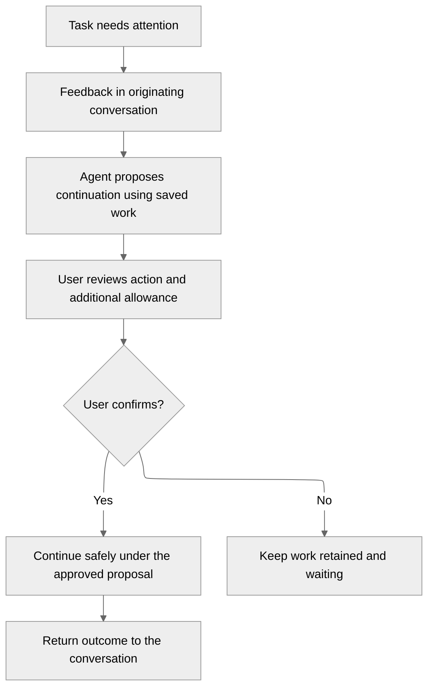

# M6 delivery plan

Date: 2026-10-23. Status: agreed five-slice direction; each delivery PR owns its acceptance evidence.

## What this decides

- Conversations are the user interface for task feedback and recovery.
- Continue existing work where safe, preserving saved changes, progress and quality evidence.
- Each recovery needs explicit approval of one proposal with a bounded additional allowance.
- Downstream tasks retain their selected inputs; recovery never silently updates them.
- The first slice delivers attention only. It grants no continuation or repair authority.

## Why now

M4 retains failed or interrupted work, but users need its cause and next decision in the originating conversation.

## How it works today

- M4 prepares frozen attempts and executes independent tasks serially.
- Coding, managed quality and publication have separate retained outcomes.
- The Tasks view exposes evidence and bounded cancellation/publication controls.
- Interrupted coding and failed quality require a reviewed follow-up plan until confirmed recovery exists.
- M5 dependency scheduling and concurrency remain unimplemented.

## The proposal

The diagram describes the complete M6 journey. Only its feedback boundary belongs to the first slice.

### Saved work and continuation

Continuation is the preferred product action when the task goal and approved inputs remain valid.
Before continuing, the system verifies saved work and explains any unavailable evidence.
Materially changed inputs require an explicit linked attempt, preserving the previous attempt's history.
No recovery silently overwrites accepted patches, quality results or provider uncertainty.

### Approval and allowance

A proposal states why work stopped, the intended next action, reusable work and additional time/token limits.
It also explains any possible charge from an earlier uncertain provider request.
Approval authorizes that exact proposal once; another recovery needs another approval.
The interface shows monetary estimates only when a reliable basis exists.

### Dependencies and questions

Waiting dependent tasks remain waiting until their prerequisite is eligible.
Already-started tasks retain the selected upstream commit, even if recovery produces a newer one.
Changing those inputs requires an explicit decision under the M5 dependency contract.

Task questions and user answers belong in the originating conversation.
Answering a question provides direction; it does not itself authorize continuation.
The initial coding protocol cannot ask structured questions, so that lifecycle remains later M6 scope.

## The plan

| PR | Scope | Observable outcome and acceptance |
| --- | --- | --- |
| 1: Durable feedback and attention | Retain accepted execution and quality problems; expose conversation feedback and project attention. | Failures survive reconnect/restart, retain exact origin and appear once. Stale reports cannot create attention. Reads authorize no recovery. |
| 2: Recovery proposals and saved work | Define immutable proposals, inspect retained changes and evidence, and establish task question/answer records. | Users can understand the proposed action, available work and additional allowance without starting it. |
| 3: Confirmed continuation | Approve an exact proposal once; continue existing work safely or explicitly link a replacement attempt. Integrate M5 dependency rules. | Concurrent confirmations converge on one receipt/action. Changed inputs, stale workers and uncertain paid calls cannot bypass authorization. |
| 4: Complete conversation recovery | Finish question, proposal, consent, attention resolution and outcome interactions. | Reload, two tabs, navigation and lost responses preserve the correct decision and originating task. |
| 5: Cumulative M6 acceptance | Close deployed interruption, pod loss, cancellation, retained-work and confirmation-race gates. | The complete conversation-to-continuation loop survives failures with no duplicate execution or external actions. |

Each slice adds usable visibility and extends the existing cumulative harness.
PR 1 can build on M4 independently of scheduling; dependency-aware recovery and full M6 closure require M5 integration.
Every subsequent PR starts from current `origin/alpha` after its prerequisite merges and targets `alpha`.

### First-slice boundary

The [task feedback contract](../architecture/task-feedback.md) owns the retained records and scoped reads.
The console shows factual system feedback separately from assistant-authored messages.
Attention remains open: PR 1 has no answer, dismiss, resolve, retry or continuation command.
Publication issues retain their existing views until a lifecycle can represent reconciliation and resolution correctly.

### Kubernetes validation

Use owned test namespaces on explicit `docker-desktop` Kubernetes.
Within a durability test, preserve stores across restarts and verify the same feedback identities after recovery.
After testing, purge the owned test deployment and its ownership-labelled session namespace.
Do not delete unrelated development environments or retained user work.

Record source/image identities, fixture boundaries and failed or blocked checks in each delivery PR.
M4's fixture-based coding/publication evidence does not establish live provider or GitHub behavior.

## Whys

### Why not implement recovery in the first PR?

Feedback must be observable before it can support a safe decision.
Separating observation from authority keeps the first slice small and prevents accidental retries of uncertain external calls.

### Does continuation include automatic quality repair?

No automatic repair loop is authorized by this plan.
Any repair action must be part of an explicitly reviewed proposal with a bounded allowance.
Long-term retention and reclamation policy remains M8; M6 reports the work actually available.

## Where the detail lives

- [Roadmap](../../../ROADMAP.md#m6-delivery-scopes) records agreed milestone direction and prerequisites.
- [Task feedback](../architecture/task-feedback.md) defines the first slice's persistence, API and safety boundary.
- [Task acceptance](../operations/task-acceptance.md) defines cumulative task-delivery proofs and evidence limits.
