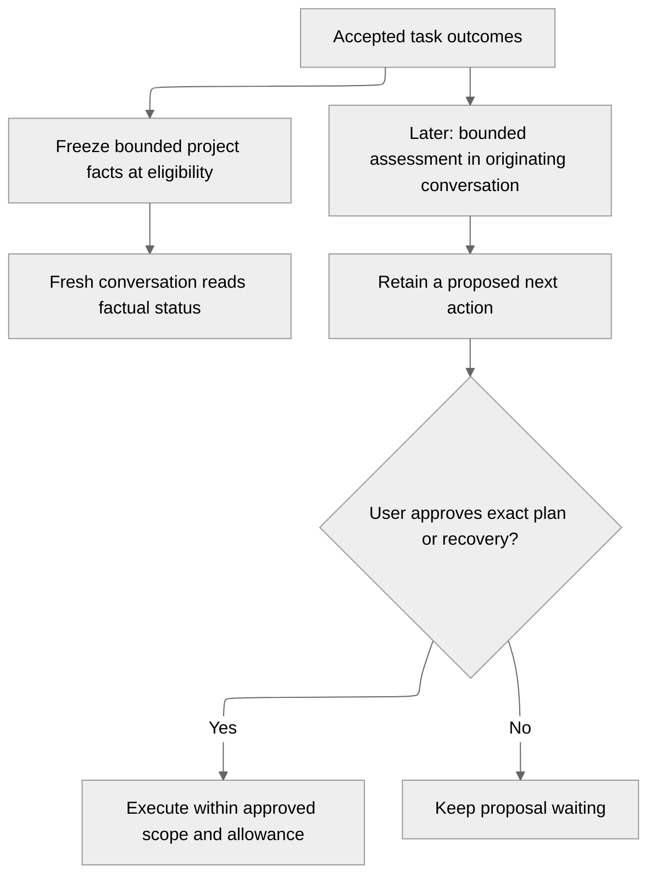

# M7 delivery plan

Date: 2026-10-24. Status: staged delivery direction; each pull request owns its acceptance evidence.

## What this decides

- Fresh conversations receive bounded project facts derived from admitted work and accepted task outcomes.
- Outcome assessment belongs to the originating conversation and uses explicit budgets and retained request identities.
- Proactive proposals require review through the existing plan or recovery authorization boundary.
- Scoped Model Context Protocol integrations precede additional providers.
- M7 acceptance preserves the recorded M5 and M6 prerequisites rather than declaring them complete.

## Why now

Task delivery retains coding, quality and publication evidence, but fresh conversations need useful project status without sharing private working context.

## Planning baseline

These observations describe the starting point for this plan. See
[the roadmap](../history/backend-foundation-roadmap.md#m7-delivery-scopes) and the current architecture
contracts for implemented scope and delivery evidence.

- Eligibility freezes the project's objective and registration status into the retained conversation command.
- The `read_project_status` tool reads that frozen snapshot.
- Task attempts retain separate coding, managed-quality and draft-publication outcomes.
- M6 delivers independent-task feedback and confirmed recovery; dependency integration and structured worker questions remain incomplete.

## The proposal

The first slice implements only the factual continuity path. The assessment and proposal path requires later delivery.

### Factual continuity

The existing private-v1 project snapshot carries a bounded selection of task lifecycle facts and accepted outcomes alongside its objective.
Facts identify tasks and attempts and distinguish coding, quality and publication outcomes.
Counts and an explicit incomplete-selection marker prevent a bounded list from claiming complete project history.
The [continuity contract](../architecture/project-continuity.md) owns selection, privacy and replay rules.

### Assessment and proactive proposals

Meaningful accepted outcomes can later trigger assessment in their originating conversation.
The assessment contract must define qualifying outcomes, coalescing, cursor ownership, stale-result rejection and a bounded allowance before model execution ships.
Ordinary progress remains a UI update without a model call.

Each assessment retains its input snapshot, provider request identity and result.
Replay must recover that result without repeating paid calls or external actions.
Interpretations and proposed actions remain separate from shared project facts; another conversation does not inherit them.

### Integrations and providers

MCP configuration defines reachable servers, allowed tools, input/output limits and workspace or project scope.
Deployment injects scoped credentials directly into the authorized worker; configuration and transcripts never carry them.
The integration slice must define mutation consent, cancellation, uncertain outcomes and replay before enabling external effects.

Additional providers reuse the existing request, reservation, uncertainty, tool and cancellation authorities.
Provider choice requires current capability evidence and deterministic failure fixtures.
Live-provider evidence remains separately identified and requires explicit execution authorization.

## The plan

| PR | Scope | Observable outcome and acceptance |
| --- | --- | --- |
| 1: Factual project continuity | Extend the frozen project-status snapshot with bounded task lifecycle facts and accepted outcomes. | Fresh conversations receive project facts without another conversation's text. Later task changes, duplicate delivery and restarts preserve the original snapshot. Scope and bounds reject invalid data. |
| 2: Bounded outcome assessment | Define and implement retained originating-conversation assessment, coalescing, budgets and stale-result fencing. | Meaningful outcomes produce one bounded assessment; ordinary progress does not invoke a model. Restart and replay preserve paid-call identity and uncertainty. |
| 3: Proactive proposals | Convert eligible assessments into reviewable plans or recovery proposals with retained provenance. | Users inspect reasons, inputs and allowance before exact approval. Duplicate and stale assessments cannot authorize execution. |
| 4: Scoped MCP integrations | Add configuration, worker capabilities and retained tool execution under explicit scope. | Tool discovery, invocation, limits, cancellation and ambiguous external effects obey the configured authority across retries and restarts. |
| 5: Additional providers | Add a selected provider after the MCP boundary is exercised. | The provider passes the same context, tool, budget, uncertainty, cancellation and result-acceptance gates as existing execution. |
| 6: Cumulative M7 acceptance | Close the deployed continuity, assessment, proposal, integration and provider matrix. | Isolation, restart, duplicate delivery, stale results and uncertain external outcomes preserve accepted work and user approval authority. |

Each PR starts from current `origin/alpha` after its prerequisite merges and targets `alpha`.
The delivery PR records source/image identities, executed checks, fixture limits and failed or blocked validation.
Runtime changes extend the cumulative harness and run on explicit Docker Desktop Kubernetes in owned test namespaces.

### Inherited prerequisites

Factual continuity can use accepted independent-task outcomes before M5 scheduling exists.
It does not establish dependency-aware assessment or recovery.
Those paths require frozen upstream selections and the M5 dependency contract.

M6 closure still requires dependency integration, worker-originated structured questions with answer delivery, and model-generated recovery proposals.
M7 assessment cannot substitute for those missing coding-protocol and recovery boundaries.
The final acceptance report must distinguish implemented paths from unresolved prerequisites.

## Whys

### Why begin with facts?

Accepted evidence already has a durable authority and can improve fresh-conversation context without invoking a model.
Assessment adds paid-call and stale-result concerns, so it follows the factual boundary in a separate PR.

### Does a draft or passing quality complete the project?

Project completion remains an explicit user decision.
Coding completion, passing quality and a retained draft link describe separate outcomes and cannot establish merge, deployment or objective completion.

## Where the detail lives

- [Roadmap](../history/backend-foundation-roadmap.md#m7-delivery-scopes) records milestone direction and delivery order.
- [Project continuity](../architecture/project-continuity.md) defines the first slice's frozen facts and privacy boundary.
- [Conversation execution](../architecture/conversation-execution.md) defines existing context, tools and provider authority.
- [M6 delivery plan](project-workflow-m6-delivery-plan.md) records inherited recovery prerequisites.
